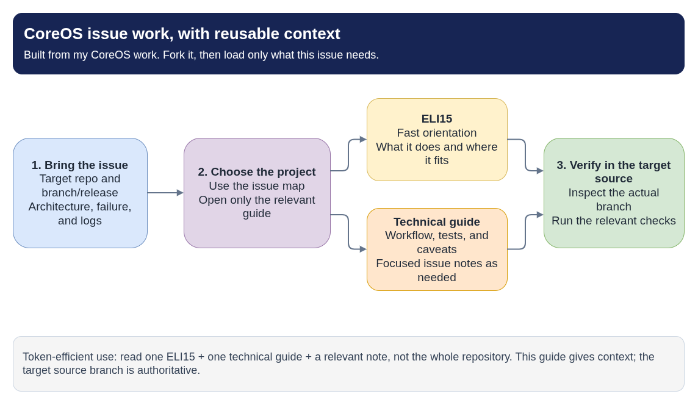

# CoreOS Field Guide

A practical, open guide to the CoreOS ecosystem: Fedora CoreOS, RHEL CoreOS,
and the projects that build, test, provision, and update them. It explains how
the pieces fit together, from source configuration and image builds through CI,
release streams, first boot, and updates on a running node.

Every project gets two views: a plain-language **ELI15** page for orientation
and a **technical guide** for implementation detail. Each comes with diagrams
whose editable sources live beside them.

It is written for:

- **Newcomers** learning how an image-based OS works, starting with the
  [learning path](#learning-path).
- **Contributors** picking up an issue in a CoreOS repository who need context
  on a project they have not touched before, starting with
  [Working an issue](#working-an-issue).
- **AI coding agents** that need focused project context instead of
  rediscovering the whole ecosystem each time (see
  [Using this guide with AI agents](#using-this-guide-with-ai-agents)).

This is a personal pet project, not official product documentation. Everything
it covers already lives in public upstream repositories on GitHub and in their
documentation; the guide condenses that material into one place and links back
to it. Release-specific behavior changes, so treat the guide as orientation and
the target repository's source branch and upstream documentation as authority.
Pages with version-specific claims identify the relevant releases and link to
authoritative sources.



- [Diagram source](coreos-guide-map.drawio)

## Working an Issue

You do not need to work through the learning path before investigating an
issue. Identify the target repository, issue, branch or release, architecture,
and failure details, then start with the matching pair below.

| Problem area | Plain-language context | Technical starting point |
|---|---|---|
| Renovate/MintMaker dependency updates | [Automation overview](knowledge/renovate-and-mintmaker.md) | [COSA lockfile workflow](projects/coreos-assembler/auto-lockfile-updates/README.md) and [checksum helper](projects/update-artifacts-lockfile/README.md) |
| Node/extensions image build or missing metadata | [FCOS pipeline](projects/fedora-coreos-pipeline/eli15.md) | [Node-image build](projects/fedora-coreos-pipeline/build-node-image.md) and [troubleshooting](projects/fedora-coreos-pipeline/build-node-image-troubleshooting.md) |
| FCOS release artifact recovery | [FCOS pipeline](projects/fedora-coreos-pipeline/eli15.md) | [Release pipeline](projects/fedora-coreos-pipeline/README.md) and [existing-build recovery](projects/fedora-coreos-pipeline/fix-build-recovery.md) |
| Kola test failure, flaky test, or denylist/snooze | [kola](projects/kola/eli15.md) | [kola guide](projects/kola/README.md) and the [config repo's tests and denylist](projects/fedora-coreos-config/README.md#kola-tests-and-the-denylist) |
| Disk layout or `/boot` size | [fedora-coreos-config](projects/fedora-coreos-config/eli15.md) | [Disk layout and `/boot`](projects/fedora-coreos-config/README.md#disk-layout-and-the-boot-partition) |
| Jenkins job discovery or CI behavior | [CoreOS CI](projects/coreos-ci/eli15.md) | [CoreOS CI guide](projects/coreos-ci/README.md) |
| TMT tests or candidate package testing | [TMT testing](projects/tmt-testing/eli15.md) | [TMT testing guide](projects/tmt-testing/README.md), [bootupd](projects/bootupd/README.md), and [console login messages](projects/console-login-helper-messages/README.md) |
| Package ownership or JUnit reports | [Fedora packaging](projects/fedora-packaging/eli15.md) | [Fedora packaging](projects/fedora-packaging/README.md) and [JUnit migration notes](projects/fedora-packaging/python-junit-xml-improvements.md) |
| Konflux build/test handoff | [Konflux](projects/konflux/eli15.md) | [Konflux](projects/konflux/README.md) and [tenant configuration](projects/tenants-config/README.md) |
| Provisioning or bootloader updates | [Ignition](projects/ignition/eli15.md) and [bootupd](projects/bootupd/eli15.md) | [Ignition](projects/ignition/README.md), [bootupd](projects/bootupd/README.md), and [`rpm-ostree`/`bootc`](getting-started/rpm-ostree-vs-bootc.md) |

Start with one ELI15 for orientation, then read the matching technical guide and
only the relevant supporting note. Verify commands, line numbers, and behavior
against the branch you are actually changing.

## Cross-project Knowledge

These guides cover patterns that span multiple CoreOS repositories; use them
when the issue crosses project boundaries or involves shared CI automation.

- [Glossary](knowledge/glossary.md)
- [Knowledge index](knowledge/index.md)
- [Renovate and MintMaker](knowledge/renovate-and-mintmaker.md)
- [Testing and gating](knowledge/testing-and-gating.md)
- [Tracing an issue across repositories](knowledge/issue-investigation.md)

## Learning Path

| Topic | Guide |
|---|---|
| Linux, boot, CoreOS concepts, and hands-on exercises | [Getting started](getting-started/README.md) |
| Components from configuration to an updated node | [CoreOS ecosystem flow](getting-started/coreos-ecosystem-functionality.md) |
| Transactional OS deployments and bootable containers | [`rpm-ostree` and `bootc`](getting-started/rpm-ostree-vs-bootc.md) |

## Project Guides: Configuration and Builds

| Topic | Technical guide | ELI15 |
|---|---|---|
| FCOS package, image, overlay, and Kola configuration | [Technical](projects/fedora-coreos-config/README.md) | [ELI15](projects/fedora-coreos-config/eli15.md) |
| RHCOS/SCOS base OS configuration and COSA | [Technical](projects/rhel-coreos-config/README.md) | [ELI15](projects/rhel-coreos-config/eli15.md) |
| OpenShift node-image assembly | [Technical](projects/openshift-os/README.md) | [ELI15](projects/openshift-os/eli15.md) |
| CoreOS build tooling and artifact generation | [Technical](projects/coreos-assembler/README.md) | [ELI15](projects/coreos-assembler/eli15.md) |
| Bootable disk and live-image artifacts | [Technical](projects/custom-coreos-disk-images/README.md) | [ELI15](projects/custom-coreos-disk-images/eli15.md) |
| Build output browser | [Technical](projects/fedora-coreos-browser/README.md) | [ELI15](projects/fedora-coreos-browser/eli15.md) |

## Project Guides: Testing, CI, and Releases

| Topic | Technical guide | ELI15 |
|---|---|---|
| Integration tests, denylist, and testing OS container images | [Technical](projects/kola/README.md) | [ELI15](projects/kola/eli15.md) |
| Fedora CoreOS build and release pipeline | [Technical](projects/fedora-coreos-pipeline/README.md) | [ELI15](projects/fedora-coreos-pipeline/eli15.md) |
| FCOS release streams and metadata | [Technical](projects/fedora-coreos-streams/README.md) | [ELI15](projects/fedora-coreos-streams/eli15.md) |
| OpenShift component CI and Prow | [Technical](projects/openshift-release/README.md) | [ELI15](projects/openshift-release/eli15.md) |
| Upstream CoreOS CI and Jenkins jobs | [Technical](projects/coreos-ci/README.md) | [ELI15](projects/coreos-ci/eli15.md) |
| TMT and FMF test metadata | [TMT course](knowledge/tmt/README.md) and [technical guide](projects/tmt-testing/README.md) | [ELI15](projects/tmt-testing/eli15.md) |
| Konflux builds, integration tests, and release handoff | [Technical](projects/konflux/README.md) | [ELI15](projects/konflux/eli15.md) |
| Konflux tenant configuration concepts | [Technical](projects/tenants-config/README.md) | [ELI15](projects/tenants-config/eli15.md) |

## Project Guides: Provisioning and Packaging

| Topic | Technical guide | ELI15 |
|---|---|---|
| Authoring provisioning configuration | [Technical](projects/butane/README.md) | [ELI15](projects/butane/eli15.md) |
| First-boot provisioning | [Technical](projects/ignition/README.md) | [ELI15](projects/ignition/eli15.md) |
| Fedora package builds and updates | [Technical](projects/fedora-packaging/README.md) | [ELI15](projects/fedora-packaging/eli15.md) |
| CentOS Stream/RHEL dist-git package flow | [Technical](projects/dist-git/README.md) | [ELI15](projects/dist-git/eli15.md) |
| Bootloader update component and tests | [Technical](projects/bootupd/README.md) | [ELI15](projects/bootupd/eli15.md) |
| Console login messages package and tests | [Technical](projects/console-login-helper-messages/README.md) | [ELI15](projects/console-login-helper-messages/eli15.md) |
| Automated lockfile workflow in COSA | [Technical](projects/coreos-assembler/auto-lockfile-updates/README.md) | [ELI15](projects/coreos-assembler/auto-lockfile-updates/eli15.md) |
| Artifact checksum update helper | [Technical](projects/update-artifacts-lockfile/README.md) | [ELI15](projects/update-artifacts-lockfile/eli15.md) |

## Public References

- [Fedora CoreOS documentation](https://docs.fedoraproject.org/en-US/fedora-coreos/)
- [Ignition documentation](https://coreos.github.io/ignition/)
- [Butane documentation](https://coreos.github.io/butane/)
- [Konflux documentation](https://konflux-ci.dev/docs/)
- [CoreOS Assembler documentation](https://coreos.github.io/coreos-assembler/)
- [TMT documentation](https://tmt.readthedocs.io/)
- [FMF documentation](https://fmf.readthedocs.io/)

## Using This Guide with AI Agents

The guide is structured so an agent can load only what an issue needs: one
ELI15 page for orientation, the matching technical guide, and at most one
focused note. [`AGENTS.md`](AGENTS.md) describes that selective-reading
workflow, maps each upstream repository to its guide, and sets the rules for
editing the guide. Loading the whole repository into context defeats the
purpose.

The guide lives beside the code you are changing, not inside it. Clone it once:

```bash
git clone https://github.com/c4rt0/coreos-field-guide.git ~/src/coreos-field-guide
```

Then add a pointer to your agent's **local, uncommitted** instructions in the
repository you are working on, so the upstream project is not changed. For
example, in `CLAUDE.local.md` (Claude Code) or your tool's equivalent:

```markdown
For CoreOS project context, first read ~/src/coreos-field-guide/AGENTS.md and
follow its repository table. Treat the guide as orientation and verify claims
in this repository.
```

Inside this repository, `AGENTS.md` is read directly by tools that support it,
and `CLAUDE.md` imports it for Claude Code. New to the vocabulary? Start with
the [glossary](knowledge/glossary.md).

You can also fork the guide and extend it with notes for the projects you work
on.

## Contributing

Corrections and new topics are welcome. See [`CONTRIBUTING.md`](CONTRIBUTING.md)
for page structure, diagram conventions, and the checks that run on pull
requests. Diagrams are always rendered locally with
[`scripts/render-diagrams.sh`](scripts/render-diagrams.sh).

## License

- Guide content (text and diagrams) is licensed under
  [CC BY-SA 4.0](LICENSE). You may share and adapt it with attribution, and
  adaptations must use the same license.
- Scripts and CI configuration (`scripts/`, `.github/`) are licensed under the
  [MIT License](LICENSE-CODE).

Projects, product names, and logos referenced in the guide belong to their
respective owners. Linked upstream documentation keeps its own license.
