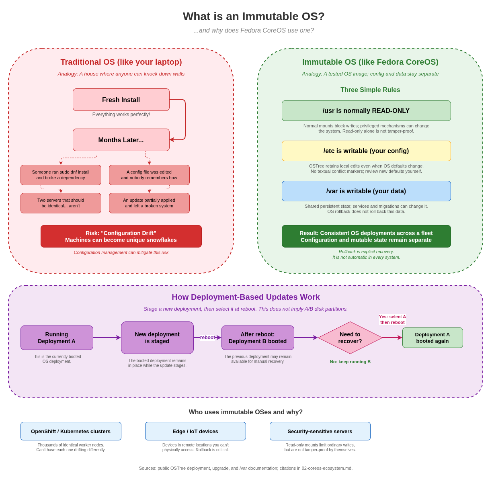

# The CoreOS Ecosystem: A Beginner's Guide

Update-controller and image-transport details can vary by release.

*You know your way around Linux. You can SSH into a server, install packages
with dnf, edit config files. But you've never worked with an "immutable"
operating system, and terms like OSTree, Ignition, and rpm-ostree sound alien.
This guide walks you through it all.*

---

## 1. What Is an Image-Managed OS?



- [Diagram source](coreos-immutable-os-basics.drawio)

### The analogy: managed image vs build-your-own

Think of a traditional Linux install like building a PC from parts. You start
with a base (Fedora, RHEL), bolt on packages, tweak configs, add repos, run
scripts. Over time, every machine becomes a unique snowflake. Two "identical"
servers might have subtly different package versions or leftover config files.
This is called **configuration drift**, and it's the enemy of reliability.

Now think of a smartphone. It ships with a managed system image. Apps and
machine data are kept apart from the base OS. When an OS update arrives, the
new deployment is prepared separately and selected on reboot. The previous
deployment may be available for recovery, but automatic rollback is not a
universal guarantee.

An immutable OS works the same way:

- **Reliability** - Updates prepare a complete new deployment instead of
  rewriting the currently booted OS tree in place.
- **Atomic updates** - All-or-nothing. The new version is staged while the old
  one is still running. A reboot switches to it.
- **Rollback** - A previous deployment can usually be selected or restored
  explicitly. The operator or a configured boot-assessment mechanism decides
  when to do this.

### What it does NOT mean

"Immutable" doesn't mean "you can't change anything." You can still write
files, run containers, and configure services. It means the **base OS layer**
is normally managed as a deployment rather than edited in place. Writable
configuration and state are kept separately. Read-only mounts by themselves
do not make a host tamper-proof.

---

## 2. OSTree: Git for Your Operating System

### What it is

OSTree stores filesystem trees in content-addressed commits, similar in spirit
to git. Each commit describes a complete filesystem tree. Identical objects
can be reused across commits, so updates can avoid fetching unchanged content;
the exact transfer depends on the configured repository or transport.

### How updates work

```
Current state:
  Deployment A (booted)   --> OSTree commit abc123

After "rpm-ostree upgrade":
  Deployment A (booted)   --> OSTree commit abc123
  Deployment B (pending)  --> OSTree commit def456

After reboot:
  Deployment B (booted)   --> OSTree commit def456
  Deployment A (retained, if available) --> OSTree commit abc123
```

For a normal `rpm-ostree upgrade`, the booted deployment is not rewritten;
the update is staged for a later boot. These deployment labels do not imply
two A/B disk partitions. If the new deployment has problems, selecting the
previous one is a recovery action, not an automatic consequence of failure.

---

## 3. rpm-ostree: The Package Manager That Isn't

### What it is

rpm-ostree combines RPM package management with OSTree's atomic model. It
understands RPM packages but instead of modifying the running filesystem,
it creates a new OSTree deployment with the changes baked in.

### How it differs from dnf

| | `dnf install nginx` | `rpm-ostree install nginx` |
|---|---|---|
| **Modifies running system?** | Yes, immediately | No - creates a new deployment |
| **If it fails halfway?** | Partially modified system | Running system untouched |
| **Undo?** | Usually requires repair | `rpm-ostree rollback`, then reboot or select the prior boot entry |
| **When does it take effect?** | Immediately | After reboot |

### Key concepts

- **Deployments** - Bootable filesystem trees. A system commonly retains a
  current and a previous deployment, subject to retention and cleanup policy.
- **Base image** - The OS image from Fedora/RHEL CoreOS, managed separately
  from local configuration and data.
- **Layered packages** - Supported RPM additions or replacements. A normal
  package-layering operation composes a new deployment; the requests are
  carried across base updates.
- **Overrides** - Replace a base package with a different version (advanced).

### Essential commands

The mutating commands below are for an unmanaged rpm-ostree host. On an
OpenShift/OKD node, use the cluster's supported MCO workflow instead of
independently upgrading or layering the host.

```bash
# Show current deployments, base image, layered packages
rpm-ostree status

# Check for updates without applying
rpm-ostree upgrade --check

# Download and stage an update (applied on next reboot)
rpm-ostree upgrade

# Layer a package on top
rpm-ostree install htop strace

# Remove a layered package
rpm-ostree uninstall htop

# Roll back to the previous deployment
rpm-ostree rollback
```

### A note about containers

On CoreOS, the expected way to run most application software is in containers,
not as host RPM layers. Package layering is supported for host components that
need to be part of the OS, such as selected drivers or diagnostics. It is an
explicit local customization and normally takes effect after reboot.

---

## 4. The Filesystem Split

System-owned paths such as `/usr/bin` are normally read-only on CoreOS. Do not
assume every path below `/usr` behaves identically: for example, some systems
redirect `/usr/local` to writable state.

```
/usr    -- The OS itself. Normally read-only during operation.
/etc    -- Your configuration. Writable.
/var    -- Your data. Writable. Persists across updates.
/run    -- Temporary runtime data. In-memory. Gone on reboot.
```

### /usr - The managed OS tree

Everything the OS ships: binaries, libraries, systemd units. Normally
read-only at runtime and supplied by the selected deployment. Root can use
debugging or image-management mechanisms to change the view, so read-only is
not itself a tamper-proof security guarantee.

Do not place local files in system-owned directories such as `/usr/bin`. If
you need to override a systemd unit, put the drop-in in
`/etc/systemd/system/`.

### /etc - Configuration

Writable. OSTree compares the old defaults in `/usr/etc`, the current `/etc`,
and the new defaults. This is a file-level merge, not a textual merge:

- You modified a file? Your version is retained, even if the new OS changes
  the same default file. OSTree does not insert textual conflict markers.
- You did not modify a file? The new version's default replaces it.
- You added a file or deleted a default locally? That local change is carried
  forward.

Use `ostree admin config-diff` to inspect local differences, and review new
defaults yourself when a customized file needs an upstream change. This
describes OSTree's merge; MCO can still replace configuration files it manages.

### /var - Persistent data

Container storage (`/var/lib/containers`), logs, databases. Deployments in the
same OSTree stateroot share this persistent state instead of replacing it with
each OS tree. Services, tmpfiles rules, and migrations can still create,
modify, or remove data there. An OS rollback does not roll back `/var` or undo
a database-format migration. `/home` is a symlink to `/var/home` on CoreOS.

### /run - Temporary

In-memory. PID files, sockets. Gone on reboot.

### The mental model

| Zone | Analogy | Who manages it |
|------|---------|---------------|
| `/usr` | The phone's OS | The distribution |
| `/etc` | Your phone's settings | You |
| `/var` | Your photos and app data | You and your apps |
| `/run` | Apps currently in memory | The system |

---

## 5. FCOS vs RHCOS vs SCOS

Three distributions built from the same technology, for different audiences.

### Fedora CoreOS (FCOS)

- Community-driven, upstream, free
- Auto-updates via Zincati (stable/testing/next streams)
- Based on Fedora packages
- For: developers, small deployments, standalone container hosts

Zincati discovers updates through Cincinnati and coordinates staging with
`rpm-ostree`. Update transport and behavior depend on release and installation
path; the documented stable-stream transition for new disk images was
`42.20250803.3.0` on 2025-08-19. Older installations and custom configurations
can differ.

Some stable FCOS images are also **bootc-compatible OCI images**: the example
stable build's Containerfile sets `containers.bootc=1`. Image compatibility and
update integration are separate: the FCOS update path described here remains
Zincati/rpm-ostree, not a wholesale switch to bootc. See the
[current comparison and inspected image digest](rpm-ostree-vs-bootc.md#current-fcos-compatibility-and-update-integration).

### RHEL CoreOS (RHCOS)

- Delivered with OpenShift and designed for OpenShift nodes; use Fedora CoreOS
  for a standalone CoreOS host
- Node configuration and OS rollouts are coordinated by the OpenShift Machine
  Config Operator (MCO), under release orchestration
- Based on RHEL packages, enterprise support
- MCO may use `rpm-ostree`/pivot internally for OSTree-backed node updates;
  cluster operators should not independently run host update commands
- For: OpenShift clusters

### CentOS Stream CoreOS (SCOS)

- Community CoreOS distribution used for OKD nodes
- Built from CentOS Stream packages
- Used by OKD (community OpenShift)
- For: OKD clusters and community development/testing

### Package bases, not a promotion chain

```
Fedora packages        --> FCOS  (standalone/community hosts)
CentOS Stream packages --> SCOS  (OKD nodes)
RHEL packages          --> RHCOS (OpenShift nodes)
```

These distributions share upstream technology and engineering work, but a
release does not have to pass through an FCOS -> SCOS -> RHCOS promotion
pipeline. SCOS is an OKD node OS, not merely a mandatory staging step for
RHCOS. Historical OKD installation pivots from FCOS to SCOS are a separate,
release-specific installation detail.

---

## 6. Ignition: First-Boot Provisioning

### What it does

Ignition runs very early in the boot process (in the initramfs, before
the real root filesystem is mounted) and provisions the machine:

- Create users and set SSH keys
- Write files (configs, scripts, systemd units)
- Format and mount disks
- Configure networking
- Set the hostname

### When it runs

Ignition normally provisions a machine on its first boot. It is not a
continuously running configuration manager and does not replay the original
configuration on every reboot or OS update.

If desired configuration changes later, use the supported post-boot control
plane: for example, update a MachineConfig on an OpenShift node, use ordinary
Linux configuration management on a standalone host, or change the relevant
`/etc` files and services. Reprovisioning is appropriate for some first-boot
operations (such as rebuilding disk layout), but is not required merely because
Ignition itself will not be replayed.

### Butane: the human-friendly format

Nobody writes Ignition JSON by hand. Write Butane (YAML), compile to JSON:

```yaml
variant: fcos
version: 1.6.0

passwd:
  users:
    - name: admin
      ssh_authorized_keys:
        - ssh-ed25519 AAAA... admin@workstation
      groups:
        - wheel

storage:
  files:
    - path: /etc/hostname
      mode: 0644
      contents:
        inline: my-coreos-node

systemd:
  units:
    - name: hello.service
      enabled: true
      contents: |
        [Unit]
        Description=Hello World
        After=network-online.target
        [Service]
        Type=oneshot
        ExecStart=/usr/bin/echo "Hello from Ignition!"
        [Install]
        WantedBy=multi-user.target
```

```bash
butane --strict config.bu > config.ign
```

### How the machine gets the config

| Platform | Method |
|----------|--------|
| AWS | EC2 user-data |
| GCP | Instance metadata |
| Azure | Custom data |
| Bare metal | Kernel arg `ignition.config.url=http://...` |
| QEMU/libvirt | fw_cfg or HTTP server |

---

## 7. Afterburn: The Cloud Metadata Agent

### What it does

Afterburn is a set of platform-specific integrations that can retrieve
instance metadata or provide early-boot inputs. Its supported features and
execution point depend on the platform and distribution; some integrations run
in the initramfs, while others run as systemd services. Do not assume there is
one universal Afterburn service that always runs after Ignition.

- SSH authorized keys
- Hostname from instance name
- Network configuration
- Platform-specific attributes

### Which clouds

Examples include AWS, GCP, Azure, OpenStack, VMware, DigitalOcean, and others.
Feature support is not uniform across providers; consult the current platform
matrix.

### How it relates to Ignition

They are complementary, but their ordering is integration-specific:
- **Ignition** handles your custom provisioning (what you decided)
- **Afterburn** handles cloud integration (what the cloud assigns)

Ignition may create users and write configuration. Applicable Afterburn
components may expose cloud SSH keys, hostname, or network data. Some
Afterburn logic runs before or alongside initramfs provisioning; check the
target platform's boot configuration rather than assuming it follows Ignition.

---

## 8. The Boot Sequence

```
1. Firmware (UEFI/BIOS)
   Hardware init, find boot device

2. Bootloader (GRUB2)
   Select OSTree deployment, load kernel

3. Initramfs
   Locate and prepare the root/deployment; platform-specific early-boot
   integrations may provide network inputs

4. Ignition (FIRST BOOT ONLY)
   Provision the machine from its first-boot configuration

5. Switch to the selected root filesystem/deployment

6. systemd
   Start system services in dependency order

7. Applicable Afterburn systemd services
   Run only where enabled; some Afterburn logic may already have run earlier

8. Kubelet / container workloads
   Join cluster, run pods (RHCOS)
   -- or --
   Your containers (FCOS)
```

### Debugging at each stage

| Stage | Where to look |
|-------|---------------|
| Bootloader | `/boot/loader/entries/` |
| Initramfs | Boot with `rd.break` kernel arg |
| Ignition | `journalctl -u ignition-firstboot-complete` |
| systemd | `journalctl -b`, `systemctl --failed` |
| Afterburn | Inspect the platform's installed Afterburn unit names with `systemctl list-units '*afterburn*'` |
| Kubelet | `journalctl -u kubelet` |

### Emergency access

```bash
# Drop into emergency shell (add to kernel command line):
systemd.unit=emergency.target

# On a standalone rpm-ostree host, request rollback to the previous deployment:
rpm-ostree rollback && systemctl reboot

# Or just pick the second entry at the GRUB boot screen
```

---

## The Whole Picture in One Paragraph

CoreOS distributions (FCOS, RHCOS, and SCOS) use image-based OS management,
but differ in build inputs, update transport, and rollout controller. OSTree
and `rpm-ostree` provide deployments and RPM-aware operations in OSTree-based
paths; bootc manages bootable OCI images and defaults to an OSTree backend,
while also supporting composefs. The OS tree is normally read-only, `/etc` is
configuration, and `/var` holds persistent state. Ignition provisions first
boot; Afterburn integrations are platform-specific. FCOS uses Zincati for its
update flow, while OpenShift/OKD use MCO to coordinate managed node changes.
Previous deployments can provide recovery, but rollback is not universally
automatic.

## Public references

- [OSTree configuration merge semantics](https://ostreedev.github.io/ostree/atomic-upgrades/#assembling-a-new-deployment-directory), [shared deployment state](https://ostreedev.github.io/ostree/deployment/), and [`/var` handling](https://ostreedev.github.io/ostree/var/)
- [Fedora CoreOS auto-updates and manual rollbacks](https://docs.fedoraproject.org/en-US/fedora-coreos/auto-updates/)
- [FCOS auto-update documentation](https://github.com/coreos/fedora-coreos-docs/blob/1fec1acb5437220c559b8833e0ef1d643edd918b/modules/ROOT/pages/auto-updates.adoc) and [OCI transport transition dates](https://github.com/coreos/fedora-coreos-docs/blob/1fec1acb5437220c559b8833e0ef1d643edd918b/modules/ROOT/pages/major-changes.adoc)
- [FCOS stable Containerfile at the inspected image's source revision](https://github.com/coreos/fedora-coreos-config/blob/956ef9d4ca9b6f29ea8316a3d2667db64485873f/Containerfile) and [bootc integration roadmap](https://github.com/coreos/fedora-coreos-tracker/issues/1726)
- [OKD's SCOS migration FAQ (historical 4.16 context)](https://www.okd.io/docs/project/scos-migration-faq)
- [`rpm-ostree` administration and package layering](https://coreos.github.io/rpm-ostree/administrator-handbook/)
- [`rpm-ostree` native-container transport](https://coreos.github.io/rpm-ostree/container/)
- [Ignition](https://coreos.github.io/ignition/) and [Butane](https://coreos.github.io/butane/)
- [Afterburn supported platforms](https://coreos.github.io/afterburn/platforms/) and [initrd networking](https://coreos.github.io/afterburn/usage/initrd-network-cmdline/)
- [OpenShift MachineConfigDaemon update design](https://github.com/openshift/machine-config-operator/blob/release-4.22/docs/MachineConfigDaemon.md)
- [bootc upgrades and rollback](https://bootc-dev.github.io/bootc/bootc-upgrades.7.html) and [storage backends](https://bootc-dev.github.io/bootc/bootc-composefs.7.html)
