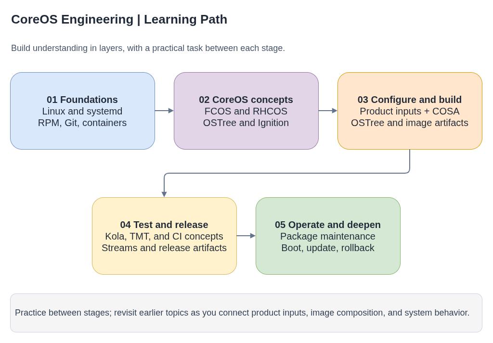

# CoreOS Engineering - Learning Path

Structured learning path for understanding CoreOS and RHCOS engineering.
The phases move from Linux foundations through immutable OS concepts, image
builds, testing, and package maintenance. Work through the practice tasks as
you go.

If you are fixing an issue now, start with the
[issue-work index](../README.md#working-an-issue) and the relevant project guide.
The phases below are a learning backlog, not prerequisites for troubleshooting.

- [Diagram source](coreos-engineering-learning-path.drawio)

## Phase 1 - Foundations (weeks 1–3)

These are the building blocks everything else sits on. If you're shaky
here, everything downstream becomes harder.

### 1.1 Linux fundamentals
- [ ] Process model: PID 1, init systems, systemd units and targets
- [ ] Filesystem hierarchy: `/etc`, `/usr`, `/var`, `/run` and why
      immutable OS splits them differently
- [ ] Package management: RPM basics (`rpm -qa`, `-qi`, `-ql`, `-qf`)
- [ ] Networking: `ip addr`, `ss`, `firewall-cmd`, DNS resolution
- [ ] SELinux: labels, contexts, `getenforce`, `semanage`, `restorecon`
- [ ] Journals and logging: `journalctl -u`, `-b`, `--since`

**Practice:** SSH into a Fedora/RHEL box. Find what package owns
`/usr/bin/curl`. List its dependencies. Check if a service is running.
Read its logs.

### 1.2 Containers
- [ ] What a container image is (layers, tags, digests)
- [ ] `podman run`, `build`, `push`, `images`, `rmi`
- [ ] `skopeo list-tags`, `inspect`, `copy`
- [ ] Containerfile/Dockerfile syntax: `FROM`, `RUN`, `COPY`, `ARG`, `LABEL`
- [ ] Multi-stage builds
- [ ] Container registries: quay.io, registry.ci.openshift.org

**Practice:** Build a simple Containerfile. Push to quay.io. Inspect
with skopeo. Pull on another machine.

### 1.3 Git workflow
- [ ] Branching, rebasing, cherry-picking
- [ ] Resolving merge conflicts
- [ ] `git log --oneline --graph`, `git blame`, `git bisect`
- [ ] Upstream vs fork workflow (GitHub PRs)
- [ ] GPG signing commits (see the [GitHub commit-signing guide](https://docs.github.com/en/authentication/managing-commit-signature-verification/signing-commits))

**Practice:** Fork a repo, create a branch, make changes, rebase on
upstream, submit a PR.

---

## Phase 2 - The CoreOS ecosystem (weeks 3–6)

Understanding what you're building and why.

### 2.1 Immutable OS concepts
- [ ] What rpm-ostree is and why (atomic updates, rollback)
- [ ] `/usr` is read-only, `/etc` is writable, `/var` persists
- [ ] OSTree: content-addressed filesystem tree
- [ ] Difference between traditional RHEL and CoreOS

### 2.2 FCOS vs RHCOS vs SCOS
- [ ] Fedora CoreOS - upstream, community, auto-updates
- [ ] RHEL CoreOS - downstream, shipped with OCP, no standalone install
- [ ] CentOS Stream CoreOS - development stream for RHCOS
- [ ] How Fedora, CentOS Stream, and RHEL relate (an upstream/downstream relationship, not a single automatic promotion pipeline)

### 2.3 Boot process
- [ ] [Butane](../projects/butane/README.md): authoring YAML that is transpiled to Ignition configuration
- [ ] [Ignition](../projects/ignition/README.md): first-boot provisioning in the initramfs
- [ ] Afterburn: platform-specific metadata integration (features and timing vary by platform)
- [ ] Typical boot: firmware → bootloader → initramfs (ignition) →
      real root → systemd targets → kubelet
- [ ] Threat models for Ignition and Afterburn

### 2.4 OCP ↔ RHEL ↔ RHCOS relationship
- [ ] OCP version bundles a specific RHCOS image
- [ ] RHCOS is built on a specific RHEL version
- [ ] How to inspect the RHCOS image variants in a specific release payload
- [ ] Why an OpenShift minor can contain more than one RHCOS/RHEL image variant
- [ ] `oc adm release info` to inspect release payloads
- [ ] Stable vs dev-preview vs nightly streams
- [ ] Release browser: https://amd64.ocp.releases.ci.openshift.org/

**Practice:** Use `oc adm release info` to find the RHCOS image in
a release. Run `rpm -qa` inside it. Compare RPMs across two releases.

### 2.5 Guided ecosystem walkthroughs
- [ ] [How CoreOS works: source configuration to a running node](coreos-ecosystem-functionality.md)
- [ ] [`rpm-ostree` and `bootc`: two immutable OS delivery models](rpm-ostree-vs-bootc.md)

---

## Phase 3 - Building RHCOS (weeks 6–9)

### 3.1 The openshift/os repo [→ `projects/openshift-os/`]
- [ ] Containerfile: how `ARG`s parameterize the build
- [ ] `build-args-*.conf`: per-version build parameters
- [ ] `packages-openshift.yaml`: package manifest with conditionals
- [ ] `build-node-image.sh`: the main build script
- [ ] Extensions: what they are, how they're built

### 3.2 Building locally
- [ ] Combining repo files from rhel-coreos-config
- [ ] `podman build` with build arguments and a local build context
- [ ] Inspecting the built image

### 3.3 CoreOS Assembler (COSA) [→ `projects/coreos-assembler/`]
- [ ] What COSA does: treefile → OSTree → disk images
- [ ] COSA builds FCOS and the RHCOS/SCOS base OS; the final `openshift/os` node-image build varies by release branch
- [ ] How older COSA-based and newer Containerfile-based node-image branches differ
- [ ] `cosa init`, `cosa fetch`, `cosa build`
- [ ] `cosa buildextend-*` for different artifacts
- [ ] Architecture-specific builders and why a native build is not automatically a cross-build

### 3.4 rhel-coreos-config [→ `projects/rhel-coreos-config/`]
- [ ] Build args: base image, CPE, version labels
- [ ] Treefiles and overrides
- [ ] Repo files: nightly vs GA

### 3.5 Custom disk images [→ `projects/custom-coreos-disk-images/`]
- [ ] When you need disk images: bare metal install, live ISO, PXE boot
- [ ] The pipeline: container image → OCI archive (skopeo) → disk image (OSBuild)
- [ ] `custom-coreos-disk-images.sh`: platforms (qemu, metal, live)
- [ ] Layering packages on RHCOS/FCOS container images
- [ ] Deploying custom images to OpenShift via MachineConfig (`osImageURL`)
- [ ] Requirements vary by OSBuild version; if a disposable VM must use permissive SELinux, restore its original mode after the build

**Practice:** Follow the COSA guide to build an FCOS image from its public
configuration. Inspect the result, change a package input in a local copy,
and rebuild. Then explore how a built image can be converted to a qcow2.

---

## Phase 4 - CI/CD (weeks 9–12)

### 4.1 Prow & ci-operator [→ `projects/openshift-release/`]
- [ ] What Prow is: Kubernetes-based CI for OpenShift
- [ ] ci-operator configs: `base_images`, `images`, `tests`
- [ ] `openshift/release` repo structure
- [ ] `make jobs` to regenerate Prow YAML
- [ ] Image mirroring: `core-services/image-mirroring/`
- [ ] OWNERS and OWNERS_ALIASES
- [ ] `pj-rehearse` and the chicken-and-egg problem

### 4.2 Jenkins CI [→ `projects/coreos-ci/`]
- [ ] Jenkins pipelines: declarative vs scripted
- [ ] Job DSL: generating jobs from Groovy code
- [ ] Multibranch pipelines: branch sources, traits, build strategies
- [ ] Jenkinsfile syntax (see the [Jenkins Pipeline syntax reference](https://www.jenkins.io/doc/book/pipeline/syntax/))

### 4.3 Testing
- [ ] Kola: CoreOS integration test framework
- [ ] `distros:` tag for test filtering (FCOS vs RHCOS)
- [ ] TMT/FMF: test metadata format for gating [→ `projects/tmt-testing/`]
- [ ] Testing Farm: a service for provisioning TMT test environments
- [ ] [Konflux](../projects/konflux/README.md): builds, integration tests, and release handoff

**Practice:** Add a new image build to a ci-operator config. Run
`make jobs`. Read through a Prow job failure log.

---

## Phase 5 - Fedora/RHEL packaging (weeks 12–15)

### 5.1 RPM packaging [→ `projects/fedora-packaging/`]
- [ ] Spec file structure: `%prep`, `%build`, `%install`, `%files`
- [ ] NVR: Name-Version-Release (e.g. `afterburn-5.9.0-1.el9_6`)
- [ ] `fedpkg`: clone, build, mockbuild, scratch-build
- [ ] Mock: isolated chroot builds [→ `projects/fedora-packaging/`]

### 5.2 Dist-git workflow [→ `projects/dist-git/`]
- [ ] CentOS Stream package changes through the public dist-git workflow
- [ ] How distribution-specific package review differs from upstream changes
- [ ] Fedora package lifecycle: orphan, retire, and unretire

### 5.3 Fedora builds and updates
- [ ] Koji: builds, tags, targets, and inheritance
- [ ] Bodhi: update submissions and testing
- [ ] Read package changelogs and identify the source of an update

**Practice:** Follow a public Fedora package from its spec file through a
Koji build and a Bodhi update.

---

## Phase 6 - Security and maintenance (weeks 15–17)

### 6.1 Security updates
- [ ] Read public CVE records and upstream advisories
- [ ] Trace a fix from upstream source to a published package update
- [ ] Check whether an updated package is included in an OS image
- [ ] Understand how changelogs and release notes describe a fix

### 6.2 Updates for immutable systems
- [ ] Distinguish a package update from a composed OS image release
- [ ] Understand how staged updates and rollback reduce update risk

**Practice:** Choose a public Fedora security update and map its advisory,
package build, and inclusion in a CoreOS image.

---

## Phase 7 - Programming (ongoing)

### 7.1 Python
- [ ] Data structures, comprehensions, f-strings
- [ ] `argparse` for CLI tools
- [ ] `subprocess` for shell commands
- [ ] `pathlib` for file operations
- [ ] `requests` for HTTP APIs
- [ ] Version string parsing patterns

### 7.2 Bash
- [ ] Variables, conditionals, loops
- [ ] Exit codes and `set -euo pipefail`
- [ ] `grep`, `sed`, `awk`, `jq` for data extraction
- [ ] Regular expressions: Python `re` + `grep -E` / `sed -E`
- [ ] Writing safe scripts (quoting, word splitting)

### 7.3 Groovy
- [ ] Closures and delegation (for Jenkins DSL)
- [ ] Reading Jenkins pipeline code
- [ ] Job DSL patterns

### 7.4 Reading Rust & Go (not writing)
- [ ] Rust: `Cargo.toml`, `mod.rs`, `use`, `impl`, error handling
- [ ] Go: `go.mod`, packages, interfaces, goroutines
- [ ] Both: enough to follow a code path and understand component boundaries

---

## Phase 8 - Continued learning (ongoing)

- [ ] Use the [Fedora CoreOS documentation](https://docs.fedoraproject.org/en-US/fedora-coreos/)
      as the product reference
- [ ] Read the public sources for [FCOS configuration](https://github.com/coreos/fedora-coreos-config)
      and the [build pipeline](https://github.com/coreos/fedora-coreos-pipeline)
- [ ] Explore [TMT](https://tmt.readthedocs.io/) and
      [Testing Farm](https://docs.testing-farm.io/) for test workflows
- [ ] Revisit the guides as hands-on work adds context

---

## How to use this course

1. **Work through in order** - phases build on each other
2. **Do the practice tasks** - reading without doing doesn't stick
3. **Keep concise notes as you go** - record concepts and verified references,
   not just that you completed a task
4. **Check public references** - use the linked project documentation and
   upstream sources to verify details
5. **Revisit phases** - you'll understand Phase 2 differently after
   doing Phase 6

Use the links above to navigate this repository. Confirm version-specific
details in upstream documentation and the source branch you are studying.
