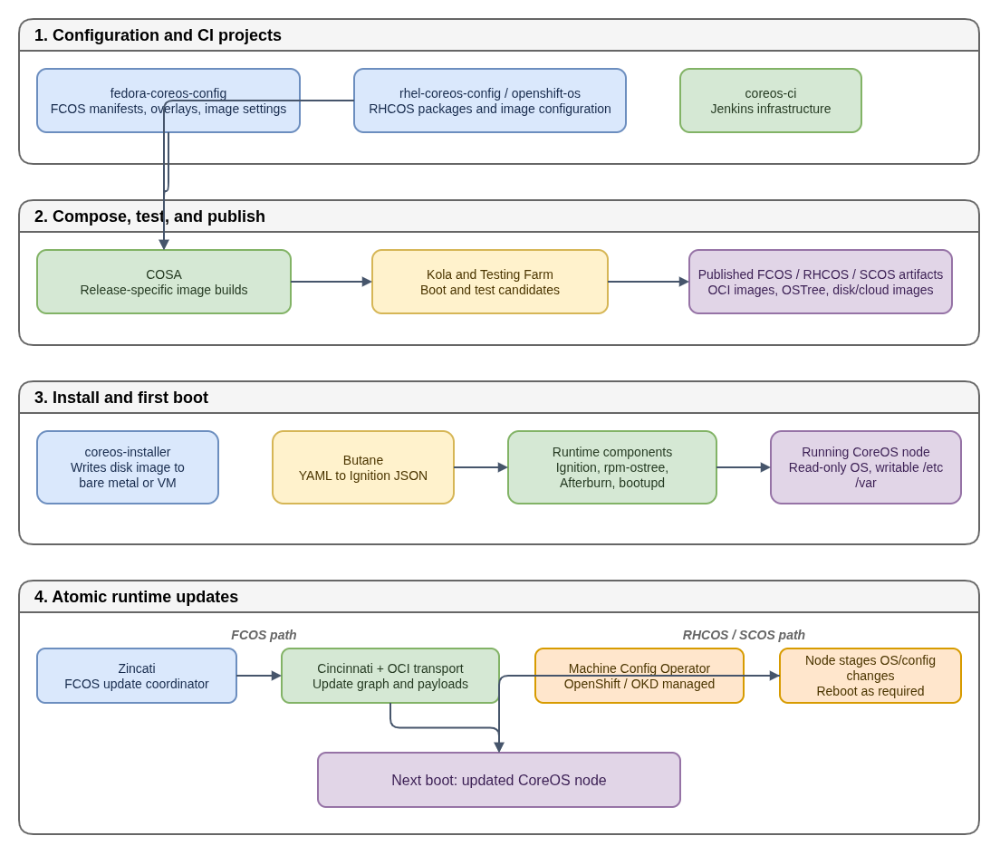

# How CoreOS Works: From Source Configuration to a Running Node

Pinned revisions are linked in the sources; later branches can differ.



- [Diagram source](coreos-ecosystem-functionality.drawio)

This guide explains the projects in the CoreOS ecosystem and how they fit
together. The important idea is that CoreOS is not just one repository or one
binary. It is a build, test, boot, and update system for an image-managed Linux
OS.

## Learning goals

After reading this, you should be able to explain:

- What `fedora-coreos-config` and `rhel-coreos-config` define.
- What `coreos-assembler` (COSA) builds.
- How CI tests and publishes CoreOS artifacts.
- What happens during installation and first boot.
- Why FCOS and RHCOS use different update controllers.

## The CoreOS mental model

A traditional Fedora or RHEL server is changed in place. An administrator runs
package commands, edits files under `/usr`, and gradually creates a unique
machine.

CoreOS treats the operating system as a tested image:

- `/usr` normally contains read-only OS content; the mount and storage backend
  vary by release.
- `/etc` contains machine configuration.
- `/var` contains persistent application and system data.
- Updates stage a new deployment beside the booted one.
- A reboot selects the new deployment.
- A previous deployment may be selected manually for recovery; automatic
  rollback is not universal.

This is the same high-level idea as an atomic database transaction: prepare the
new state first, then switch to it as one operation.

## 1. Configuration and CI projects

### `fedora-coreos-config`

`fedora-coreos-config` is the configuration repository for Fedora CoreOS
(FCOS). It describes the desired OS rather than implementing the build engine.
Important content includes:

- RPM package selections and repositories.
- rpm-ostree treefiles and image settings.
- Containerfile/build scripts for the container-native build path.
- `overlay.d/` content such as dracut modules and scripts.
- Kola test definitions.
- Stream branches such as `testing-devel`, `next-devel`, and `stable`.

It is the FCOS product definition. COSA consumes it to build an image. At the
cited stable revision, `manifest.yaml` selects the Buildah path and the
Containerfile produces a bootc-compatible OCI image. Manifest inputs and
container builds can be used together; they are not exclusive old/new models.

### `rhel-coreos-config` and `openshift/os`

These are corresponding RHCOS inputs. They describe RHEL and
OpenShift-specific packages, repositories, image parameters, and extensions.
The base OS build and the final node-image build are separate steps, whose
implementation depends on the release branch. COSA-style manifests and
Containerfiles can both participate; for example, the `openshift/os`
release-4.22 Containerfile builds the final OCP/OKD node image on top of a base
CoreOS image. This is not an exclusive old/new split between build inputs.

### `coreos-ci`

`coreos-ci` provides CI infrastructure, especially Jenkins configuration,
seed jobs, and shared job definitions. It answers:

> Where should the jobs run, and how are they created?

### `fedora-coreos-pipeline`

`fedora-coreos-pipeline` defines what the release workflow does:

- Start a build.
- Build on the required architectures.
- Run Kola and cloud tests.
- Push or publish artifacts.
- Advance a stream or release when the required checks pass.

The distinction is useful:

- `coreos-ci` supplies Jenkins infrastructure and job creation.
- `fedora-coreos-pipeline` supplies the FCOS build/release workflow.

## 2. Compose, test, and publish

### `coreos-assembler` (COSA)

COSA is the build tool. It consumes a configuration repository and performs
the mechanical work of composing an operating system:

```text
configuration + RPM repositories + build recipe
        -> COSA / release-specific image build
        -> OCI OS image, OSTree content, disk/cloud artifacts (as applicable)
```

Typical local commands are:

```bash
cosa init https://github.com/coreos/fedora-coreos-config
cosa build
cosa osbuild qemu
cosa run
```

The result can include OCI OS images, OSTree commits, disk images, cloud
images, and other release artifacts. COSA can orchestrate tree composition or
container builds; its use does not determine the runtime update manager.
COSA is a build tool, not the update agent running on every machine.

### OSTree and rpm-ostree

OSTree stores complete filesystem trees as content-addressed commits. Similar
files are reused by hash; transfer granularity depends on the transport, such
as individual objects, static deltas, or OCI layers.

`rpm-ostree` combines RPM knowledge with OSTree deployments. It can:

- Compose RPMs into an image.
- Fetch a new deployment.
- Layer RPM packages or apply overrides by composing a new deployment.
- Keep a previous deployment for rollback.

The important distinction from `dnf` is that a normal `rpm-ostree install` or
`rpm-ostree upgrade` stages a deployment instead of rewriting the booted OS
tree. `rpm-ostree` supports package layering; it is not limited to packages
selected when the base image was built. Some specialized operations can apply
changes live, but ordinary layering and upgrades should be understood as
staged changes.

OSTree deployments are not necessarily A/B disk partitions. Previous
deployments can be retained for manual rollback, but failure does not
automatically switch every system back to the previous deployment.

### Kola and Testing Farm

Kola boots candidate images and runs functional scenarios. Testing Farm
provides provisioned test environments, including hardware or virtual machines
needed for tests that cannot run in a normal container.

The purpose is to test the image as an operating system:

- Does it boot?
- Does networking work?
- Does Ignition provision the expected state?
- Do systemd services start?
- Does the image work on the target architecture or cloud?

Only after testing does the pipeline publish a candidate as a release artifact.

## 3. Install and first boot

### `coreos-installer`

`coreos-installer` writes a CoreOS image to a disk, virtual machine, or other
supported target. It converts a published artifact into a machine that can
boot.

### Butane

Butane is a human-friendly YAML format for writing machine configuration. It
compiles YAML into Ignition JSON:

```bash
butane --strict config.bu > config.ign
```

Butane is a configuration authoring tool. It does not provision the machine
itself.

### Ignition

Ignition runs very early, in the initramfs, normally during first boot. It can:

- Partition and format disks.
- Create users.
- Install SSH keys.
- Write files.
- Enable systemd units.
- Configure some networking and storage settings.

Ignition is intentionally not a continuously running configuration manager.
It normally provisions the machine at first boot; later OS updates do not
replay the original config as if it were Ansible. That does not mean the host
must be destroyed to change configuration. Use the supported post-boot
mechanism: MachineConfig for supported OpenShift node changes, or normal
configuration management and writable `/etc` on a standalone host. Some
first-boot disk operations may still require reprovisioning.

### Afterburn

Afterburn provides platform-specific integrations. Depending on the platform
and distribution, its components can retrieve or expose metadata such as:

- Instance hostname.
- SSH keys.
- Network or platform-specific information.

Ignition describes operator-provided first-boot configuration. Afterburn reads
platform metadata. Feature coverage differs by platform, and Afterburn does
not universally run after Ignition: some integrations contribute initramfs
network inputs, while others are systemd services.

### `bootupd`

`bootupd` manages bootloader components. The bootloader runs before the Linux
userspace, so bootloader maintenance is a separate concern from updating the
OSTree userspace deployment.

## 4. Runtime update paths

The update controller depends on the distribution.

### Fedora CoreOS: Zincati

FCOS uses Zincati as its automatic update agent. Conceptually:

```text
Zincati
  -> Cincinnati update graph
  -> configured update payload transport
  -> rpm-ostree stages a deployment
  -> reboot
```

Zincati coordinates update discovery and finalization; `rpm-ostree` stages the
deployment. Current FCOS defaults to rpm-ostree's OCI-native transport; older
or custom configurations can use an OSTree repository. Stable FCOS also
publishes bootc-compatible OCI images, but bootc compatibility does not change
this default Zincati/rpm-ostree integration. The separate bootc integration
work is tracked publicly. The previous deployment is not automatically
selected just because the new one fails.

### RHCOS and SCOS: Machine Config Operator

RHCOS and SCOS are managed as cluster nodes, not as independent FCOS machines
with Zincati. OpenShift's Machine Config Operator (MCO) coordinates node
configuration and rollout; the Cluster Version Operator (CVO) supplies release
intent in OpenShift:

```text
OpenShift release payload
  -> Machine Config Operator
  -> stage supported config and OS changes
  -> drain/reboot as required, then validate
```

On OSTree-backed node-image paths, MCO may invoke `rpm-ostree` through
`pivot`; the MCO remains the rollout owner. Exact implementation details vary
by release. SCOS is CentOS Stream based and used for OKD nodes; its rollouts
follow the cluster-managed OKD path, not a mandatory FCOS -> SCOS -> RHCOS
promotion chain. The same deployment technology can therefore have different
update controllers in different products.

## Useful Linux commands

Run these on an unmanaged FCOS machine or test VM. On an OpenShift/OKD node,
use MCO for changes rather than independently issuing the update/rollback
commands below:

```bash
# Show deployments, base image, and layered packages
rpm-ostree status

# Check whether an update is available
rpm-ostree upgrade --check

# Stage an update for the next reboot
rpm-ostree upgrade

# Return to the previous deployment
rpm-ostree rollback

# Inspect the current boot and failed services
journalctl -b
systemctl --failed

# Inspect first-boot provisioning
journalctl -u ignition-firstboot-complete

# Discover the platform's installed metadata integration units
systemctl list-unit-files '*afterburn*'
journalctl -b -u 'afterburn*'
```

## Verification exercise

Inspect the public upstream repositories that provide the build inputs and
build tools:

```bash
git ls-remote --exit-code https://github.com/coreos/fedora-coreos-config HEAD
git ls-remote --exit-code https://github.com/coreos/coreos-assembler HEAD
```

Each command should print a public repository's HEAD ref. The repositories play
different roles; none of them alone is the complete CoreOS system.

## Summary

`fedora-coreos-config` and downstream equivalents define the product. COSA
composes it. CI tests and publishes it. `coreos-installer` puts it on a
machine. Ignition provisions first boot; applicable Afterburn integrations
depend on platform and boot stage. OSTree/rpm-ostree or bootc provide
deployment-based update mechanisms. Zincati coordinates FCOS updates, while
MCO coordinates RHCOS/SCOS node configuration and rollout. Rollback requires
an explicit recovery action unless a separate boot-assessment policy is
configured.

## Public references

- [`fedora-coreos-config`](https://github.com/coreos/fedora-coreos-config), [`coreos-assembler`](https://github.com/coreos/coreos-assembler), and [`fedora-coreos-pipeline`](https://github.com/coreos/fedora-coreos-pipeline)
- [FCOS stable build selection](https://github.com/coreos/fedora-coreos-config/blob/956ef9d4ca9b6f29ea8316a3d2667db64485873f/manifest.yaml) and [bootc-compatible Containerfile at the same revision](https://github.com/coreos/fedora-coreos-config/blob/956ef9d4ca9b6f29ea8316a3d2667db64485873f/Containerfile)
- [`openshift/os` release-4.22 final node-image Containerfile](https://github.com/openshift/os/blob/release-4.22/Containerfile)
- [FCOS default auto-update integration (upstream documentation source)](https://github.com/coreos/fedora-coreos-docs/blob/1fec1acb5437220c559b8833e0ef1d643edd918b/modules/ROOT/pages/auto-updates.adoc) and [separate bootc integration roadmap](https://github.com/coreos/fedora-coreos-tracker/issues/1726)
- [OKD SCOS background (historical 4.16 migration FAQ)](https://www.okd.io/docs/project/scos-migration-faq)
- [`rpm-ostree` administration](https://coreos.github.io/rpm-ostree/administrator-handbook/) and [OCI-native transport](https://coreos.github.io/rpm-ostree/container/)
- [Ignition](https://coreos.github.io/ignition/), [Butane](https://coreos.github.io/butane/), and [Afterburn platform support](https://coreos.github.io/afterburn/platforms/)
- [OpenShift MachineConfigDaemon update design](https://github.com/openshift/machine-config-operator/blob/release-4.22/docs/MachineConfigDaemon.md)
- [bootc documentation](https://bootc-dev.github.io/bootc/), including [upgrades](https://bootc-dev.github.io/bootc/bootc-upgrades.7.html) and [composefs](https://bootc-dev.github.io/bootc/bootc-composefs.7.html)
