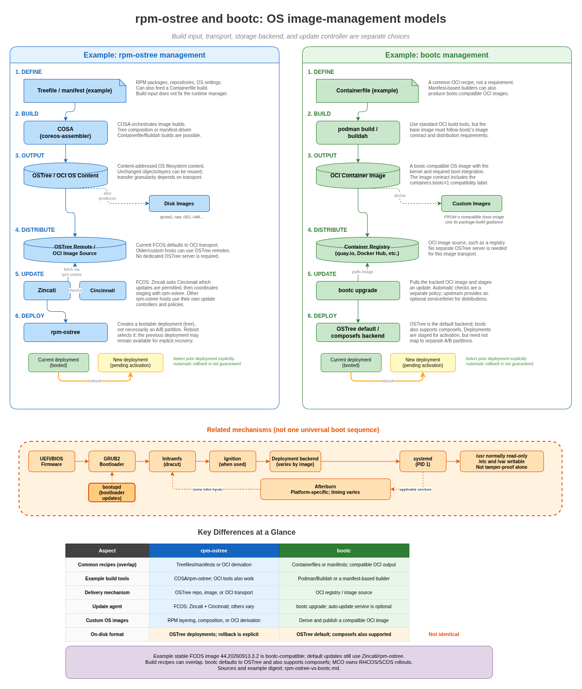
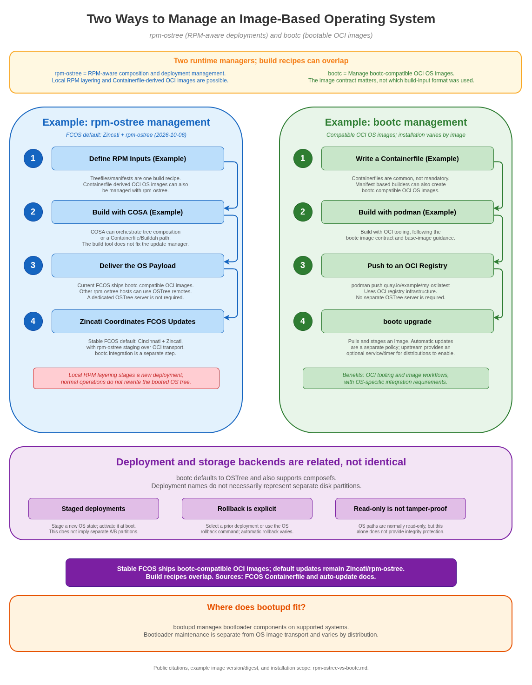

# `rpm-ostree` and `bootc`: Two OS Image-Management Models

Behavior and product integration can vary by distribution and release.



- [Diagram source](coreos-rpm-ostree-vs-bootc.drawio)



- [Diagram source](coreos-rpm-ostree-vs-bootc-simple.drawio)

This guide compares RPM-aware `rpm-ostree` management with `bootc` management
of bootable OCI images. Build input, transport, on-disk backend, and update
orchestration are separate choices: an OCI transport does not by itself mean
that a machine is managed by bootc.

## Learning goals

You should be able to explain:

- What OSTree provides to both models.
- How RPM manifests and container builds can both produce OCI OS images.
- How the image contract and runtime manager determine deployment behavior.
- How rollback is requested and why it is not universally automatic.
- Why bootc-compatible FCOS images do not imply bootc-managed default updates.

## Build inputs are not runtime managers

The paths below are representative workflows, **not an exclusive old/new
dichotomy**. rpm-ostree can compose OCI images from treefiles and manage
Containerfile-derived OS images. bootc consumes compatible OCI images; it
does not require that their builder used a Containerfile rather than a
manifest. COSA can orchestrate both tree composition and container builds.

Current FCOS is a concrete overlap: its stable manifest selects a Buildah
path, its Containerfile produces bootc-compatible OCI images, and its default
runtime update integration is still Zincati/rpm-ostree. See
[rpm-ostree's native-container workflows](https://coreos.github.io/rpm-ostree/container/)
and the [FCOS stable build inputs](https://github.com/coreos/fedora-coreos-config/tree/956ef9d4ca9b6f29ea8316a3d2667db64485873f).

## Deployment-based updates

In an OSTree-based system, OSTree stores filesystem trees as content-addressed
commits. `rpm-ostree` uses bootable deployments; bootc defaults to OSTree for
its storage backend, and also supports a composefs backend. A typical staged
update looks like:

```text
Current deployment: running now
New deployment: staged and pending activation
```

After reboot, the new deployment is selected. The previous one may remain
available, subject to the system's retention and cleanup policy. Deployment
names such as A and B describe bootable OS states, not necessarily two disk
partitions. A failed update does not universally trigger an automatic
rollback; an operator, bootloader, or configured boot-assessment mechanism
must select the previous deployment.

On OSTree-based images, `/usr` is normally read-only while `/etc` and `/var`
hold writable configuration and state. Read-only alone is not tamper-proof;
integrity depends on the selected storage backend and verified-boot setup.

## Example A: rpm-ostree management

### 1. Define RPM inputs (a treefile example)

A treefile or manifest describes the RPM packages, repositories, and OS
settings. In the Fedora CoreOS ecosystem, configuration repositories such as
`fedora-coreos-config` provide this input. These manifests can also feed a
Containerfile-based build; using them does not rule out bootc-compatible
output.

Think of the treefile as a precise package recipe for a complete operating
system, not a list of packages to install interactively on one server.

### 2. Compose with COSA and rpm-ostree

One workflow uses rpm-ostree composition to resolve RPM inputs and create an
OSTree commit representing a complete OS filesystem tree. COSA can orchestrate
this workflow or a container-build path; the build tool is not an exclusive
property of the runtime manager.

```text
treefile + RPM repositories
        -> example: COSA/rpm-ostree compose
        -> OSTree commit (can also be packaged as OCI)
```

### 3. Deliver the composed OS

Depending on the product and configuration, an OS can be distributed through
an OSTree repository, a bootable disk/cloud image, or an OCI-native transport
for OSTree content. A dedicated OSTree server is not inherent to the
`rpm-ostree` model.

### 4. Update with Zincati or `rpm-ostree`

On FCOS, Zincati discovers updates through Cincinnati and coordinates their
staging with `rpm-ostree`. Current FCOS uses OCI transport by default; an
OSTree repository remains relevant for older or custom configurations. On an
unmanaged rpm-ostree host, a user can also inspect or request an update:

```bash
rpm-ostree status
rpm-ostree upgrade --check
rpm-ostree upgrade
```

The new OS content is staged as a deployment; the booted deployment is not
rewritten by a normal upgrade. OCI delivery does not by itself change the
update manager. A bootc-compatible image can still be managed in this
Zincati/rpm-ostree path.

### 5. Optional package layering

`rpm-ostree` supports package layering and overrides. A normal package install
creates a new deployment rather than editing the booted `/usr` tree in place:

```bash
rpm-ostree install htop
rpm-ostree uninstall htop
rpm-ostree rollback
```

Layering is useful for host components that cannot easily run in a container.
The package request is carried across base updates, and the resulting changes
normally take effect after reboot. Some specialized `rpm-ostree` operations
support live application; do not assume that behavior for ordinary installs.

## Example B: bootc management

### 1. Define the OS with a Containerfile

A common bootc image build uses familiar container build syntax. This is an
example, not a required build-input format:

```Dockerfile
FROM quay.io/fedora/fedora-bootc:44
RUN dnf install -y example-package
```

The output is not an ordinary application container. A bootc-compatible image
includes the OS userspace and the kernel/initramfs content and integration
points needed to boot. Compatibility is an image contract, not a property of
every OCI image.

### 2. Build with normal container tools

Podman or Buildah builds the Containerfile. This lets an OS image use much of
the existing container toolchain:

```bash
podman build -t quay.io/example/my-bootc-os:latest .
```

### 3. Publish to an OCI registry

The image is pushed to a registry such as Quay or another OCI-compatible
registry:

```bash
podman push quay.io/example/my-bootc-os:latest
```

The registry becomes the delivery mechanism for the OS image.

### 4. Install or upgrade with `bootc`

For a new machine, installation is performed through the bootc-compatible
image's installer workflow. Upstream `bootc install to-disk` is invoked from
the target image's privileged container context; it is not a generic command
to run against an arbitrary existing host. For an existing bootc system, use:

```bash
bootc upgrade
```

The exact installer, target layout, and command depend on the image and
environment. Read the image's installation guidance before writing to a disk.

### 5. Stage the next deployment

By default, bootc stores deployments using OSTree. It also supports a composefs
backend; the image determines which backend is used. In either case, an update
is staged and then activated at reboot. Do not assume that all bootc systems
use OSTree internally or use A/B disk partitions.

### Optional automatic updates

`bootc upgrade` is the update command; automatic invocation is a separate
policy. Upstream provides an optional `bootc-fetch-apply-updates.timer` and
service for distributions to enable. It is not a universal default across all
bootc images. Check the operating system's policy before assuming updates are
automatic.

## What is the same?

| Concern | `rpm-ostree` | `bootc` |
|---|---|---|
| Base OS model | Immutable image | Immutable image |
| On-disk backend | OSTree | OSTree by default; composefs is also supported |
| Update activation | Reboot | Reboot |
| Rollback | Explicit rollback or boot-entry selection | Explicit `bootc rollback` or boot-entry selection |
| Normal mutable areas | `/etc`, `/var` | `/etc`, `/var` |

## What changes?

| Concern | `rpm-ostree` model | `bootc` model |
|---|---|---|
| Build recipes (not exclusive) | Treefiles/manifests or Containerfile-derived OS images | Any recipe producing bootc-compatible OCI; Containerfiles are common |
| Example build tools | COSA/rpm-ostree compose or container tools | Podman/Buildah or manifest-based image builders |
| Common delivery | OSTree repository, bootable image, or OCI-native transport | OCI container registry/image source |
| Update command | Zincati or `rpm-ostree upgrade` | `bootc upgrade` |
| Host package customization | RPM layering is supported; normal operations stage a deployment | Prefer deriving and publishing a new bootable image |
| Automatic updates | Product-specific; FCOS uses Zincati | Optional service/timer; distribution decides whether to enable it |

## Current FCOS compatibility and update integration

Stable FCOS publishes bootc-compatible OCI images, not merely arbitrary
application containers. For example, this published stable image has the
following metadata:

```text
Image:   quay.io/fedora/fedora-coreos:stable (amd64)
Version: 44.20260913.3.2
Created: 2026-09-29T03:24:48Z
Digest:  sha256:fc025291309d4a3c096ab072414966bccdcdc05d5cf40e81ab4b39326bf7d113
Label:   containers.bootc=1
Source:  fedora-coreos-config revision 956ef9d4ca9b6f29ea8316a3d2667db64485873f
```

The [Containerfile at that source revision](https://github.com/coreos/fedora-coreos-config/blob/956ef9d4ca9b6f29ea8316a3d2667db64485873f/Containerfile)
sets the compatibility label and builds bootable OCI content. This example
rules out blanket claims that FCOS images are incompatible with bootc; check
the exact image and release integration separately.

There are still separate integration questions:

- **Default updates:** FCOS documentation specifies Zincati/rpm-ostree. OCI
  image compatibility does not replace that controller. The public
  [bootable-container roadmap](https://github.com/coreos/fedora-coreos-tracker/issues/1726)
  still lists Zincati/bootc integration work (roadmap updated 2026-06-23).
- **Installation and provisioning:** use the exact image's guidance for the
  installer, storage layout, first-boot configuration, and target platform.
  A compatible OCI image is not the same artifact as an existing FCOS disk
  image, nor proof that every historical installation workflow is supported.
- **Image validation:** bootc has a documented image contract and
  `bootc container lint`; a Fedora/RHEL base, OCI transport, or OSTree content
  alone is not enough to classify an arbitrary image as compatible.

Inspect current public metadata from a workstation with Skopeo:

```bash
skopeo inspect --config docker://quay.io/fedora/fedora-coreos:stable
```

Tags move. Record the digest and version for a reproducible check instead of
generalizing an undated local installation failure to all FCOS images.

## Useful inspection commands

For an rpm-ostree/CoreOS machine:

```bash
rpm-ostree status
rpm-ostree upgrade --check
journalctl -b
```

For a bootc machine:

```bash
bootc status
bootc upgrade --check
bootc upgrade
```

Use the commands supported by the installed version. The important thing to
inspect is which deployment is running, which deployment is pending, and where
the next image or commit will come from.

## Verification exercise

Answer these questions before choosing a model:

1. Which build recipe and tools produce the OS, and does the resulting OCI
   image satisfy the bootc contract if bootc will manage it?
2. Which installer and image-specific boot/storage layout are supported?
3. Which transport is used: OSTree repository, disk/cloud image, or registry?
4. Which controller owns update discovery and rollout: Zincati, a cluster
   operator, an optional bootc update service, or an administrator?
5. How is a previous deployment selected, and is boot assessment configured?

## Summary

`rpm-ostree` provides RPM-aware composition, package layering, and
deployment-based updates. `bootc` manages bootable OCI images and defaults to
OSTree storage while also supporting composefs. They share image-oriented,
staged-update goals, and their build recipes can overlap. Stable FCOS publishes
bootc-compatible OCI images while default updates remain Zincati/rpm-ostree.
Transport, backend, controller, and rollback behavior must be checked
separately. A read-only `/usr` is not by itself a tamper-proof guarantee, and
rollback is not universally automatic.

## Public references

- [`rpm-ostree` client administration and package layering](https://coreos.github.io/rpm-ostree/administrator-handbook/)
- [`rpm-ostree` OCI-native transport](https://coreos.github.io/rpm-ostree/container/)
- [Fedora CoreOS auto-updates and manual rollbacks](https://docs.fedoraproject.org/en-US/fedora-coreos/auto-updates/)
- [FCOS auto-update documentation](https://github.com/coreos/fedora-coreos-docs/blob/1fec1acb5437220c559b8833e0ef1d643edd918b/modules/ROOT/pages/auto-updates.adoc) and [OCI transition dates](https://github.com/coreos/fedora-coreos-docs/blob/1fec1acb5437220c559b8833e0ef1d643edd918b/modules/ROOT/pages/major-changes.adoc)
- [FCOS stable build selection](https://github.com/coreos/fedora-coreos-config/blob/956ef9d4ca9b6f29ea8316a3d2667db64485873f/manifest.yaml), [Containerfile at the inspected source revision](https://github.com/coreos/fedora-coreos-config/blob/956ef9d4ca9b6f29ea8316a3d2667db64485873f/Containerfile), and [public OCI image tags](https://quay.io/repository/fedora/fedora-coreos?tab=tags)
- [FCOS bootable-container/bootc integration roadmap (updated 2026-06-23)](https://github.com/coreos/fedora-coreos-tracker/issues/1726)
- [bootc overview and stability status](https://bootc-dev.github.io/bootc/)
- [bootc upgrades, rollback, and optional update service](https://bootc-dev.github.io/bootc/bootc-upgrades.7.html)
- [bootc storage backends: OSTree and composefs](https://bootc-dev.github.io/bootc/bootc-composefs.7.html)
- [bootc-compatible image requirements](https://bootc-dev.github.io/bootc/bootc-compatible-images.7.html)
- [bootc installation workflows](https://bootc-dev.github.io/bootc/bootc-installation.7.html)
