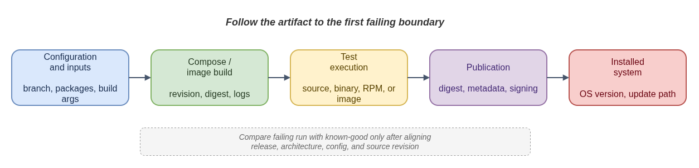

# Tracing a CoreOS Issue Across Repositories

A reported failure can cross several repository boundaries. A node symptom may
originate in configuration, an OS compose, image assembly, a test, publication,
or the update path. Follow the artifact and evidence to find the first failing
boundary before changing code.

- [Diagram source](issue-investigation.drawio)

## Capture the failing context

- Target repository, branch or commit, and issue.
- Release or stream, architecture, and relevant configuration revision.
- Failing job and first failing stage, with the exact error and nearby log lines.
- Artifact identifiers such as a build ID, image digest, package NVR, or
  published metadata entry.

## Follow the lifecycle

| Boundary | Evidence to identify | Common ownership question |
|---|---|---|
| Configuration and inputs | Selected branch, package sources, build arguments, stream settings | Did the build receive the intended inputs? |
| Compose or image build | Build revision, architecture, image digest, build logs | Did the producer create the expected artifact? |
| Test execution | Exact source, binary, RPM, or image under test; plan and test selection | Did CI test the changed artifact or a different installed version? |
| Publication | Artifact digest, metadata, signing or release job result | Was the tested artifact the one published? |
| Installed system and updates | OS version, update stream/channel, client and policy state | Is the symptom in the image, provisioning, or update path? |

For a cross-repository change, trace producer to consumer using immutable
identifiers where available. Compare a failing run with a known-good one only
after aligning release, architecture, configuration, and source revision. A
passing neighboring release is evidence, not proof that its inputs match.

## Close the loop

State what failed first, which artifact was involved, and what evidence links the
symptom to the owning code or configuration. Verify the fix with the relevant
test on the affected branch and artifact path. Mark guide notes as historical
when they describe a particular release or implementation snapshot.

Start from the [issue map](../README.md#working-an-issue), then open only the
relevant project guide and supporting note. For testing questions, see
[Testing and Gating](testing-and-gating.md); for automated dependency updates,
see [Renovate and MintMaker](renovate-and-mintmaker.md).
