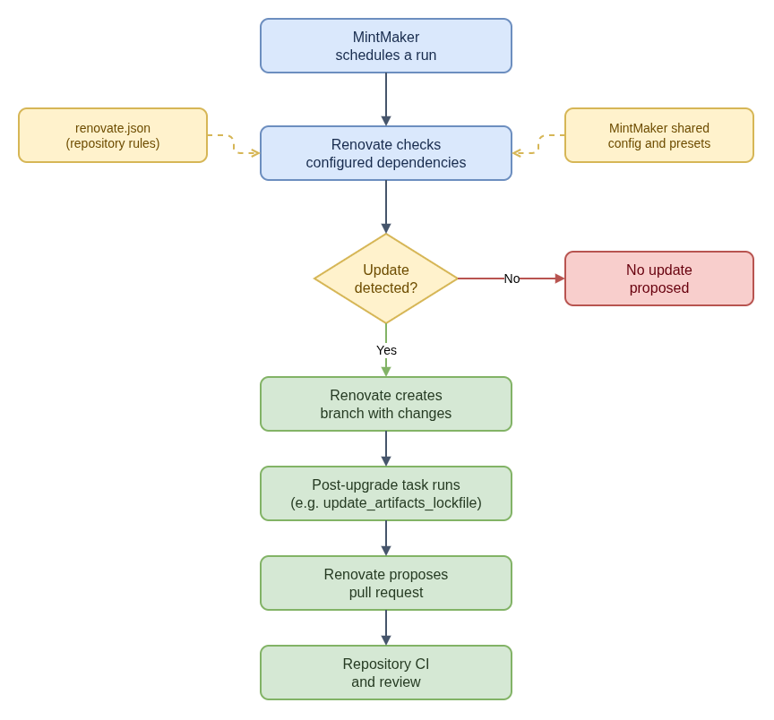

# Renovate and MintMaker in CoreOS Workflows

Renovate and MintMaker work together, but they are not the same component. This
distinction helps locate failures in automated dependency updates across CoreOS
repositories.

| Component | Role | It does not mean |
|---|---|---|
| MintMaker | Konflux's service built on Renovate; schedules and orchestrates runs for configured repository components. | A dependency was updated, built, or approved. |
| Renovate | Reads repository update rules, detects configured dependency changes, and proposes file updates. | The proposed dependency is compatible or the PR passed CI. |
| Renovate execution image | Supplies the runtime and configured tools for a Renovate run and its post-upgrade tasks. | Any arbitrary command is available or allowed. |
| Repository CI and review | Validate the resulting change under that repository's checks and policy. | The automation itself proved the artifact is safe to release. |

- [Diagram source](renovate-and-mintmaker.drawio)

## CoreOS example: artifact checksums

In the `coreos-assembler` artifact-lockfile flow, Renovate updates the declared
OpenShift client artifact URL. A configured post-upgrade task invokes
`update_artifacts_lockfile` in the Renovate execution environment. The helper
uses Renovate's data file to identify lockfiles, downloads the declared
artifacts, and updates their SHA-256 values. Renovate then proposes the result
for the repository's normal CI and review.

This helper handles artifact checksums; the RPM dependency-lockfile workflow is
separate. A successful bot run is also distinct from a successful build, an
approved PR, or a published release.

## Configuration and run boundaries

For a Konflux component, distinguish the repository and branch being processed
from the Renovate rules applied to it. The effective rules can combine the
repository's `renovate.json` on its default branch with MintMaker's shared
configuration and presets; the repository file alone may not explain every
enabled manager or schedule. When behavior differs from the source file, check
the effective configuration and the MintMaker revision deployed by Konflux.

Trace the update in order: component/run scheduling, Renovate dependency
detection, branch changes, configured post-upgrade tasks, pull request, then
repository CI and review. Stop at the first stage without expected evidence.

## Where to look when an update fails

1. If there is no run, check that the repository/branch has a configured
   component and that MintMaker is enabled for it.
2. If Renovate ran but opened no update, check the effective configuration,
   enabled manager, update rules, and run output.
3. If a PR exists, inspect the diff: verify the intended version, URL,
   architecture, and checksum changed together where required.
4. If a post-upgrade task failed, confirm its command, input data file,
   installed tool version, and execution-image policy in the active
   configuration.
5. Read automation output separately from repository CI and review results. One
   does not imply the other.

## CoreOS references

- [COSA dependency-update flow](../projects/coreos-assembler/dependency-update-flow.md)
- [COSA artifact checksum flow](../projects/coreos-assembler/artifact-lockfile-update-flow.md)
- [Automated lockfile workflow](../projects/coreos-assembler/auto-lockfile-updates/README.md)
- [Checksum helper guide](../projects/update-artifacts-lockfile/README.md)
- [COSA Renovate configuration](https://github.com/coreos/coreos-assembler/blob/main/renovate.json)
- [Renovate documentation](https://docs.renovatebot.com/)
- [MintMaker source](https://github.com/konflux-ci/mintmaker)
- [MintMaker dependency-management documentation](https://konflux-ci.dev/docs/mintmaker/user/)
