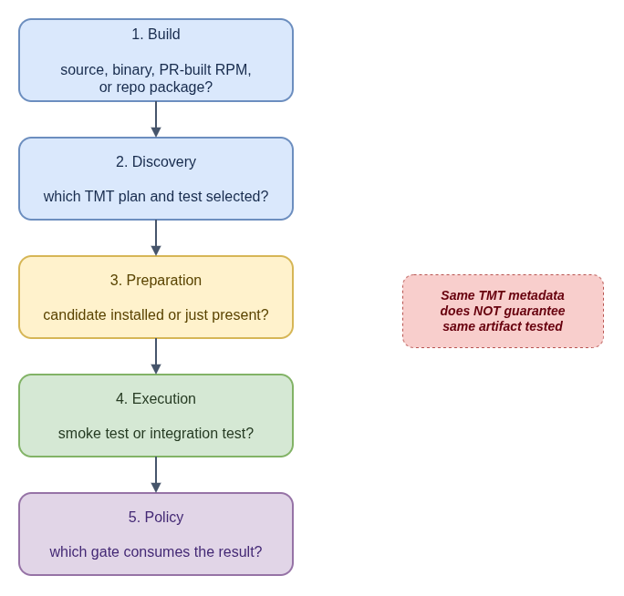

# Testing and Gating Across CoreOS Projects

CI labels such as "tests passed" can describe different checks. To diagnose an
issue, identify the exact artifact that was tested, how it was selected, and
which policy consumes the result.

- [Diagram source](testing-and-gating.drawio)

| Check path | What it establishes | What it does not establish by itself |
|---|---|---|
| Metadata validation, such as `tmt lint` | Test and plan metadata can be parsed and validated. | That a guest was provisioned or a test executed. |
| Source test | The selected test ran against the source or binary configured by that workflow. | That the packaged candidate RPM or release image was tested. |
| Candidate-package test | The configured test ran with a package built for the change. | That every application behavior passed or that the package is approved for release. |
| Downstream gate | Required results were evaluated under the target branch's release policy. | That an absent test, missing result, or waiver means the test passed. |

## Trace the tested artifact

For each job, check:

1. **Build:** Was the test given source code, a locally built binary, a PR-built
   RPM, or a package already present in the test environment's repositories?
2. **Discovery:** Which TMT plan and test were selected? Does `discover` use
   local FMF metadata or fetch tests from another repository?
3. **Preparation:** Does the plan install the candidate artifact or merely check
   that a package with the same name is present?
4. **Execution:** What behavior does the test assert? A version or package
   presence smoke test has a narrower scope than an integration test.
5. **Policy:** Which release or package gate consumes the result? Check required
   results and waivers rather than inferring approval from CI configuration.

GitHub Actions source tests, Packit candidate-RPM jobs, Testing Farm execution,
and downstream gating can be related parts of a workflow, but they are distinct
steps. Reusing the same TMT metadata does not guarantee that each path tests the
same artifact.

## Related guides

- [TMT and FMF course](tmt/README.md)
- [Packit, TMT, and gating across CoreOS repositories](tmt/packit.md)
- [TMT project guide](../projects/tmt-testing/README.md)
- [bootupd build and test flow](../projects/bootupd/README.md)
- [Console login messages build and test flow](../projects/console-login-helper-messages/README.md)
- [Dist-git workflow and gating](../projects/dist-git/README.md)
