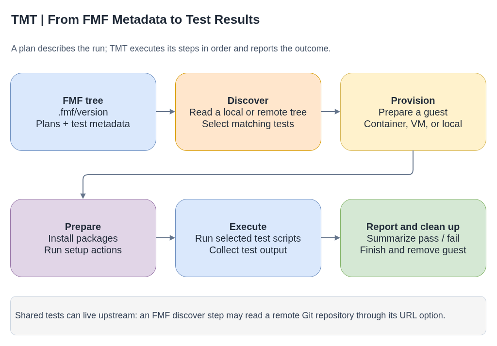
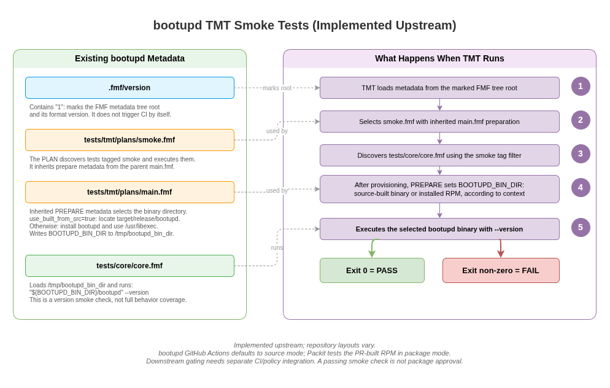

# TMT (Test Management Tool) - Course

TMT is a metadata-driven test tool. It stores test and plan metadata in a Git
repository using FMF (Flexible Metadata Format), then discovers and runs tests
in environments selected by each plan. CI systems can use the resulting test
reports as part of their validation or package-gating workflow.



- [Diagram source](tmt-test-flow.drawio)

FMF provides the metadata format; TMT interprets plans, prepares an execution
environment, runs tests, and reports results.

For how TMT fits into source testing, candidate-package testing, and release
gates, see the [cross-project testing and gating guide](../testing-and-gating.md).

Install:
```bash
dnf install tmt           # preferred
dnf install tmt+provision-container  # optional container provision plugin
dnf install tmt+all       # all packaged features
pip install tmt           # Python installation of the core tool
```

Provisioning methods are plugins. Install the plugin required by a plan using
the packaging instructions for the target operating system.

## The three building blocks



- [Diagram source](tmt-test-structure.drawio)

### 1. `.fmf/version` - the root marker

A file containing just `1`. Like `.git/` marks a git repo, `.fmf/version`
marks an FMF tree. Without it, TMT finds nothing.

```bash
tmt init              # creates .fmf/version automatically
# or manually:
mkdir .fmf
echo 1 > .fmf/version
```

### 2. Tests - what to run

A `.fmf` file with a `test:` key. This is the actual script that gets
executed.

```yaml
# tests/tmt/tests/core/core.fmf
summary: check clhm package is installed
tag:
  - smoke
test: |
  set -xeuo pipefail
  rpm -q console-login-helper-messages
```

Fields:
- `summary:` - human-readable description (shows in TMT output and `tmt lint`)
- `tag:` - labels. `smoke` is the convention for gating tests
- `test:` - shell script. Exit 0 = pass, non-zero = fail

The path doesn't matter to TMT - it scans the whole tree under
`.fmf/version`. But `tests/tmt/tests/core/core.fmf` is the convention.

**Lint rule:** summary must be under 50 characters (warning C001).

### 3. Plans - how to find and run tests

Plans orchestrate the test lifecycle. They have phases:

```yaml
# tests/tmt/plans/smoke.fmf
summary: Basic smoke test
tag:
  - smoke
discover:
  how: fmf
  filter: "tag: smoke"
execute:
  how: tmt
```

```yaml
# tests/tmt/plans/main.fmf
prepare:
  - name: Install console-login-helper-messages package
    how: install
    package: console-login-helper-messages
```

FMF metadata is inherited through the metadata tree. A `main.fmf` can provide
shared parent metadata to a child plan such as `smoke.fmf`; TMT does not
implicitly combine phases from independent sibling plans.

## Plan phases explained

A TMT run has seven steps: `discover`, `provision`, `prepare`, `execute`,
`report`, `finish`, and `cleanup`. Plans commonly configure the first four;
TMT supplies defaults for the remaining steps unless a workflow needs to
customize them.

### `prepare:` - set up the environment

Runs before tests. Installs packages, creates files, runs setup
scripts.

```yaml
prepare:
  - name: Install the package
    how: install              # TMT's built-in package manager
    package: my-package       # uses dnf/yum in the test env
  - name: Run a setup script
    how: shell
    script: |
      echo "SOME_VAR=value" > /tmp/config
```

`how: install` - TMT handles the package manager.
`how: shell` - run arbitrary commands.

### `discover:` - find the tests

Tells TMT where to look for test `.fmf` files.

```yaml
# Local (scan this repo)
discover:
  how: fmf
  filter: "tag: smoke"

# Remote (scan another repo - used in dist-git)
discover:
  - name: Upstream tests
    how: fmf
    url: https://github.com/coreos/console-login-helper-messages.git
    filter: 'tag: smoke'
```

`how: fmf` - scan `.fmf` files from the FMF root.
`url:` - clone a remote repo and scan there (used in dist-git plans).
`filter:` - only run tests matching this expression.

### `execute:` - run the tests

```yaml
execute:
  how: tmt
```

Almost always `how: tmt`. This is TMT's built-in executor - runs each
test's `test:` script and collects results.

### `report:`, `finish:`, `cleanup:`

These steps summarize results, run optional finishing actions, and remove
provisioned guests. They are usually handled by TMT defaults.

## How plans and tests connect

```
Plan (smoke.fmf)                    Test (core.fmf)
+---------------------+             +----------------------+
| discover:            |   finds    | tag:                  |
|   how: fmf           |---------->|   - smoke             |
|   filter: "tag:smoke"|            | test: |               |
| execute:             |   runs     |   rpm -q my-package   |
|   how: tmt           |---------->|                       |
+---------------------+             +----------------------+
```

The plan's `filter: "tag: smoke"` matches tests that have `tag: [smoke]`.
The plan's `execute: how: tmt` runs the matched test's `test:` script.

## Running TMT locally

### Validate your structure

```bash
tmt tests ls       # list discovered tests
tmt plans ls       # list discovered plans
tmt lint           # check for errors/warnings
```

### Run tests

```bash
# Run all plans in a container
tmt run --all provision --how container

# With verbose output (IMPORTANT - see "Verbosity" section below)
tmt run --all --debug -vvvv provision --how container

# Run only smoke-tagged plans
tmt run --all plan --filter 'tag: smoke' provision --how container

# Use a specific image
tmt run --all provision --how container --image fedora:latest

# Run locally only when you trust the tests
tmt --allow-unsafe-behavior=provision/local run --all provision --how local
```

`provision --how container` - TMT spins up a podman container, runs
everything inside it, then tears it down.

### TDD cycle

1. Add `.fmf/version` + test file only (no plan yet)
   ```bash
   tmt tests ls    # should show the test
   tmt plans ls    # empty - no plans yet
   ```

2. Add the plan files
   ```bash
   tmt plans ls    # should show the plans
   tmt run --all provision --how container   # will fail
   # (package not in the container's repos -> rpm -q fails)
   ```

3. Add `prepare: how: install` to `main.fmf`
   ```bash
   tmt run --all provision --how container   # should pass
   ```

## Verbosity - `--debug -vvvv`

Use `--debug -vvvv` when detailed CI logs are useful. Without verbose output,
the default summary may not show every discovery and execution detail.

What each flag adds:

**`-vvvv` (verbose level 4)** - user-facing detail:
- Plan discovery (`Found 1 plan.`)
- Test selection (`summary: 1 test selected`)
- Provisioning details (`distro: Fedora Linux 44`, `arch: x86_64`)
- Actual test output (`stdout: console-login-helper-messages-0.21.3-13.fc44.noarch`)
- Pass/fail results (`00:00:00 pass /tests/tmt/tests/core/core (on default-0) [1/1]`)
- Final summary (`total: 1 test passed`)

**`--debug`** - diagnostic detail:
- `Workdir '...' created.` messages
- Queue management (`provision.provision queue: added task: default-0`)
- Connection attempts (`wait: waiting for condition 'try_whoami'`)
- Plugin diagnostics (`Command 'bootc status' produced no usable output.`)

Use verbosity appropriate to the CI log size and the detail needed to confirm
test discovery, execution, and results.

### Example CI output (with --debug -vvvv)

```
Found 1 plan.

/tests/tmt/plans/smoke
summary: Basic smoke test
    discover
        summary: 1 test selected
            /tests/tmt/tests/core/core
    provision
        how: container
        distro: Fedora Linux 44 (Container Image)
        summary: 1 guest provisioned
    prepare
        prepare task #2: Install console-login-helper-messages package
            cmd: dnf5 install -y console-login-helper-messages
            stdout: console-login-helper-messages-0.21.3-13.fc44.noarch
        summary: 2 preparations applied
    execute
        /tests/tmt/tests/core/core [1/1]
            cmd:
                set -xeuo pipefail
                rpm -q console-login-helper-messages
            stdout: console-login-helper-messages-0.21.3-13.fc44.noarch
                00:00:00 pass /tests/tmt/tests/core/core (on default-0) [1/1]
        summary: 1 test executed
    report
        summary: 1 test passed

total: 1 test passed
```

(Simplified; higher debug levels include additional diagnostic output.)

## GitHub Actions metadata validation

This example checks FMF metadata with `tmt lint`. It does not provision a test
guest; install and configure the provision plugin needed by a test-execution
workflow separately.

```yaml
name: Validate TMT metadata

on:
  push:
  pull_request:

permissions:
  contents: read

jobs:
  lint:
    runs-on: ubuntu-latest
    steps:
      - uses: actions/checkout@v4
      - uses: actions/setup-python@v5
        with:
          python-version: "3.x"
      - name: Install TMT
        run: |
          python -m pip install --user tmt
          echo "$HOME/.local/bin" >> "$GITHUB_PATH"
      - name: Lint metadata
        run: tmt lint
```

## CI execution environments

TMT plans can run in different environments depending on the type of test:

| Environment | Typical use | Configuration |
|---|---|---|
| GitHub Actions | Metadata checks and repository-level tests | Workflow YAML |
| Testing Farm | Provisioned virtual or physical machines | Test request and TMT plan |
| Tekton pipelines, including Konflux | Container builds and multi-architecture integration tests | Pipeline YAML and service configuration |

The environment does not change the FMF test metadata. It determines how the
plan provisions its guest and how the surrounding CI system consumes results.

## The two-layer pattern - upstream + dist-git

One package-testing pattern keeps test definitions upstream and stores a
distribution-specific plan in dist-git:

### Upstream (GitHub) - tests + plans

```
.fmf/version                          # FMF root marker
tests/tmt/plans/smoke.fmf             # discover + execute
tests/tmt/plans/main.fmf              # prepare (install pkg)
tests/tmt/tests/core/core.fmf         # the actual test
```

### Dist-git (GitLab) - plans that discover from upstream

```
.fmf/version                          # separate FMF root
tests/tmt/plans/smoke.fmf             # discover from upstream url:
tests/tmt/plans/main.fmf              # prepare (install RPM)
```

The dist-git `smoke.fmf` uses `discover.url` to fetch tests from the
upstream GitHub repo at test time:

```yaml
discover:
  - name: Upstream tests
    how: fmf
    url: https://github.com/coreos/console-login-helper-messages.git
    filter: 'tag: smoke'
```

No test code is duplicated. Tests live upstream, dist-git just points
to them.

## How test structure varies across CoreOS repos

There's no single standard. Each repo has a slightly different layout:

| Repo | Test location | main.fmf complexity | Why |
|---|---|---|---|
| ignition | `tests/tmt/tests/core/` | Complex (`use_built_from_src`) | Compiled binary, needs path setup |
| afterburn | `tests/core/` (outside tmt/) | Complex (same pattern) | Compiled binary |
| butane | No test file | Complex (same pattern) | Compiled binary |
| coreos-installer | `tests/core/` | Complex (same pattern) | Compiled binary |
| **CLHM** | `tests/tmt/tests/core/` | **Simple** (just `how: install`) | Shell scripts, no binary |

Compiled-binary repos use `when:` conditionals in `main.fmf` to handle
two scenarios: test against installed RPM vs locally built binary. Their
smoke test runs `binary --version`, so prepare needs to know where the
binary is.

For a package made up of shell scripts, a smoke test can verify that the
package is installed without locating a compiled binary.

## Example repository layout

```
example-package/
  .fmf/
    version                            # "1"
  .github/
    workflows/
      validate-tmt.yml                 # CI: validate FMF metadata
  tests/
    tmt/
      plans/
        smoke.fmf                      # discover and execute smoke tests
        main.fmf                       # prepare the test environment
      tests/
        core/
          core.fmf                     # test metadata and script
```

## Useful commands

```bash
tmt init                                # create .fmf/version
tmt tests ls                            # list discovered tests
tmt plans ls                            # list discovered plans
tmt lint                                # validate structure
tmt run --all --debug -vvvv provision --how container   # run everything
tmt run discover                        # run discovery only; this is not a dry run
tmt test create --template shell /tests/smoke   # scaffold a test
tmt plan create --template mini /plans/smoke    # scaffold a plan
```

`tmt run discover` may create local run state and fetch remote metadata. Use
`tmt run --dry` to inspect planned steps; dry mode can still create or modify a
local workdir. `tmt clean runs` removes saved run workdirs when no longer needed.

## Docs

- TMT: https://tmt.readthedocs.io/
- FMF: https://fmf.readthedocs.io/
- Plan spec (phases): https://tmt.readthedocs.io/en/stable/spec/plans.html
- GitHub Actions: https://docs.github.com/en/actions

## Verification

### Locally

```bash
tmt lint                   # no errors
tmt tests ls               # shows your test(s)
tmt plans ls               # shows your plan(s)
tmt run --all --debug -vvvv provision --how container
# look for: "total: N test passed"
```

### In CI

Confirm that metadata validation succeeds. For a test-execution job, also
confirm that the required provision plugin is installed, the selected plan
discovers the expected tests, and the report records their results.

### Downstream package gating

A package build pipeline can use TMT results as a gate when it integrates a
TMT plan. The exact integration and result display depend on the distribution's
public packaging and testing documentation.
