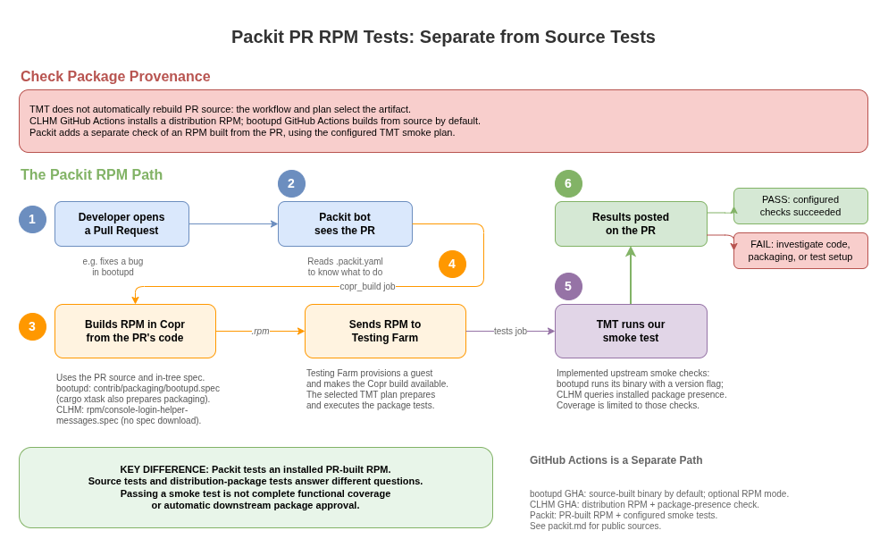

# Packit, TMT, and gating across CoreOS repos

Earlier proposals are superseded: CLHM and bootupd now have Packit PR testing on
`main`.

For the shared mental model across test artifacts and release gates, see
[Testing and Gating Across CoreOS Projects](../testing-and-gating.md).

## First ask which artifact is tested



- [Diagram source](packit-pr-testing.drawio)

**TMT runs tests; it does not automatically rebuild the pull request.** The
workflow, plan context, and package repositories determine the tested artifact.

- **CLHM GitHub Actions:** `tmt-tests.yml` runs a container plan whose prepare
  step installs `console-login-helper-messages` from the guest's repositories.
  The `rpm -q` smoke test checks package presence, not installation of PR code.
  This exercises metadata and provisioning, but is not a PR-source RPM test.
- **bootupd GitHub Actions:** the default `use_built_from_src=true` path runs
  `cargo build --release`, then TMT executes that binary. A manually selected
  package mode instead installs the distribution RPM. Source tests can test PR
  content without Packit; they do not validate the installed PR RPM.
- **Packit PR RPM tests:** `copr_build` builds an RPM from the PR source, then
  `tests` asks Testing Farm to run the selected TMT plan against that build.
  CLHM checks package presence; bootupd runs its `--version` smoke test. Neither
  smoke test proves all application behavior is correct.

GitHub Actions/source testing and Packit RPM testing are separate CI paths,
even when they reuse FMF metadata. See the [TMT guide](README.md),
[CLHM guide](../../projects/console-login-helper-messages/README.md), and
[bootupd guide](../../projects/bootupd/README.md).

## Current Packit configuration

| Repository | Spec used by Packit | Configured jobs |
|---|---|---|
| console-login-helper-messages (CLHM) | In-tree `rpm/console-login-helper-messages.spec` | PR `copr_build` + `tests`; release `propose_downstream` |
| bootupd | In-tree `contrib/packaging/bootupd.spec` | PR `copr_build` + `tests` |
| afterburn | Fetches `rust-afterburn.spec` from Fedora dist-git | Release `propose_downstream`; commit `koji_build` + `bodhi_update` |
| coreos-installer | Fetches `rust-coreos-installer.spec` from Fedora dist-git | Release `propose_downstream`; commit `koji_build` + `bodhi_update` |

The bootupd TMT plans, smoke test, and GitHub Actions workflow are implemented
upstream, not "coming in PR #1003". Configuration present in a repository is
not evidence that every external CI deployment or downstream gate is enabled.

## Spec handling: two real patterns

Packit needs an RPM spec to build an SRPM. CLHM and bootupd use specs already
tracked upstream. bootupd's `create-archive` action also runs `cargo xtask spec`
and copies generated packaging artifacts from `target/` into
`contrib/packaging/`; it does not fetch the spec from Fedora dist-git.

This excerpt from CLHM's current configuration shows the in-tree shell-package
pattern (the upstream file also includes targets and a release job):

```yaml
downstream_package_name: console-login-helper-messages
specfile_path: rpm/console-login-helper-messages.spec
jobs:
  - job: copr_build
    trigger: pull_request
    targets:
      - fedora-rawhide-x86_64
  - job: tests
    trigger: pull_request
    targets:
      - fedora-rawhide-x86_64
    tmt_plan: /tests/tmt/plans/smoke
```

Fetching a spec remains a valid alternative used by afterburn and
coreos-installer. It is **not** the current CLHM implementation. For example,
this is the spec-fetching portion of afterburn's public configuration:

```yaml
packages:
  afterburn-fedora:
    specfile_path: rust-afterburn.spec
    downstream_package_name: rust-afterburn
    actions:
      post-upstream-clone:
        - wget https://src.fedoraproject.org/rpms/rust-afterburn/raw/rawhide/f/rust-afterburn.spec
```

## Testing, release automation, and gating are different

- **PR testing:** pre-merge checks of source or a PR-built RPM. Packit's
  `copr_build` + `tests` is the RPM path used by CLHM and bootupd.
- **Release automation:** moving an upstream release into distribution
  packaging, submitting Koji builds, and creating Bodhi updates. The presence
  of `.packit.yaml` alone does not imply PR tests are configured.
- **Downstream gating:** a distribution's release policy consumes required CI
  results for a package build or update. A dist-git plan can discover public
  upstream tests with `discover.url`, while CI supplies the candidate RPM.
  Adding upstream tests alone does not configure downstream enforcement.

**No TMT tests does not automatically mean "package approved."** A package may
be ungated, require other checks, have missing required results, or need a
waiver. Inspect the actual downstream policy and recorded decision rather than
inferring approval from an absent test directory.

Packit also documents a default **installability test** when a configured
`tests` job has no FMF metadata. That is a real, limited check, not an automatic
pass or a downstream release-policy decision.

## Public sources

- [CLHM Packit configuration](https://github.com/coreos/console-login-helper-messages/blob/main/.packit.yaml) and [in-tree spec](https://github.com/coreos/console-login-helper-messages/blob/main/rpm/console-login-helper-messages.spec)
- [CLHM GitHub Actions](https://github.com/coreos/console-login-helper-messages/blob/main/.github/workflows/tmt-tests.yml) and [TMT plans/tests](https://github.com/coreos/console-login-helper-messages/tree/main/tests/tmt)
- [bootupd Packit configuration](https://github.com/coreos/bootupd/blob/main/.packit.yaml) and [in-tree spec](https://github.com/coreos/bootupd/blob/main/contrib/packaging/bootupd.spec)
- [bootupd GitHub Actions](https://github.com/coreos/bootupd/blob/main/.github/workflows/tmt-tests.yml), [prepare metadata](https://github.com/coreos/bootupd/blob/main/tests/tmt/plans/main.fmf), and [smoke test](https://github.com/coreos/bootupd/blob/main/tests/core/core.fmf)
- [afterburn Packit configuration](https://github.com/coreos/afterburn/blob/main/.packit.yaml)
- [coreos-installer Packit configuration](https://github.com/coreos/coreos-installer/blob/main/.packit.yaml)
- [Packit configuration guide](https://packit.dev/docs/configuration) and [tests job guide](https://packit.dev/docs/configuration/upstream/tests)
- [Fedora package-maintenance guide](../../projects/fedora-packaging/README.md) and [Fedora gating documentation](https://docs.fedoraproject.org/en-US/ci/gating/)
