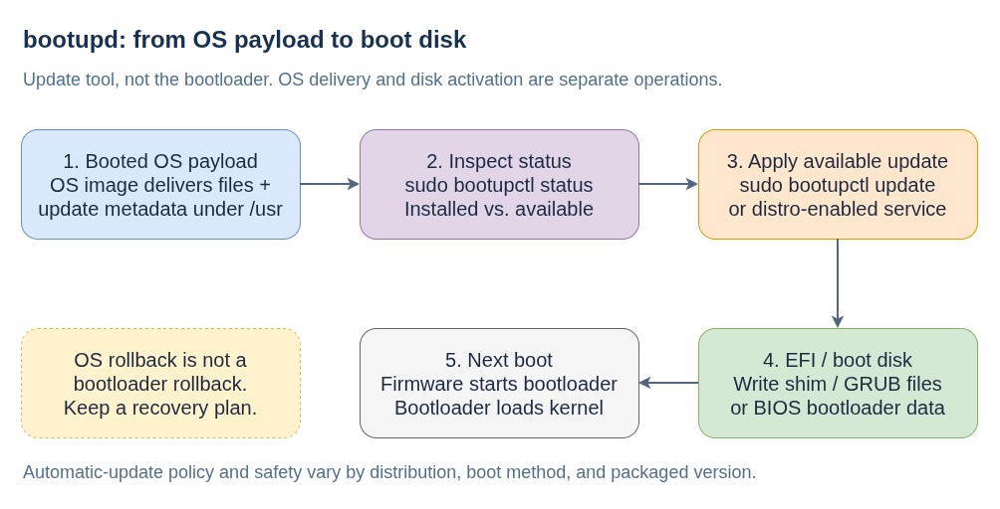
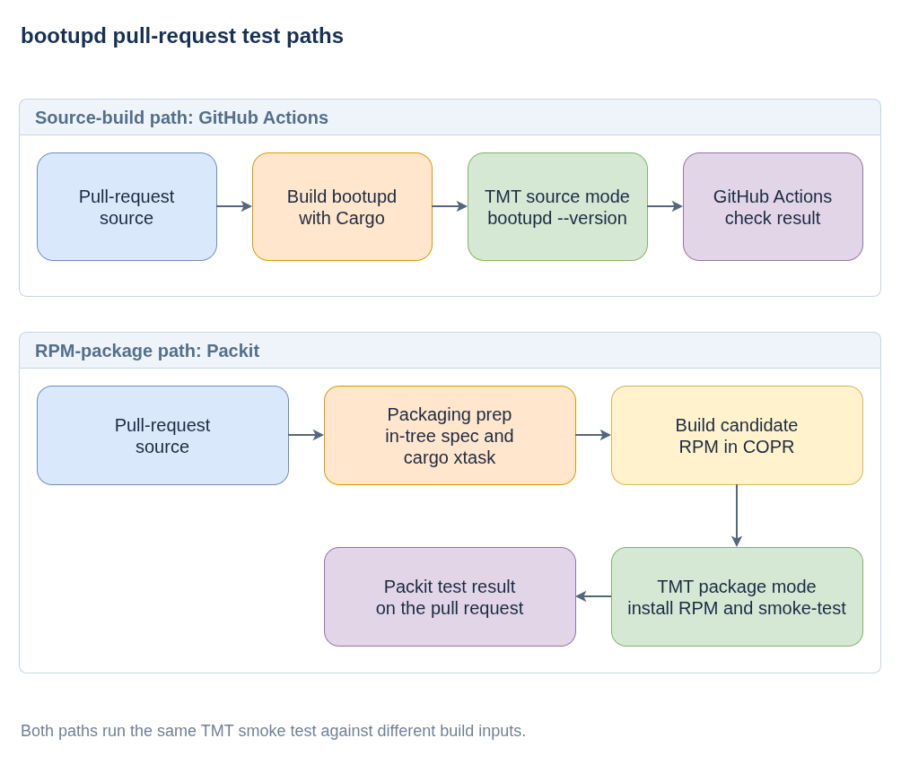

# bootupd: Bootloader Updates

**Plain-language companion:** [ELI15](eli15.md)

`bootupd` is a userspace tool for installing and updating bootloader data on supported systems, including CoreOS and bootc images. It is **not the bootloader**: GRUB and shim are examples of the software it manages. It is also not a BIOS/UEFI firmware updater, a kernel updater, or a kernel-argument manager.

## Where it fits in boot

In a typical GRUB/shim-based UEFI installation, firmware starts an EFI executable on the EFI System Partition (ESP), shim participates in the Secure Boot trust chain, and GRUB loads the selected kernel. A BIOS installation uses bootloader code written to the boot disk instead. `bootupd` runs inside Linux to maintain that earlier part of the boot chain; it does not replace the firmware, GRUB, or the kernel.

This separation matters on image-based systems. An OS deployment can update the kernel and userspace without replacing the bootloader already stored on the ESP or in BIOS boot areas. Bootloader fixes, including security fixes, therefore need their own disk-update mechanism. Hardware firmware updates and Secure Boot database updates are separate concerns; see the [upstream scope and project relationships](https://github.com/coreos/bootupd/blob/main/README.md).

## Payload delivery and disk activation



- [Diagram source](bootupd-update-lifecycle.drawio)

[Editable lifecycle diagram](bootupd-update-lifecycle.drawio)

1. **The OS delivers an available update.** The image build includes bootloader files and component metadata under `/usr`. For example, bootupd reads update metadata from `/usr/lib/bootupd/updates/`; the current EFI backend can obtain the files from `/usr/lib/efi/` or from the bootupd payload directory, depending on the image layout. Installing a new OS deployment delivers this content, but delivery alone is not a write to the boot disk. Runtime updates use the payload in the **booted OS**, not merely a downloaded or staged future deployment.
2. **Status distinguishes the two versions.** `bootupctl status` compares bootupd's recorded installed component state with the payload available in that OS. A newer shim or GRUB package in the OS is not, by itself, proof that the disk's bootloader was updated.
3. **A separate operation applies it.** `bootupctl update`, or distribution automation invoking it, writes the applicable bootloader data to the ESP or boot disk and records the new installed state. This is activation on disk, outside the OS deployment. The tool skips components that are already current rather than rewriting them on every OS update.
4. **The next boot uses the changed bootloader.** Updating those files does not replace the running kernel, switch the running OS deployment, or itself reboot the machine. The firmware encounters the updated bootloader on a subsequent boot.

These steps follow the public [component interface](https://github.com/coreos/bootupd/blob/main/src/component.rs), [runtime update/status implementation](https://github.com/coreos/bootupd/blob/main/src/bootupd.rs), and [EFI](https://github.com/coreos/bootupd/blob/main/src/efi.rs) and [BIOS](https://github.com/coreos/bootupd/blob/main/src/bios.rs) backends. The payload layout is an image integration detail, not a directory administrators should copy into the ESP by hand.

## Integration depends on the image

On the usual GRUB/shim-based bootc images that include bootupd, `bootc install` delegates initial bootloader installation to `bootupctl backend install`. That is different from updating an already installed host. The current [bootc bootloader documentation](https://github.com/bootc-dev/bootc/blob/main/docs/src/bootc-bootloaders.7.md) explicitly says bootc does not itself automatically run `bootupctl update` after installation. Post-install updates need a separate manual operation or an enabled service supplied by the image/distribution. Other bootloader configurations and architectures have different integration.

For example, the current [FCOS bootloader-update documentation](https://github.com/coreos/fedora-coreos-docs/blob/main/modules/ROOT/pages/bootloader-updates.adoc) describes automatic updates through `bootloader-update.service`, as well as manual updates. The upstream [service](https://github.com/coreos/bootupd/blob/main/systemd/bootloader-update.service) is a boot-time oneshot that runs `bootupctl update`, not a permanently running update daemon. Do not infer the same default from the presence of the bootupd RPM on another distribution, an older image, or a customized bootc image: check its documentation, packaged version, and systemd presets.

## Inspecting and updating a host

On an installed host, inspect before changing anything:

```bash
sudo bootupctl status
```

Read `Installed` as the component version recorded for the boot disk and `Update` as the comparison with the available OS payload. `At latest version` does not mean the tool checked an upstream download server for a newer GRUB release. On a build container, the current CLI reports available components instead of the installed host's disk state, so inspect the actual target host.

If a manual update is needed, follow the distribution's instructions and prepare the recovery access described below before running:

```bash
sudo bootupctl update
sudo bootupctl status
```

The current host CLI requires root privileges, including for status, and update operations need access to the real boot storage. Older installations may need an adoption step before bootupd can track their existing bootloader. If status reports an `Adoptable` component, consult the distribution's adoption guidance; the documented FCOS command is `sudo bootupctl adopt-and-update`. Do not treat every existing boot partition as already managed. For automated FCOS updates, inspect the service log with `sudo journalctl -b -u bootloader-update.service`.

## Safety and recovery limits

- **OS rollback is not bootloader rollback.** The bootloader is shared disk state outside the versioned OS deployment. Rolling back the root filesystem does not automatically restore the previous shim, GRUB, or BIOS boot code.
- **Power-failure safety depends on the update path and version.** Current upstream considers its UEFI update path safe against power failures, but explicitly does not give that assurance for BIOS and other paths. Do not extend a statement about current upstream to every older packaged release or storage setup.
- **A completed write is not proof of a successful future boot.** Upstream still does not provide automatic recovery from a buggy new bootloader that cannot boot the machine. Secure Boot compatibility also matters; do not casually bypass the packaged tool's safety checks.
- **Temporary staging is not a retained backup.** The current EFI updater stages changes, exchanges them into place, synchronizes storage, and cleans up temporary copies. Some GRUB configuration migrations create backup files, but these are not a full backup of the ESP, partition layout, or boot disk. Before manual changes, have an appropriate boot-media backup and a usable console/rescue path, especially on bare metal. Bootupd is not a backup or firmware recovery tool.

See the [upstream safety status](https://github.com/coreos/bootupd/blob/main/README.md#status) and [EFI file-update implementation](https://github.com/coreos/bootupd/blob/main/src/filetree.rs). Deployed distributions may ship different versions and policies.

## Pull-request validation

Its public test setup checks both the source-built program and the RPM produced from a pull request, so a successful smoke test is not limited to an unrelated prebuilt package.



- [Diagram source](bootupd-test-flows.drawio)

The source-build path uses GitHub Actions to build `bootupd` with Cargo and run the TMT smoke plan against that binary. The Packit path uses the repository's packaging configuration and in-tree spec to build an RPM, then runs the same smoke plan against the installed candidate package. In both modes, the test invokes `bootupd --version`.

The TMT plan selects source or installed-package preparation through its context, while the smoke test remains the same. This keeps the test focused on whether the selected binary/package can execute, rather than on bootloader changes in a running system.

The linked Packit configuration lists Fedora Rawhide and CentOS Stream 10 for its pull-request build and test jobs. Targets and job definitions can change; consult the configuration for the current setup.

## Public references

- [Upstream source repository](https://github.com/coreos/bootupd)
- [bootc bootloader integration](https://github.com/bootc-dev/bootc/blob/main/docs/src/bootc-bootloaders.7.md)
- [FCOS bootloader updates (documentation source)](https://github.com/coreos/fedora-coreos-docs/blob/main/modules/ROOT/pages/bootloader-updates.adoc)
- [bootupctl commands and privilege handling](https://github.com/coreos/bootupd/blob/main/src/cli/bootupctl.rs)
- [Packit configuration](https://github.com/coreos/bootupd/blob/main/.packit.yaml)
- [TMT preparation plan](https://github.com/coreos/bootupd/blob/main/tests/tmt/plans/main.fmf)
- [TMT smoke test](https://github.com/coreos/bootupd/blob/main/tests/core/core.fmf)
- [TMT documentation](https://tmt.readthedocs.io/)
