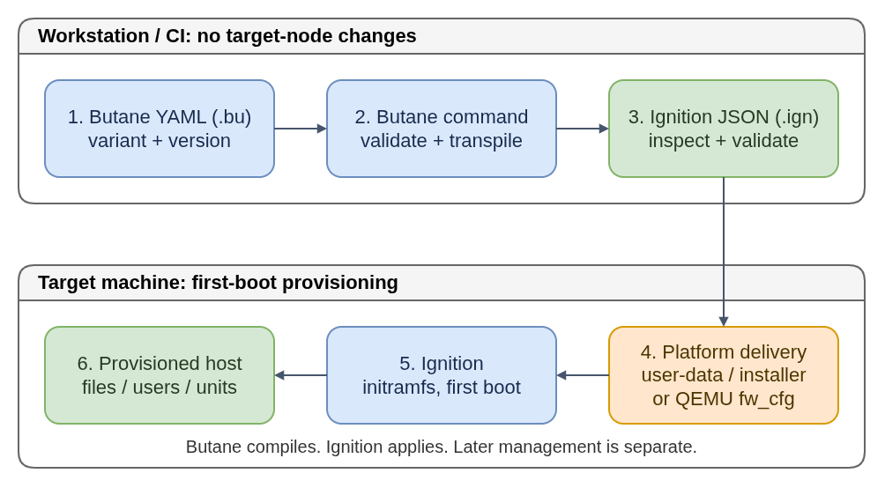

# Butane: Authoring First-Boot Configuration

Schema versions in examples are pinned and are not recommendations to use the
latest schema version.

Butane lets you describe a machine's initial configuration in readable YAML:
which files, users, storage layouts, and systemd units should exist. It validates
that description and transpiles it into the machine-readable Ignition format.
Think of it as a configuration compiler, not a program that configures a host.

In the workflow here, the `butane` command runs on a workstation or in CI, **not
on the target node**. Ignition later applies the generated JSON during first boot.
Changing the YAML alone changes neither an existing machine nor an OS image.

**Plain-language companion:** [ELI15](eli15.md)



- [Diagram source](butane-config-lifecycle.drawio)

[Editable diagram source](butane-config-lifecycle.drawio). The PNG also embeds the diagram.

## Component Boundaries

| Component | Responsibility |
|---|---|
| Butane | Validate an authoring schema and translate its conveniences into provisioning data. |
| Ignition | Apply that data in the target machine's first-boot initramfs. |
| coreos-installer / platform tooling | Install or launch an OS image and arrange delivery of the first-boot config. |
| CoreOS Assembler (COSA) / OSBuild | Build OS trees and boot artifacts; Butane does not compose an operating system. |
| Machine Config Operator (MCO) / other host management | Coordinate supported post-boot changes; Butane is not a reconciliation agent. |

The `openshift` variant can produce a **MachineConfig** containing Ignition
configuration, rather than a standalone Ignition document. MCO owns applying
supported MachineConfig changes to managed nodes. Do not interchange that
wrapper, an FCOS config, and installation-time OpenShift-generated configs.

## Variant And Version

`variant` selects the operating-system schema, such as `fcos` or `openshift`.
`version` selects a specific revision of that **Butane configuration schema**.
Together they determine accepted fields, distribution-specific shortcuts, and
the generated Ignition schema. They are not the Butane executable's version,
and an FCOS schema number is not a Fedora release number.

For example, the documented pair `variant: fcos` and `version: 1.6.0` generates
Ignition `3.5.0`. This is a deliberately pinned example, **not a claim about the
latest version**. Use a stable schema supported by your Butane tool and by the
Ignition included in the target OS image; do not merely increase the number.

Validation is more than parsing YAML: valid indentation does not make unknown
fields, incompatible variants, duplicate paths, or invalid values acceptable.
`--strict` makes warnings fatal; `--pretty` only formats the generated output.
It does not prove that a disk exists, a remote URL is reachable, or a service works.

## Logical Lifecycle

1. Choose the target OS, supported schema, and platform delivery method.
2. Write and review the YAML. Inline text and local files are authoring inputs;
   `--files-dir` supplies the base directory for supported local-file references.
3. Run Butane. It validates the selected variant/version and transpiles YAML
   fields, file contents, and shortcuts into Ignition JSON primitives.
4. Validate and inspect the output, then supply it through the platform's
   documented mechanism, such as user-data, QEMU `fw_cfg`, or an installer.
5. Boot a fresh machine. Ignition performs provisioning; the normal host systemd
   subsequently starts services. Later reboots do not replay the original config.

Local contents are embedded at transpilation time. By contrast, a remote
`contents.source` or `ignition.config.merge.source` remains a reference for
Ignition to fetch at boot. That distinction affects availability and trust.

Upstream Ignition also documents native Butane-YAML input. Support depends on
the Ignition shipped in your target image; this guide deliberately uses explicit
**off-node transpilation and JSON delivery**, not a Butane node agent.

## Safe Example

This `marker.bu` only requests a new text file in writable `/etc`. It changes no
partition table, access policy, or service. It is not a complete login config.
For a boot exercise, use a fresh disposable FCOS VM and arrange authorized access
separately using the platform's documentation.

```yaml
variant: fcos
version: 1.6.0
storage:
  files:
    - path: /etc/field-guide.txt
      mode: 0644
      contents:
        inline: |
          Provisioned on first boot.
```

With compatible `butane` and `ignition-validate` tools installed, run locally:

```bash
butane --strict --pretty marker.bu > marker.ign.tmp && \
  ignition-validate marker.ign.tmp && \
  mv marker.ign.tmp marker.ign
```

Only a successful transpilation and validation replaces `marker.ign`. These
commands do not create `/etc/field-guide.txt` on the workstation. The JSON uses
`ignition.version: "3.5.0"`, a data URL for the inline text, and decimal mode
`420`, equivalent to YAML's octal `0644`.

## Pitfalls

- Do not deliver an OpenShift MachineConfig wrapper where raw Ignition JSON is expected.
- Do not hand-edit generated JSON to fix a YAML mistake; fix the source and regenerate it.
- YAML `0644` and JSON `644` are different permission values; let Butane translate modes.
- Treat YAML, embedded files, and generated JSON as sensitive. Encoding is not encryption; avoid private keys and credentials in public Git or instance metadata.
- Wipe flags and disk-layout shortcuts can destroy data when Ignition applies them. Validation is not a safety audit; review device identities and test on disposable disks.
- Writing a systemd unit does not run it during transpilation. Enabling it also requires a suitable `[Install]` section and correct runtime dependencies.
- Boot-time remote fetches need early networking. A network keyfile inside the config cannot provide the connectivity needed to fetch that same config.

## Related Guides

- [Ignition](../ignition/README.md): the runtime provisioning side of the handoff.
- [CoreOS ecosystem](../../getting-started/02-coreos-ecosystem.md): filesystems, boot, and post-boot management.
- [OpenShift, RHEL, and RHCOS](../../getting-started/03-ocp-rhel-rhcos.md): why managed-node configuration differs from standalone FCOS.
- [CoreOS Assembler](../coreos-assembler/README.md): building the OS rather than configuring one instance.

## Primary Sources

- [Butane getting started](https://coreos.github.io/butane/getting-started/): authoring and transpilation commands.
- [Schema variants and Butane-to-Ignition version mapping](https://coreos.github.io/butane/specs/).
- [FCOS schema 1.6.0](https://coreos.github.io/butane/config-fcos-v1_6/): fields and Ignition 3.5.0 output.
- [OpenShift schema 4.19.0](https://coreos.github.io/butane/config-openshift-v4_19/): a documented MachineConfig-output example, not a latest-release claim.
- [Ignition getting started](https://coreos.github.io/ignition/getting-started/): validation, delivery, and YAML-input support.
- [FCOS configuration workflow, upstream documentation source](https://github.com/coreos/fedora-coreos-docs/blob/main/modules/ROOT/pages/producing-ign.adoc).
