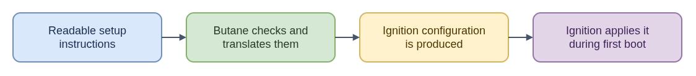

# ELI15: Butane, the First-Boot Configuration Translator

[Technical guide: Butane](README.md)

Butane is a translator for describing a machine's initial setup in readable YAML. Think of it as turning a carefully checked checklist into a format the boot-time setup system can understand. Its inputs include a chosen operating-system variant and schema version, plus requested files, users, storage, and service-unit settings. It validates those choices and produces Ignition configuration; supported local file contents can be folded into that output.

That output is a plan, not a changed computer. Butane normally runs on a workstation or in CI. Ignition on a target machine applies the generated configuration during first boot. Butane does not build the operating system, install it, or keep reconciling a machine after boot. A valid document also cannot prove a disk is safe, a remote source reachable, or a service healthy.

For CoreOS issue work, this split helps locate the failure: check authoring and schema translation when generation is wrong; check delivery and Ignition when a fresh machine is wrong; check host-management systems for later changes. Both Butane and the target image must support the chosen schema.

- [Diagram source](eli15-flow.drawio)
