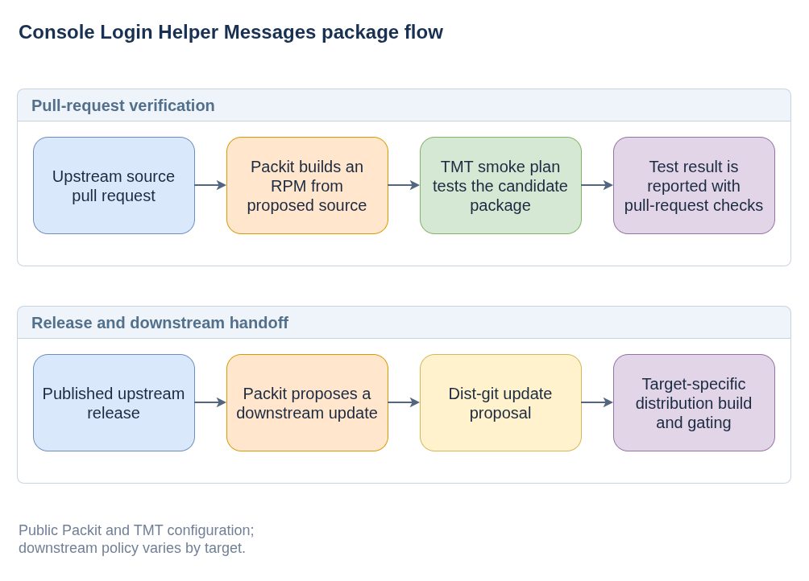

# Console Login Helper Messages

**Plain-language companion:** [ELI15](eli15.md)

`console-login-helper-messages` (CLHM) provides shell scripts and systemd integration for showing system information at login. On a headless CoreOS machine, a local or serial console can tell an operator how to reach the machine, which OS is running, and whether systemd has failed units, without needing a desktop environment.

It is a message-producing component, not a login/authentication service or a system repair agent. It does not configure networking, create login users, or fix failed units. Its [upstream manual](https://github.com/coreos/console-login-helper-messages/blob/main/doc/manual.md) separates three display mechanisms: pre-login `issue` snippets, post-login MOTD snippets, and an interactive shell profile hook.

## What the messages mean

| Display point | Information | How it is produced and displayed |
| --- | --- | --- |
| Console, before login | SSH **host-key fingerprints** | A oneshot systemd service runs after `sshd-keygen.target`. The helper uses `ssh-keygen -l` on host keys and writes fingerprints to an issue snippet, which `agetty` displays. It does not print private key material or a user's authorized keys. |
| Console, before login | Network interface addresses | NetworkManager's dispatcher calls a helper on interface `up` and `down` events. It creates/removes per-interface issue snippets and asks `agetty` to reload them. |
| At login | OS release name | A oneshot service reads `PRETTY_NAME` and `ANSI_COLOR` from `/usr/lib/os-release` and writes a MOTD snippet. The configured `login`/PAM message reader displays it. |
| Interactive shell startup | Failed systemd units | The profile hook queries `systemctl list-units --state=failed`, prints the count and unit names to standard error, and stays quiet if none are failed. It only runs its message logic for an interactive shell on a systemd system. |

For example, an operator at a newly booted machine's trusted console can find an address for SSH and compare the displayed host fingerprint with the SSH client's fingerprint. After login, a failed-unit warning is a prompt to investigate with `systemctl --failed` and the journal, not a diagnosis of the underlying failure.

## How the information reaches the terminal

1. **The distribution installs and enables the relevant pieces.** Fedora-style packaging splits CLHM into `-issuegen`, `-motdgen`, and `-profile` subpackages in addition to the base package. Shipping the base RPM alone does not enable every message. Distribution presets enable the desired snippet services; the profile subpackage provides the `/etc/profile.d` integration.
2. **Helpers generate runtime snippets.** With the current upstream defaults, issue files go to `/run/issue.d/` and MOTD files to `/run/motd.d/`. Enabled SSH-key and OS-release services generate them once per boot and use `RemainAfterExit=yes`; `active (exited)` is therefore normal, not evidence of a long-running daemon. These `/run` files are transient and are regenerated rather than baked permanently into the OS image.
3. **Network events keep the console useful.** The default NetworkManager hook handles physical interfaces and virtual interfaces backed by physical devices. The helper writes `agetty` address escapes such as `\4{interface}` and `\6{interface}`; `agetty` resolves the IPv4/IPv6 information when displaying the issue. The helper does not store a fixed address copied from the image build. A separate optional udev path exists upstream but is disabled by default and has narrower networking support.
4. **Existing login tools render the result.** CLHM does not centrally concatenate messages into `/etc/issue` or `/etc/motd`. `agetty` reads issue snippets before console login; `login` or `pam_motd`, as configured by the distribution, reads MOTD snippets after login. SSH MOTD display depends on its session/PAM configuration. A console issue message is not automatically an SSH pre-authentication banner. The profile warning is evaluated separately when an interactive shell sources the profile script.

The shared writer creates a temporary file on the same `/run` filesystem, renames it into place to avoid interleaved/partial writes, and applies the expected SELinux label when `restorecon` is available. This small detail lets independent helpers update their own snippets without implementing a message server. See the public [systemd units](https://github.com/coreos/console-login-helper-messages/tree/main/usr/lib/systemd/system), [snippet helpers](https://github.com/coreos/console-login-helper-messages/tree/main/usr/libexec/console-login-helper-messages), [runtime definitions and writer](https://github.com/coreos/console-login-helper-messages/tree/main/usr/lib/console-login-helper-messages), and [profile hook](https://github.com/coreos/console-login-helper-messages/blob/main/usr/share/console-login-helper-messages/profile.sh).

## Checking missing or stale messages

Check generation separately from display on the target machine:

```bash
systemctl status console-login-helper-messages-gensnippet-ssh-keys.service \
  console-login-helper-messages-gensnippet-os-release.service
ls /run/issue.d /run/motd.d
systemctl --failed
```

If files are absent, check the installed subpackages, service presets/logs, and NetworkManager events. If files exist but messages are missing, check whether the console or PAM/login reader includes the runtime snippet directories. A missing profile warning can also mean the shell is non-interactive or does not source the profile hook. Enabled messages and reader configuration can vary by distribution.

For administrator-authored static messages, the manual points to `/etc/issue.d/` and `/etc/motd.d/`, subject to the readers being configured for those directories. Do not edit CLHM's generated `/run` snippets as persistent configuration. Remember that issue information is visible **before authentication** to anyone with console access, and that a login summary is not a substitute for ongoing monitoring.

## Pull-request and release flows

The upstream project uses TMT for a package smoke test and Packit to connect pull-request validation with RPM builds.



- [Diagram source](clhm-package-flow.drawio)

The public Packit configuration defines pull-request COPR build and TMT test jobs, plus a release-triggered downstream proposal. The pull-request jobs list Fedora Rawhide and CentOS Stream 9 and 10; the downstream proposal targets Fedora branches. These are configuration details, not a statement about the status of any particular build or proposal.

The TMT smoke plan discovers tests tagged `smoke`. Its package test checks that `console-login-helper-messages` is installed in the test environment. Packit's test job is paired with the candidate RPM build so the test covers the proposed package content.

That package-presence check is narrower than the runtime behavior above: it does not demonstrate that the generator services are enabled, snippets were produced, or a real console/SSH login rendered them.

When a release is published, Packit can propose corresponding downstream dist-git changes. Each distribution's build and gating process is maintained separately, so the diagram shows that handoff as a boundary rather than claiming a particular downstream result.

## Public references

- [Upstream source repository](https://github.com/coreos/console-login-helper-messages)
- [Runtime and distribution integration manual](https://github.com/coreos/console-login-helper-messages/blob/main/doc/manual.md)
- [NetworkManager dispatcher hook](https://github.com/coreos/console-login-helper-messages/blob/main/etc/NetworkManager/dispatcher.d/90-console-login-helper-messages-gensnippet_if)
- [Network snippet helper](https://github.com/coreos/console-login-helper-messages/blob/main/usr/libexec/console-login-helper-messages/gensnippet_if)
- [Packit configuration](https://github.com/coreos/console-login-helper-messages/blob/main/.packit.yaml)
- [TMT smoke plan](https://github.com/coreos/console-login-helper-messages/blob/main/tests/tmt/plans/smoke.fmf)
- [Package smoke test](https://github.com/coreos/console-login-helper-messages/blob/main/tests/tmt/tests/core/core.fmf)
- [Fedora package source](https://src.fedoraproject.org/rpms/console-login-helper-messages)
