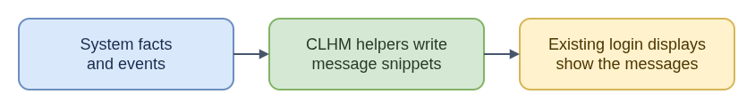

# ELI15: Console Login Helper Messages

`console-login-helper-messages` (CLHM) prepares small information snippets for existing console and shell login displays. It is more like a notice board than a login service: separate helpers write useful notes, and `agetty`, the configured login-message reader, or an interactive shell displays them at its normal point.

Its inputs are local system facts and events: SSH host keys for fingerprints, network interface events for address hints, `/usr/lib/os-release` for the release name, and systemd's failed-unit list for a shell warning. Its outputs are runtime issue/MOTD snippets or text printed during interactive shell startup. Which pieces are installed and enabled is controlled by packaging and distribution configuration.

CLHM does not authenticate users, configure networking, or repair or diagnose a failed service. A missing message can mean its generator did not run, or that the existing display mechanism does not read its snippets. This distinction helps CoreOS issue work avoid treating a login-message symptom as proof of a network or systemd fix. A console notice is not automatically an SSH pre-login banner, and a warning only points toward further investigation.

**Technical guide:** [README.md](README.md)

- [Diagram source](eli15-flow.drawio)
