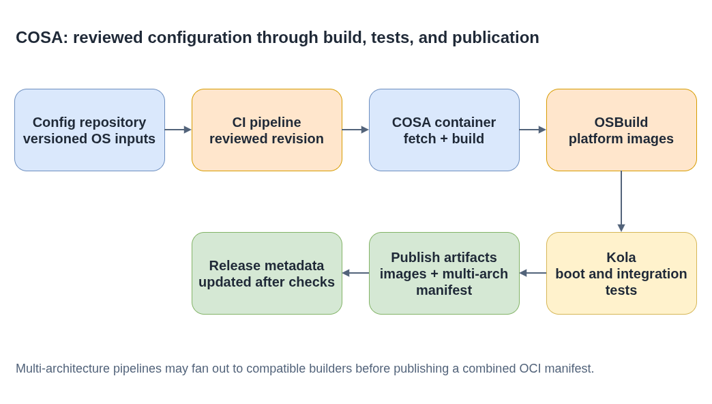

# coreos-assembler (COSA)

Command options change; `cosa <command> -h` is authoritative.

**Plain-language companion:** [ELI15](eli15.md)

CoreOS Assembler is a containerized build environment for building and testing
Fedora CoreOS and related CoreOS-based systems. COSA combines versioned OS
configuration with build tools to produce OSTree-based commits, container
images, and platform disk images.

- Upstream: [coreos/coreos-assembler](https://github.com/coreos/coreos-assembler)
- Build container: [`quay.io/coreos-assembler/coreos-assembler`](https://quay.io/repository/coreos-assembler/coreos-assembler)
- Guides: [Building Fedora CoreOS](https://coreos.github.io/coreos-assembler/building-fcos/), [Working with COSA](https://coreos.github.io/coreos-assembler/working/), and [Testing with Kola](https://coreos.github.io/coreos-assembler/kola/)



- [Diagram source](./cosa-build-test-release-flow.drawio)

## Main components

- `cosa` initializes a build directory, fetches inputs, and orchestrates builds and image generation.
- `kola` boots CoreOS instances and runs integration tests across supported platforms ([kola guide](../kola/README.md)).
- `ore` provides cloud tooling; `plume` contains release-related tooling.
- External CI pipelines can run the same COSA build and test commands, then manage artifact publication and release promotion.

## Build and smoke-test FCOS

Use the COSA container setup described in the upstream guide, including the
required container runtime and virtualization access. In an empty build
directory, initialize the public FCOS configuration repository and build a
QEMU image:

```bash
mkdir fcos-work
cd fcos-work

cosa init https://github.com/coreos/fedora-coreos-config
cosa fetch
cosa build
cosa osbuild qemu
cosa run
cosa kola run basic
```

`cosa build` produces the base build artifacts; `cosa osbuild <platform>`
generates platform images. `cosa run` boots the latest QEMU image, while Kola
tests exercise the built system and save logs under the build directory.
Consult the upstream guides for container setup, supported platforms, and
command options.

## Command reference

| Command | Purpose |
|---|---|
| `cosa init <config-repo>` | Create a workspace; the config repository is cloned to `src/config` |
| `cosa fetch` | Download the packages the build needs |
| `cosa build` | Compose the OSTree commit and OCI image; records a new build ID |
| `cosa osbuild <platform>` | Build disk images such as `qemu`, `metal`, `metal4k`, `live`, or a cloud platform |
| `cosa buildfetch` | Download an existing build's metadata and selected artifacts instead of rebuilding |
| `cosa decompress` / `cosa compress` | Convert artifacts between the shipped compressed form and a usable one |
| `cosa run` | Boot the latest (or a selected) QEMU image interactively |
| `cosa kola run ...` | Run integration tests; see the [kola guide](../kola/README.md) |
| `cosa list` | Show the builds in the workspace and their artifacts |

Builds are recorded in `builds/builds.json`; each build has a directory per
architecture containing its `meta.json` and artifacts.

**`buildfetch` and non-FCOS builds:** without `--url`, `cosa buildfetch`
assumes a Fedora CoreOS build ID, derives the stream from the ID's third field,
and fetches from the public FCOS builds site. For RHCOS or any other build,
pass `--url` with an `s3://`, `https://`, or `file://` location, plus `--arch`
and `--artifact` (for example `--artifact qemu`) to limit the download.

## Disk layout

`cosa osbuild` takes partition sizes from
`src/osbuild-manifests/coreos.osbuild.<arch>.mpp.yaml` (for example
`boot_size_mb`). The FCOS image-builder path keeps a second copy of the layout
in `fedora-coreos-config`; see
[Disk layout and the `/boot` partition](../fedora-coreos-config/README.md#disk-layout-and-the-boot-partition)
before changing either.

## Architecture and pipelines

COSA does not imply cross-compilation for every target. The target architecture
depends on the build environment; multi-architecture pipelines can schedule
architecture-specific work on compatible builders and publish a combined OCI
manifest after the component builds succeed. Validate each architecture and
the combined manifest before release.

The COSA build environment is separate from release orchestration. A CI
pipeline can build from a reviewed configuration revision, run Kola and
platform-specific tests, publish the resulting artifacts, and update release
metadata only after the required checks pass.

## Configuration as code and dependency updates

OS configuration, image definitions, and dependency lockfiles are versioned
inputs. Use reviewed Git changes as the proposal for a build, and let CI
validate the candidate revision before it is promoted. Automated dependency
updates can propose version changes; keep related source URLs and checksums in
lockfiles consistent, then verify them with the repository's supported checks
and a build/test run.

COSA's own container build is pinned the same way: `rpms.lock.yaml` for RPMs
and `ci/hermetic/artifacts.lock.yaml` for downloaded artifacts such as the `oc`
client. MintMaker keeps both current; see
[Automated lockfile updates](auto-lockfile-updates/README.md) for how those PRs
are opened, approved, and merged.

## Field-guide walkthroughs

- [CoreOS ecosystem functionality](../../getting-started/coreos-ecosystem-functionality.md)
- [Dependency update flow](dependency-update-flow.md)
- [Artifact lockfile update flow](artifact-lockfile-update-flow.md)
- [Automated lockfile updates](auto-lockfile-updates/README.md)
