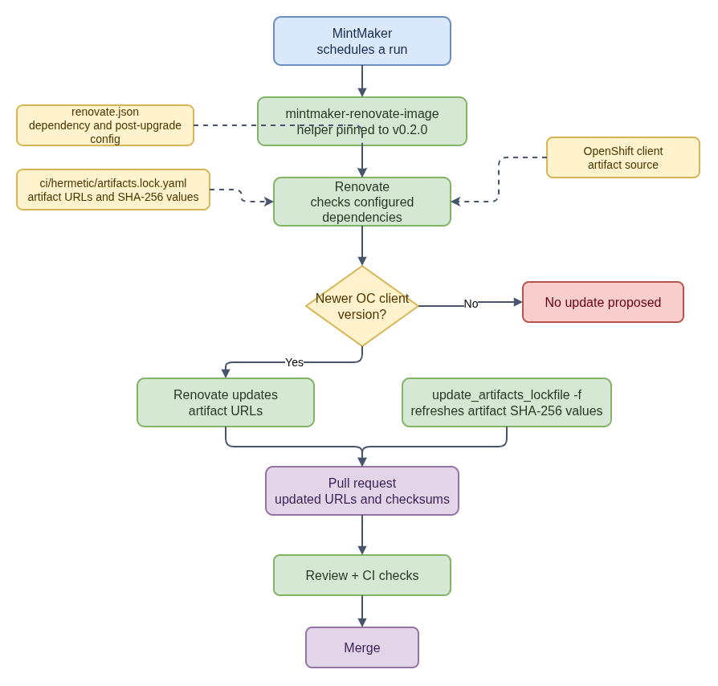

# CoreOS Artifact Lockfile Updates: URLs and Checksums Together


- [Diagram source](auto-lockfile-updates/coreos-assembler-artifact-lockfile-update-flow.drawio)
- [Automated lockfile update summary](auto-lockfile-updates/README.md)
- [Overall dependency update flow](dependency-update-flow.md)

This note covers the OpenShift client (`oc`) tarballs recorded in
`ci/hermetic/artifacts.lock.yaml`. The public workflow uses Renovate through
MintMaker and the `update_artifacts_lockfile` post-upgrade helper.

## What the lockfile records

Each artifact entry associates a download URL with a checksum and filename:

```yaml
- download_url: "<artifact URL>"
  checksum: "sha256:<digest>"
  filename: "<artifact filename>"
```

The `oc` client has separate artifacts for `x86_64`, `aarch64`, `s390x`, and
`ppc64le`. Check each architecture's URL and checksum as a pair.

## Update flow

1. MintMaker schedules a Renovate run using the public
   `coreos-assembler` configuration.
2. Renovate checks for an OpenShift client version update and, when one is
   available, changes the artifact URLs on its working branch.
3. The configured post-upgrade task invokes the helper with Renovate's data
   file:

   ```text
   update_artifacts_lockfile -f "$RENOVATE_POST_UPGRADE_COMMAND_DATA_FILE"
   ```

   The `-f` option supplies the data file that identifies the package files to
   process. The configuration includes
   `ci/hermetic/artifacts.lock.yaml` in the resulting change.
4. The `mintmaker-renovate-image` provides the helper runtime and pins
   `update-artifacts-lockfile` at `v0.2.0`. The helper is used to refresh the
   artifact SHA-256 values for the updated URLs.
5. Renovate proposes the URL and checksum changes in a pull request. Reviewers
   inspect the update, and the pull request runs the project's normal CI checks.

## Verify the checksum pairing

For each changed entry, confirm the URL identifies the intended version and
architecture. The lockfile's intended byte-level invariant is:

```text
SHA-256(bytes fetched from download_url) == checksum
```

To independently spot-check an artifact, fetch its exact URL and calculate the
digest:

```bash
curl -L --fail "$ARTIFACT_URL" -o artifact.tar.gz
sha256sum artifact.tar.gz
```

Compare the calculated digest with the entry's `sha256:` value. A matching
digest confirms byte agreement with the recorded checksum; it does not by
itself establish that the URL is the intended or trusted source. Review the
URL, version, architecture, and digest together. Normal CI checks the proposed
project change but does not replace that review.

## Public references

- [`coreos-assembler` Renovate configuration](https://github.com/coreos/coreos-assembler/blob/main/renovate.json)
- [`mintmaker-renovate-image` Dockerfile](https://github.com/konflux-ci/mintmaker-renovate-image/blob/main/Dockerfile)
- [`update-artifacts-lockfile` v0.2.0 documentation](https://github.com/konflux-ci/update-artifacts-lockfile/tree/v0.2.0)
- [Automated lockfile update summary](auto-lockfile-updates/README.md)
