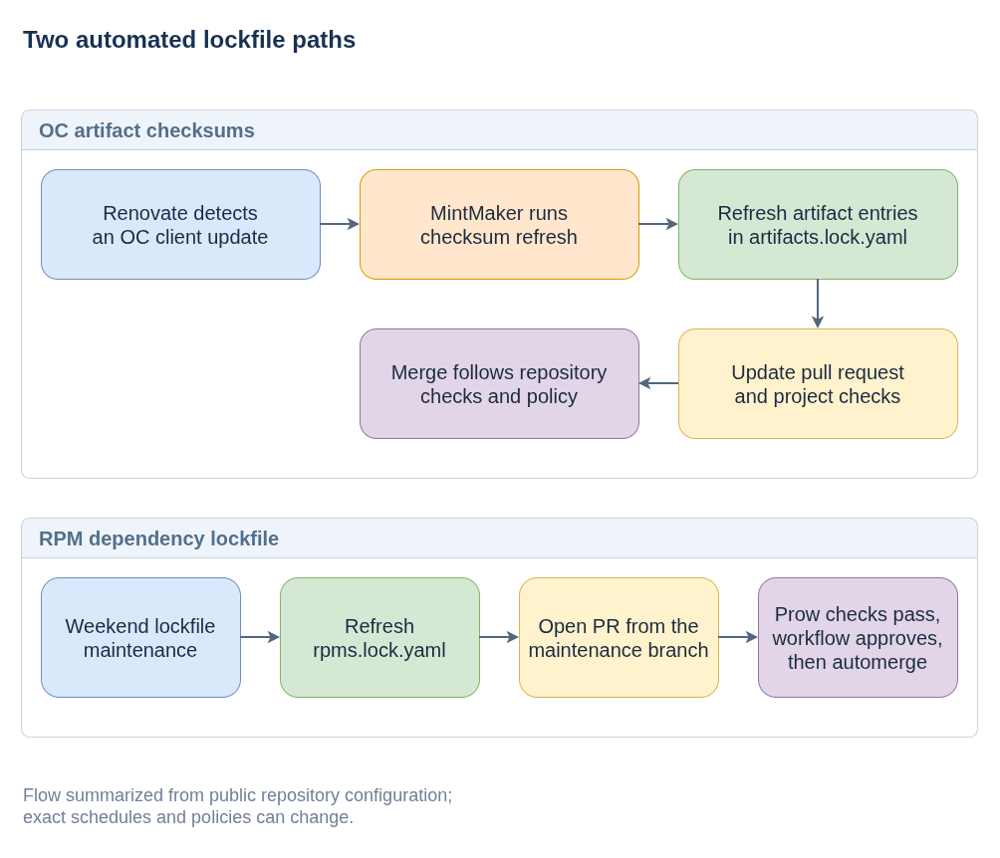

# Automated Lockfile Updates

Schedules, bot accounts, and branch protection can change; the repository
configuration is the source of truth.

`coreos-assembler` uses Renovate through MintMaker for two lockfile workflows: refreshing checksums for the OpenShift `oc` client artifact and maintaining the RPM dependency lockfile.

## Workflows

- [Diagram source](lockfile-update-flows.drawio)

### OC client artifact checksums

When Renovate detects an `oc` client version change, MintMaker runs the public [`update-artifacts-lockfile`](https://github.com/konflux-ci/update-artifacts-lockfile) helper as part of the upgrade. The helper reads the affected lockfile entries, downloads the referenced artifacts, recomputes their SHA-256 checksums, and updates the lockfile. The resulting change is proposed with the dependency update for normal project checks and review.

### RPM dependency lockfile

The `rpm-lockfile` manager's `lockFileMaintenance` job refreshes `rpms.lock.yaml` on a weekend schedule (`* * * * 0,6`) and opens a pull request from the `renovate/main/lock-file-maintenance` branch. Getting that PR to merge without a human took three changes, each fixing what the previous one exposed:

1. **Pull request, not branch push** ([#4614](https://github.com/coreos/coreos-assembler/pull/4614)). With `automergeType: "branch"`, Renovate pushes the update straight to `main` once checks pass. But branch protection requires CI checks, and Prow only runs on pull requests, so a branch push can never get the required Prow result. Setting `automergeType: "pr"` for lockfile maintenance makes Renovate open a PR instead, so CI runs normally and Renovate merges when checks pass.
2. **Scoped auto-approval** ([#4633](https://github.com/coreos/coreos-assembler/pull/4633)). Branch protection also requires one approving review, and the MintMaker bot cannot approve its own PR, so passing PRs sat open. A GitHub Actions workflow, `.github/workflows/auto-approve-lockfile.yml`, approves these PRs only when all of the following hold:
   - the PR was opened by the MintMaker bot, from this repository (not a fork), against `main`, on the exact lockfile-maintenance branch;
   - every changed file is on an allowlist (`rpms.lock.yaml`) and is *modified*, not added, deleted, or renamed;
   - the PR head did not move during validation, and the review is bound to the validated commit SHA, so a later push cannot inherit the approval.

   Concurrent events for the same PR are serialized, the job has a short timeout, and it uses the `gh` CLI rather than a third-party action.
3. **A `gh` CLI incompatibility** ([#4634](https://github.com/coreos/coreos-assembler/pull/4634)). `gh api --paginate --slurp` cannot be combined with `--jq`, so the workflow pipes the slurped pages into a separate `jq` call.

Other RPM updates outside lockfile maintenance follow the separate `rpm` manager rule in `renovate.json`; check its `automergeType` before assuming it behaves the same way.

**Debugging a stuck lockfile PR:** check, in order, whether the PR came from the expected bot and branch, whether it touches anything besides `rpms.lock.yaml`, whether the auto-approve workflow ran and what it logged, and whether required Prow checks reported on the PR head.

## Further reading

- [Plain-language explanation](eli15.md)
- [Artifact checksum helper guide](../../update-artifacts-lockfile/README.md)
- [Packaging the lockfile helper](../../update-artifacts-lockfile/python-packaging-explained.md)
- [Why the helper is packaged separately](../../update-artifacts-lockfile/why-so-many-files.md) (historical design context)

## Public references

- [`coreos-assembler` Renovate configuration](https://github.com/coreos/coreos-assembler/blob/main/renovate.json)
- [Auto-approve workflow for lockfile maintenance PRs](https://github.com/coreos/coreos-assembler/blob/main/.github/workflows/auto-approve-lockfile.yml)
- [Renovate `automergeType` documentation](https://docs.renovatebot.com/configuration-options/#automergetype)
- [`update-artifacts-lockfile` documentation](https://github.com/konflux-ci/update-artifacts-lockfile)
- [MintMaker](https://github.com/konflux-ci/mintmaker)
