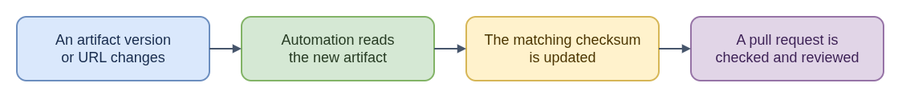

# Automated Lockfile Updates - Plain-Language Explanation

An artifact checksum lockfile records where a build gets a file and a
fingerprint of its exact bytes. If the downloaded bytes do not match the
recorded fingerprint, verification fails rather than silently using different
content. RPM dependency lockfiles are a separate list of package versions, not
the same artifact-checksum mechanism.

When an artifact version changes, a dependency bot may update its URL while the
old checksum remains. A helper fetches the declared artifact, computes a
checksum for its bytes, and updates that artifact entry so the URL and
fingerprint can be reviewed together.

The helper is packaged as a tool so automation can install a versioned release
with its declared dependencies. The dependency update is still reviewed and
checked by the repository's normal validation and merge policy; automating the
checksum does not make the change automatically trustworthy.

The helper handles artifact checksums only. Refreshing the RPM dependency
lockfile is a separate weekend job. Its updates arrive as pull requests so the
normal CI checks can run on them. The repository also requires a reviewer's
approval, and a bot cannot approve its own work, so a small, tightly limited
workflow approves these PRs. It only does so when the PR changes the RPM
lockfile and nothing else, and only for the exact version it checked.

See the [technical overview](README.md),
[artifact lockfile flow](../artifact-lockfile-update-flow.md), and
[helper packaging explanation](../../update-artifacts-lockfile/python-packaging-explained.md).

- [Diagram source](eli15-flow.drawio)
