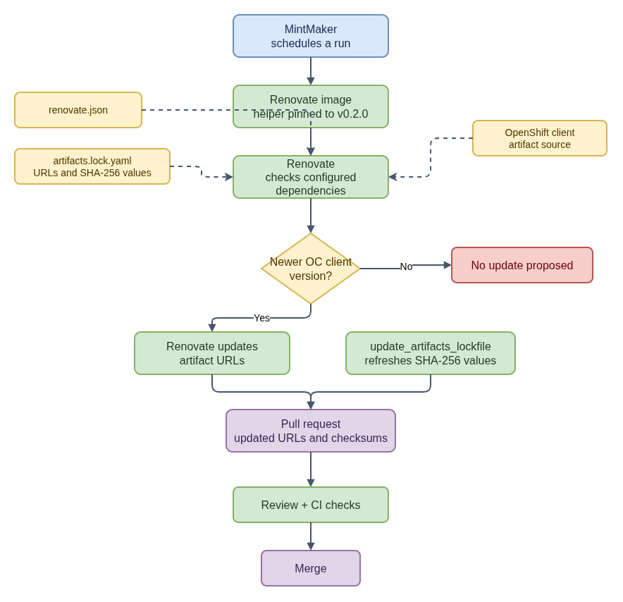

# How CoreOS Dependency Updates Flow Through MintMaker



- [Diagram source](coreos-dependency-update-flow.drawio)
- [Automated lockfile update summary](auto-lockfile-updates/README.md)
- [Artifact lockfile update details](artifact-lockfile-update-flow.md)

MintMaker,
Renovate, the Renovate image, the artifact helper, and project CI each have a
different role in an automated dependency update.

## Component responsibilities

- **MintMaker** schedules and orchestrates Renovate runs.
- **Renovate** reads the repository's `renovate.json`, checks configured
  dependency sources, and proposes updates on a branch.
- **`mintmaker-renovate-image`** provides the environment for Renovate and its
  post-upgrade tools. Its public Dockerfile pins
  `update-artifacts-lockfile` at `v0.2.0`.
- **`update_artifacts_lockfile`** is used for the OpenShift client artifact
  lockfile so URL changes can be accompanied by refreshed SHA-256 values.
- **Pull requests and CI** provide the reviewable change and the project's
  normal checks before merge.

For this artifact workflow, the configured post-upgrade invocation is:

```text
update_artifacts_lockfile -f "$RENOVATE_POST_UPGRADE_COMMAND_DATA_FILE"
```

The `-f` option reads the Renovate post-upgrade data file, which identifies the
package files to process. It is not a positional lockfile-path argument.

## Review URLs and checksums

An artifact lockfile pairs each `download_url` with a SHA-256 checksum. Review
each changed entry to confirm that its URL refers to the intended version and
architecture, and that the recorded checksum matches the downloaded bytes. A
manual spot-check can use:

```bash
curl -L --fail "$ARTIFACT_URL" -o artifact.tar.gz
sha256sum artifact.tar.gz
```

The checksum comparison verifies the bytes against the recorded digest; it does
not by itself establish that the URL points to the intended artifact. The pull
request's normal CI checks complement, but do not replace, review of the URL and
checksum pairing.

RPM lockfile maintenance is a separate workflow from this artifact helper. The
[automated lockfile update summary](auto-lockfile-updates/README.md) covers both
flows.

## Public references

- [`coreos-assembler` Renovate configuration](https://github.com/coreos/coreos-assembler/blob/main/renovate.json)
- [MintMaker](https://github.com/konflux-ci/mintmaker)
- [`mintmaker-renovate-image` Dockerfile](https://github.com/konflux-ci/mintmaker-renovate-image/blob/main/Dockerfile)
- [`update-artifacts-lockfile` v0.2.0 documentation](https://github.com/konflux-ci/update-artifacts-lockfile/tree/v0.2.0)
