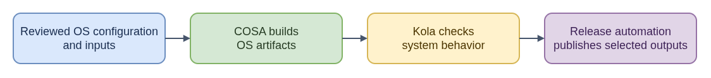

# ELI15: CoreOS Assembler (COSA)

CoreOS Assembler is a containerized workshop for building and testing Fedora CoreOS and related systems. Versioned OS configuration and fetched build inputs go in; COSA orchestrates the build and can produce OSTree commits, container images, and platform disk images.

Its parts have distinct jobs: `cosa` prepares the build directory and makes artifacts, while Kola boots instances to run integration tests. `ore` supplies cloud tooling and `plume` has release-related tools. External CI can use COSA and Kola, then handle publication or promotion. That is like a factory's equipment and inspection station being separate from the shipping desk.

A COSA build does not automatically mean a release has been published. The target architecture depends on the builder, and multi-architecture work may require separate compatible builders and later manifest assembly. For CoreOS issue work, identify whether the failure is in inputs, composition, platform image generation, or testing before blaming release publication. Keep the reviewed configuration revision and artifacts tied to the report; CI and release orchestration own checks and promotion beyond COSA's build/test role.

**Technical guide:** [README.md](README.md)

- [Diagram source](eli15-flow.drawio)
