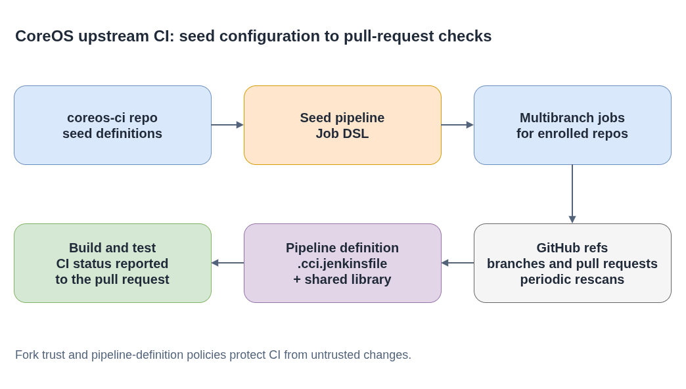

# coreos-ci

**Plain-language companion:** [ELI15](eli15.md)

`coreos-ci` contains Jenkins job definitions and shared configuration for
upstream CoreOS repository CI.

Upstream: [coreos/coreos-ci](https://github.com/coreos/coreos-ci)

- [Diagram source](./coreos-ci-pipeline.drawio)

## Structure

| Path | Purpose |
|---|---|
| `jenkins/config/` | Jenkins Configuration as Code fragments |
| `jobs/` | Jenkinsfiles converted into pipeline jobs, including seed jobs |
| `manifests/` | OpenShift template for creating the Jenkins controller |

## Multibranch job flow

The `jobs/seed-github-ci.Jenkinsfile` seed pipeline uses the Jenkins Job DSL
plugin to define a multibranch job for each enrolled repository. Each job
discovers configured branches and pull requests, then loads the repository's
`.cci.jenkinsfile`. Periodic rescans keep the job set aligned with branches and
pull requests in GitHub.

Upstream pipelines can reuse steps from
[`coreos-ci-lib`](https://github.com/coreos/coreos-ci-lib) for common tasks
such as running COSA builds and Kola tests. Fork trust rules determine whether
a pull request's pipeline definition is trusted; changes from untrusted
contributors are not automatically used as the CI definition.

The Jenkins controller build and plugin configuration are maintained in the
[Fedora CoreOS pipeline](https://github.com/coreos/fedora-coreos-pipeline)
project.

## Testing changes safely

- Run the repository's local checks and review the generated Job DSL/configuration changes before proposing them.
- Test seed-job changes only in an approved, isolated Jenkins test instance when one is available. Avoid creating broad job fan-out on a production controller.
- Keep the Jenkins Groovy Sandbox enabled. If a change requires script approval, submit it for administrator review rather than disabling the sandbox.
- Check the configured branch, pull-request, and fork trust behavior when changing job discovery or pipeline loading.

For Jenkins Job DSL syntax and installed-plugin APIs, use the plugin's
documentation and the API viewer provided by the Jenkins instance being used.
