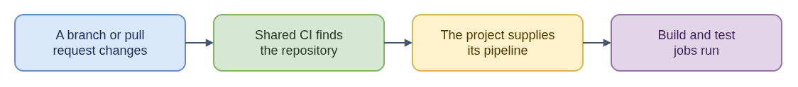

# ELI15: CoreOS Upstream CI

`coreos-ci` is shared Jenkins job configuration for upstream CoreOS repositories. Think of it as a dispatch board: it creates the framework that notices enrolled branches and pull requests and routes each one into that repository's pipeline, rather than defining every project's tests itself.

The repository holds Jenkins configuration fragments, job definitions, and a template for the Jenkins controller. A seed pipeline creates multibranch jobs; those jobs load a repository's `.cci.jenkinsfile`. Pipelines can reuse `coreos-ci-lib` for shared work such as COSA builds and Kola tests. Fork-trust rules affect whether a proposed pipeline definition is trusted, so a pull request's own CI file is not always run as-is.

This boundary helps with CoreOS issue work: distinguish a job-discovery or trust problem from a failure inside a project's build or test stages. The Fedora CoreOS pipeline project maintains controller build and plugin configuration, while individual repositories supply their pipeline definitions. A CI job appearing, starting, or passing is evidence about that configured path, not a general guarantee about every project or release step.

**Technical guide:** [README.md](README.md)

- [Diagram source](eli15-flow.drawio)
