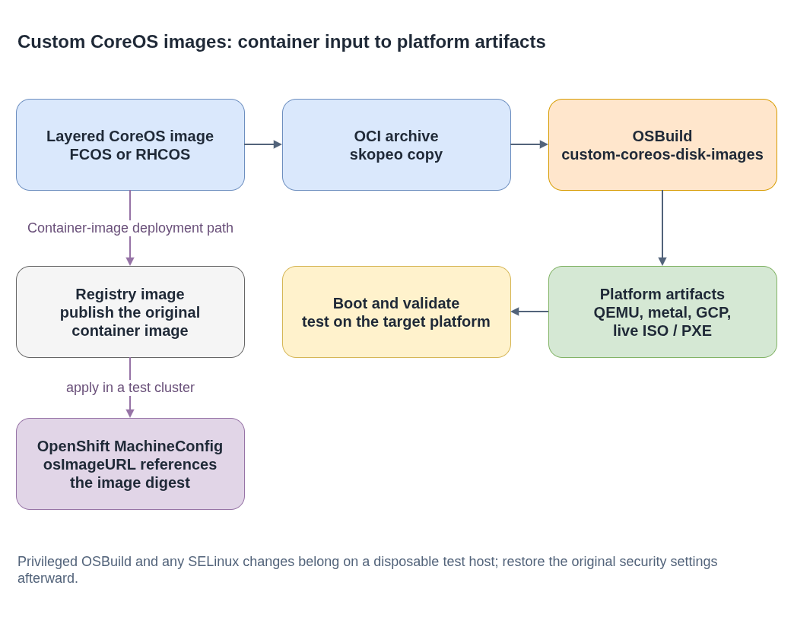

# custom-coreos-disk-images

**Plain-language companion:** [ELI15](eli15.md)

This project turns a customized Fedora CoreOS (FCOS) or Red Hat Enterprise
Linux CoreOS (RHCOS) container image into platform boot artifacts with OSBuild.
Outputs can include QEMU images, metal images, and live ISO/PXE artifacts.

Upstream: [coreos/custom-coreos-disk-images](https://github.com/coreos/custom-coreos-disk-images)



- [Diagram source](./custom-disk-image-workflow.drawio)

## 1. Build a layered container image

Start with the target FCOS or RHCOS image and add packages or files. For
example, a layered image can install a package and commit the resulting
container-native OS tree:

```Dockerfile
FROM scratch
RUN rpm-ostree install htop && ostree container commit
```

Build from an RHCOS release. Use an authorized pull secret when the source
registry requires credentials:

```bash
OCP_RELEASE='<target-version>'
RHCOS_CONTAINER=$(oc adm release info --image-for=rhel-coreos \
  "quay.io/openshift-release-dev/ocp-release:${OCP_RELEASE}-x86_64")
: "${PULL_SECRET:?Set PULL_SECRET to an authorized registry credential file}"

podman build --from "$RHCOS_CONTAINER" --authfile "$PULL_SECRET" \
  --file Containerfile --tag quay.io/example-org/custom-coreos:dev .
```

FCOS can use its public stable image as the base:

```bash
podman build --from quay.io/fedora/fedora-coreos:stable \
  --file Containerfile --tag quay.io/example-org/custom-fcos:dev .
```

RHCOS 4.16 and newer also support `dnf install` in layered container builds.
Check the target release documentation before choosing a package installation
method.

## 2. Convert the image to an OCI archive

OSBuild consumes an OCI archive. Copy a locally built image from container
storage:

```bash
skopeo copy containers-storage:quay.io/example-org/custom-coreos:dev \
  oci-archive:my-custom-coreos.ociarchive
```

An image can also be copied from a registry with `skopeo copy`; use an
authorized registry credential file when that registry requires authentication.

## 3. Build platform images

**Safety boundary:** The commands in this section install host packages, invoke
OSBuild with elevated privileges, and may require SELinux permissive mode.
Run them only on a disposable, isolated Fedora test VM with no sensitive data,
never on a production system or a daily-use workstation. Take a VM snapshot
first. Record the original SELinux mode and configuration. If permissive mode
is required, change it only for this test; do not leave SELinux permissive. If
you edit the persistent SELinux configuration, restore the saved file and
reboot the test VM after the build, including when the build fails.
If the original mode is `Disabled`, use a disposable Fedora VM with SELinux
enabled; `setenforce` cannot switch a disabled policy back on.

The upstream workflow documents a fully updated Fedora host.
Verify the requirements for the version of OSBuild you use.

```bash
# Disposable test VM only. Record and back up the original SELinux settings.
ORIGINAL_SELINUX_MODE=$(getenforce)
printf 'Original SELinux mode: %s\n' "$ORIGINAL_SELINUX_MODE"
sudo cp -a /etc/selinux/config /root/selinux-config.before-image-build

# Use only if required by the OSBuild workflow, and only in this disposable VM.
if [ "$ORIGINAL_SELINUX_MODE" = "Enforcing" ]; then
  sudo setenforce 0
fi

sudo dnf install -y osbuild osbuild-tools osbuild-ostree podman jq \
  xfsprogs e2fsprogs dosfstools genisoimage squashfs-tools \
  erofs-utils syslinux-nonlinux

# QEMU disk image
sudo ./custom-coreos-disk-images.sh \
  --ociarchive my-custom-coreos.ociarchive --platforms qemu

# Metal image and live ISO/PXE artifacts
sudo ./custom-coreos-disk-images.sh \
  --ociarchive my-custom-coreos.ociarchive --platforms metal
sudo ./custom-coreos-disk-images.sh \
  --ociarchive my-custom-coreos.ociarchive --platforms live

# Restore the saved configuration and the recorded runtime mode.
sudo cp -a /root/selinux-config.before-image-build /etc/selinux/config
if [ "$ORIGINAL_SELINUX_MODE" = "Enforcing" ]; then
  sudo setenforce 1
fi
```

If the configuration file was changed, reboot the disposable VM to verify the
restored policy. Destroy the VM or revert its snapshot after testing. QEMU
builds produce a `.qcow2` image; `live` builds produce ISO, kernel, initramfs,
and root-filesystem artifacts. Supported platforms depend on the project
version.

For FCOS, pass `--osname=fedora-coreos` to the image-generation command.

## 4. Use the container image in OpenShift

The container image is separate from the disk artifacts. Push it to an
authorized registry and test it on an appropriate development cluster by
referencing its immutable digest in a MachineConfig `osImageURL`:

```yaml
apiVersion: machineconfiguration.openshift.io/v1
kind: MachineConfig
metadata:
  labels:
    machineconfiguration.openshift.io/role: worker
  name: custom-image
spec:
  osImageURL: quay.io/example-org/custom-coreos@sha256:<digest>
```

Use the OpenShift documentation for the target release when applying a
MachineConfig or including one in installation manifests.
