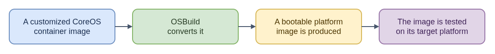

# Custom CoreOS Disk Images - ELI15

**Technical guide:** [README.md](README.md)

A CoreOS container image and a bootable disk image are different deliverables.
Think of the container image as a prepared system and the disk image as the
packaging needed for a particular machine or virtual platform to start it.
This project uses OSBuild to turn a customized Fedora CoreOS or RHCOS container
image into artifacts such as a QEMU disk, a bare-metal image, or live boot files.

That is different from building the underlying CoreOS operating system. A
problem in this conversion can be specific to the target format even when the
container image itself is fine. The container image may also be consumed
directly in OpenShift through a MachineConfig, which is another path from the
bootable disk artifact.

For issue work, first identify whether the failure is in the customized image,
the conversion to a platform artifact, or the later deployment. The documented
build uses elevated privileges and belongs in an isolated disposable VM, not a
production host.

- [Diagram source](eli15-flow.drawio)
