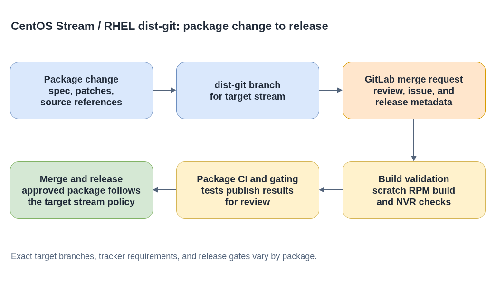
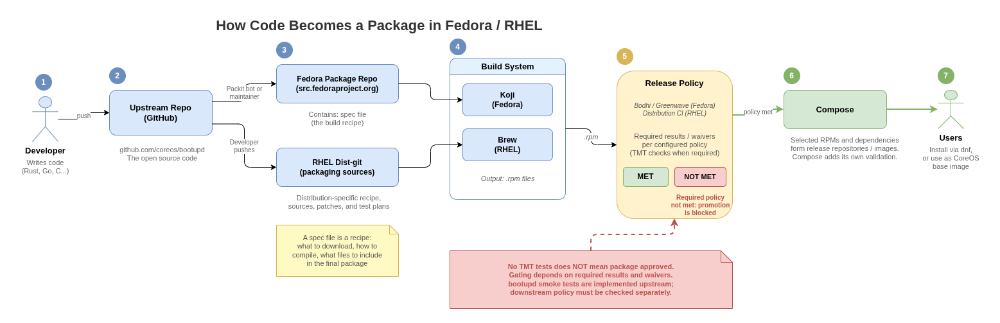

# CentOS Stream / RHEL dist-git

**Plain-language companion:** [ELI15](eli15.md)

Package changes are proposed in dist-git repositories as GitLab merge requests.
The repository contains the RPM spec, patches, and source references used to
build the package.

- [Diagram source](./dist-git-package-flow.drawio)

## Repositories

| Package | dist-git repository |
|---|---|
| ignition | [redhat/rhel/rpms/ignition](https://gitlab.com/redhat/rhel/rpms/ignition) |
| afterburn | [redhat/rhel/rpms/afterburn](https://gitlab.com/redhat/rhel/rpms/afterburn) |
| coreos-installer | [redhat/rhel/rpms/rust-coreos-installer](https://gitlab.com/redhat/rhel/rpms/rust-coreos-installer) |

## Preparing a merge request

- Confirm the target branch and stream before changing package metadata. Branches such as `c9s` and `c10s` can target different release lines.
- Follow the target repository's current issue and release-metadata policy. Required tracker references and version fields vary by project and branch; check current guidance rather than reusing values from an older change.
- Avoid reusing an existing NVR (name-version-release). If a build collides because the package version did not change, update `Release:` or use the branch's supported `%autorelease` convention.
- Run a scratch build from the merge-request branch, for example `brew build --scratch` where available.

## Build and gating

- [Diagram source](rpm-package-pipeline.drawio)

CI and package gating validate the build and run the tests configured for the
target package. Keep `gating.yaml` aligned with test plans that actually publish
results. Missing results or waivers need investigation; they are not evidence
that a test passed. After merge, follow the target stream's release policy and
verify the linked build and test results in the project's CI tools.

Release phases can have different approval requirements: an early integration
phase may allow testing while an issue is in progress, while later phases can
require formal approval. Consult the current package and release guidance for
the branch being changed.
