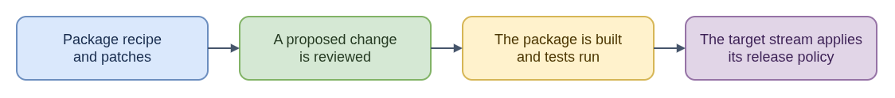

# CentOS Stream / RHEL dist-git: ELI15

[Technical README: CentOS Stream / RHEL dist-git](README.md)

CentOS Stream/RHEL dist-git is the package-source and review path for changes to RPMs. Each repository holds an RPM spec, patches, and source references; proposed changes go through GitLab merge requests. Package CI and gating then check the build and the tests configured for the target package. After a merge, the target stream's release policy still applies, so the linked build and test results need to be checked.

Think of it as editing a recipe and then sending the result through a quality gate: a reviewed change alone is not evidence that its build and tests succeeded. For CoreOS issue work, this path is relevant when the fix belongs in a package such as Ignition, Afterburn, or coreos-installer. The target branch matters because branches such as `c9s` and `c10s` can represent different release lines, and issue or release metadata rules can vary by branch. `gating.yaml` should correspond to test plans that actually publish results. Missing results or a waiver need investigation; neither proves a test passed. This guide describes package change flow, not one universal approval or release rule.

- [Diagram source](eli15-flow.drawio)
