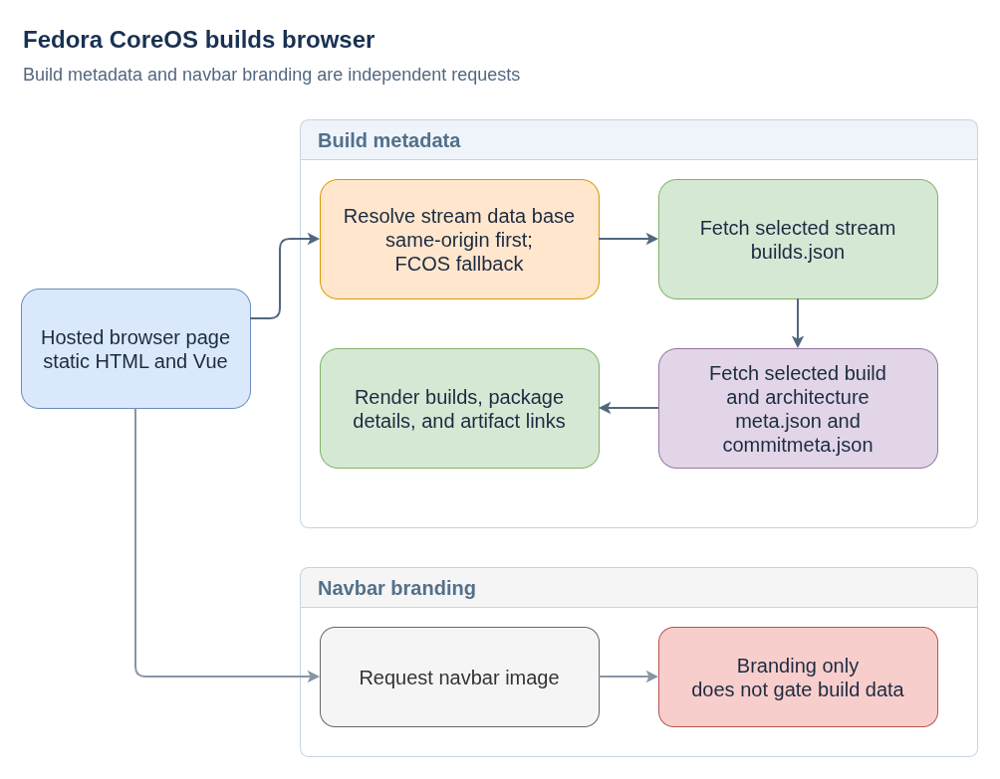

# Fedora CoreOS Builds Browser

**Plain-language companion:** [ELI15](eli15.md)

The `browser/` page in [fedora-coreos-browser](https://github.com/coreos/fedora-coreos-browser) is a static client for inspecting Fedora CoreOS and related CoreOS build output. It reads public build metadata and links to artifacts; it is separate from the build pipeline itself.

## Data flow

- [Diagram source](fedora-coreos-browser-flow.drawio)

At startup, the page chooses a stream list for its host and tries to read stream data relative to the page's origin. If that data is unavailable, it falls back to the Fedora CoreOS production stream service. For the selected stream, `builds.json` supplies build IDs and architecture availability. The browser then fetches `meta.json` and `commitmeta.json` for each selected build and architecture; those documents populate package details and artifact links.

The navbar image is a separate static-asset request. A failure to load that image does not prevent the independent build-metadata requests.

## Navbar asset note

A navbar logo request is separate from the build-metadata requests. If the logo asset returns 404, that affects branding only, not build discovery or metadata rendering.

## Public references

- [Build browser source](https://github.com/coreos/fedora-coreos-browser/blob/main/browser/index.html)
- [Updates graph source](https://github.com/coreos/fedora-coreos-browser/blob/main/graph/index.html)
- [Fedora CoreOS stable build metadata](https://builds.coreos.fedoraproject.org/prod/streams/stable/builds/builds.json)
