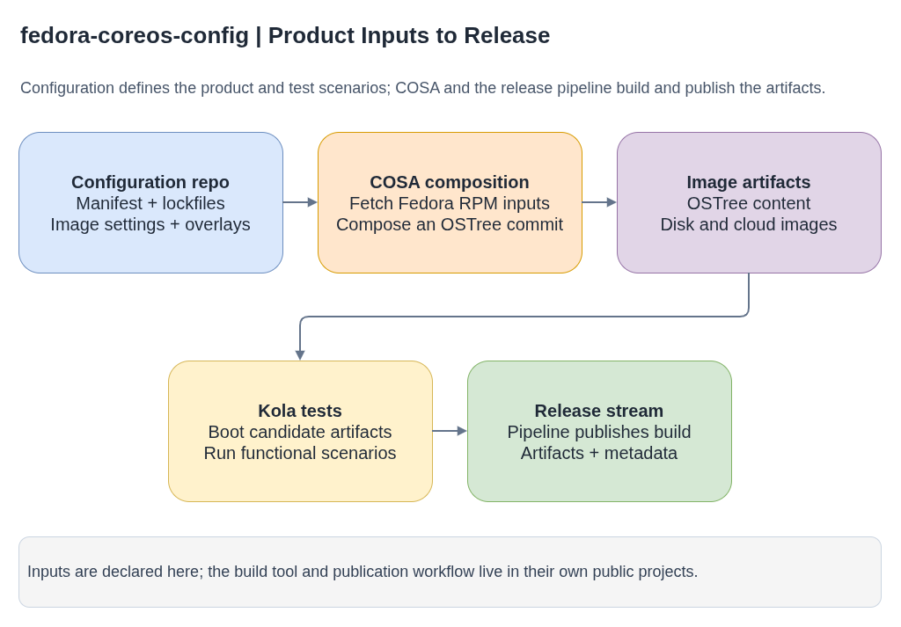

# fedora-coreos-config

Branch roles and layout values change between releases; check the branch that
matches the stream or release you are investigating.

Public product configuration for Fedora CoreOS (FCOS). The repository
describes package selection, image layout, overlays, and Kola test scenarios;
coreos-assembler (COSA) consumes these inputs to build FCOS artifacts.

**Plain-language companion:** [ELI15](eli15.md)

Upstream: [coreos/fedora-coreos-config](https://github.com/coreos/fedora-coreos-config)



- [Diagram source](fcos-config-build-flow.drawio)

## Configuration inputs

| Path | Purpose |
|---|---|
| `manifest.yaml` and `manifests/` | RPM repositories and package selections |
| `manifest-lock.*` | Resolved package versions used for repeatable builds |
| `manifest-lock.overrides.yaml` | Explicit package version overrides |
| `image.yaml` and `image-base.yaml` | Image settings and disk layout |
| `overlay.d/` | Dracut modules, scripts, and other image overlays |
| `tests/kola/` | Kola integration test definitions |
| `kola-denylist.yaml` | Tests excluded from selected test runs |

## Configuration to release

1. The configuration defines the package set, image settings, and overlays;
   Fedora RPM repositories provide the package inputs.
2. COSA composes those inputs into an OSTree commit and bootable artifacts.
3. Kola boots candidate artifacts and runs functional scenarios, including
   tests defined in this repository.
4. The Fedora CoreOS pipeline publishes the resulting build and release
   metadata to an FCOS stream.

For a local build, follow the [COSA documentation](https://github.com/coreos/coreos-assembler)
and use this repository as the configuration input.

## Branches

| Branch | Role |
|---|---|
| `testing-devel` (default) | Main development branch; most pull requests target it |
| `next-devel` | Development for the `next` stream, usually the upcoming Fedora release |
| `rawhide`, `branched` | Tracking Fedora Rawhide and a newly branched Fedora release |
| `testing`, `stable`, `next` | Production stream branches, updated by promotion during releases |
| `rhcos-4.x` | Historical branches used by older RHCOS releases; current RHCOS configuration lives in [`rhel-coreos-config`](../rhel-coreos-config/README.md) |

Most changes land on `testing-devel` and reach production streams through
promotion. When a production stream needs a change before the next promotion,
for example a denylist entry for a test failing only there, open a pull request
against that branch. These backports are conventionally titled with the branch
in brackets, such as `[stable] denylist: snooze ...`.

## Kola tests and the denylist

Tests in `tests/kola/` run as `ext.config.<path>` and declare metadata in a
`## kola:` header block, for example:

```bash
## kola:
##   distros: "fcos rhcos"
##   exclusive: false
```

`distros`, `architectures`, and `platforms` restrict where a test runs, which
matters because RHCOS and SCOS builds reuse many of these tests.
`kola-denylist.yaml` skips known failures, scoped by stream, architecture, and
platform and ideally time-limited with a `snooze` date. See the
[kola guide](../kola/README.md) for metadata keys and the exact denylist rules.

## Disk layout and the `/boot` partition

The partition layout of FCOS disk images is defined in **two places** that must
stay in sync, plus a test that enforces it:

| Where | What |
|---|---|
| `coreos-assembler`: `src/osbuild-manifests/coreos.osbuild.<arch>.mpp.yaml` | Layout for images built with `cosa osbuild`; sizes are variables such as `boot_size_mb` |
| `fedora-coreos-config`: `overlay.d/10disk-images/usr/lib/image-builder/bootc/<arch>.yaml` | Layout for the image-builder (bootc) disk-image path |
| `fedora-coreos-config`: `tests/kola/disks/partition-scheme` | kola test asserting the expected partitions and sizes per architecture |

As of the last check, `/boot` is 384 MiB in both definitions. Growing it (for
example to fit larger kernels and initramfs images across two deployments)
means changing every architecture's file in both repositories and updating the
expected values in `partition-scheme` in the same change set. Partition sizes
only apply to newly created disk images; existing machines keep their layout.

## Package overrides

By default all FCOS packages come from the stable Fedora repositories.
`manifest-lock.overrides.yaml` (with arch-specific variants for rare cases)
records exceptions. Every entry carries a `metadata.type`:

- **`fast-track`**: pull a fix in before it reaches stable Fedora, ideally with a
  `bodhi:` link to the update. The `remove-graduated-overrides` GitHub Action
  removes the entry automatically once the package (or a newer one) reaches
  stable.
- **`pin`**: hold a package at a version. A `reason` link is **required**, and
  the pin stays until someone removes it.

The repository's `ci/overrides.py` tool and **add-override** workflow generate
entries for simple cases. After an override PR merges, `coreos-koji-tagger`
tags the package into the build pool. Comments are not preserved in these
files, so put context in `metadata`.

For an architecture-specific package, use `evr`:

```yaml
packages:
  example-package:
    evr: 1.2.3-4.fcXX
    metadata:
      type: pin
      reason: https://example.com/public-context
```

For a `noarch` package, use `evra` to include the architecture explicitly:

```yaml
packages:
  example-package:
    evra: 1.2.3-4.fcXX.noarch
    metadata:
      type: pin
      reason: https://example.com/public-context
```

Before using a package build from another Fedora release, confirm that the
build is available in a repository tag used by the target composition. Use
`koji buildinfo <package-nevr>` to inspect it.

See the upstream
[overriding packages documentation](https://github.com/coreos/fedora-coreos-config#overriding-packages)
for the full rules.

## Related projects

- [coreos-assembler](https://github.com/coreos/coreos-assembler) performs the
  build and artifact-generation steps.
- [fedora-coreos-pipeline](https://github.com/coreos/fedora-coreos-pipeline)
  orchestrates testing and release publication.

RHEL CoreOS follows related configuration concepts with RHEL-specific package
sources and settings.
