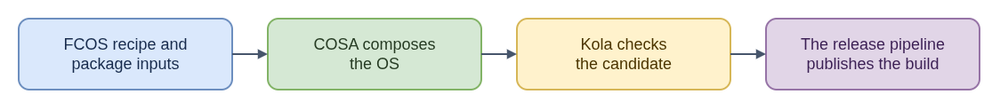

# ELI15: Fedora CoreOS Product Configuration

[Technical guide: Fedora CoreOS configuration](README.md)

`fedora-coreos-config` describes how Fedora CoreOS (FCOS) is assembled. Think of it as the product recipe: manifests and lock files select package inputs, image settings describe disk layout, overlays add files or build-time pieces, and Kola definitions describe system scenarios to test. Fedora RPM repositories provide package inputs. COSA uses this configuration to compose an OSTree commit and bootable artifacts; Kola then boots candidates and checks behavior. The Fedora CoreOS pipeline publishes the resulting build and release metadata to an FCOS stream.

The repository therefore shapes a build but does not by itself compose, publish, or roll out the operating system. A package pin or test definition affects inputs or checks; it is different from a pipeline publication problem or an update on an already-running node. RHEL CoreOS uses related ideas but has its own package sources and settings.

For CoreOS issue work, identify whether the report concerns package selection, image composition, a Kola scenario, or stream publication. Following the correct stage avoids changing configuration to solve a later release or rollout issue.

- [Diagram source](eli15-flow.drawio)
