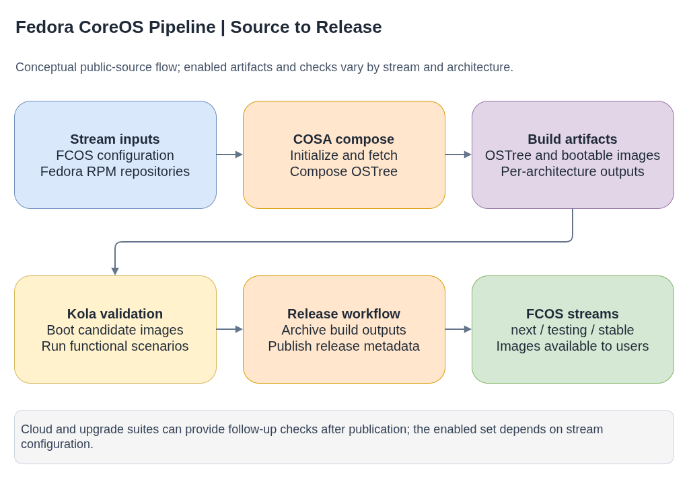

# fedora-coreos-pipeline

**Plain-language companion:** [ELI15](eli15.md)

Public build and release workflow for Fedora CoreOS (FCOS). The pipeline
consumes product configuration, composes and tests OS artifacts, and publishes
releases to FCOS streams.

Upstream: [coreos/fedora-coreos-pipeline](https://github.com/coreos/fedora-coreos-pipeline)

- [Diagram source](fcos-release-flow.drawio)

## Build-to-release flow

1. **Inputs:** stream configuration selects the FCOS configuration and package
   repositories for the build.
2. **Compose:** coreos-assembler (COSA) initializes the configuration, fetches
   packages, and creates an OSTree build.
3. **Build artifacts:** the pipeline creates architecture-specific OS and
   bootable image artifacts; additional architectures can build in parallel.
4. **Validate:** Kola exercises candidate images, with cloud and upgrade checks
   available as follow-up validation.
5. **Publish:** the release workflow assembles build metadata and publishes the
   artifacts to the selected FCOS stream.

The exact artifact set and follow-up checks depend on the stream and supported
architectures. Published FCOS streams include `next`, `testing`, and `stable`.

## Structure

| Path | Purpose |
|---|---|
| `jobs/build.Jenkinsfile` | Main FCOS build workflow |
| `jobs/build-arch.Jenkinsfile` | Additional architecture builds |
| `jobs/release.Jenkinsfile` | Release assembly and publication |
| `jobs/build-node-image.Jenkinsfile` | Node and extension image builds |
| `jobs/fix-build.Jenkinsfile` | Recovery for existing build artifacts |
| `jobs/kola-*.Jenkinsfile` | Kola test job definitions (see the [kola guide](../kola/README.md)) |
| `utils.groovy` | Shared build, test, and release helpers |
| `jenkins/config/seed.yaml` | Seed job definition: creates pipeline jobs from Jenkinsfiles |
| `jenkins/plugins.txt` | Pinned Jenkins plugin versions |
| `.cci.jenkinsfile` | Repository validation configuration |

## Concurrency

The build job runs inside a per-stream Jenkins lock (`build-<stream>`), so two
builds of the same stream never fetch previous build metadata or push new
builds at the same time. The release job uses a separate `release-<stream>`
lock. When a build seems stuck before it starts, check whether another build of
the same stream holds the lock.

## Seed job

The seed job creates or updates Jenkins pipeline jobs from the Jenkinsfiles in
`jobs/`. It reads `jenkins-jobs-url` and `jenkins-jobs-ref` from the
`jenkins-config` ConfigMap, clones that repo/branch, and runs the Jenkins Job
DSL plugin to define one pipeline job per `*.Jenkinsfile`.

By default (`FORCE` unchecked), the seed job skips jobs that already exist. To
update an existing job's definition, check the `FORCE` parameter. Even with
`FORCE`, the seed job may not reliably update the SCM configuration (which
repo/branch the Jenkinsfile loads from) on existing jobs - verify the job's
Configure > Pipeline section manually after running the seed job.

## Pipeline and CI infrastructure

This repository defines the product workflow. The public
[coreos-ci](https://github.com/coreos/coreos-ci) project contains shared CI
configuration and job infrastructure. Jenkins plugin versions are pinned in
`jenkins/plugins.txt`; compatible plugin versions should be maintained as a
set.

## Guides

- [Daily RPM lockfile regeneration (bump-lockfile)](bump-lockfile.md)
- [Multi-architecture builder provisioning](multi-arch-builders.md)
- [Node-image build and skip-build flow](build-node-image.md)
- [Investigating node-image build failures](build-node-image-troubleshooting.md)
- [Recovery for existing FCOS build artifacts](fix-build-recovery.md)

## Public references

- [Fedora CoreOS documentation](https://docs.fedoraproject.org/en-US/fedora-coreos/)
- [coreos-assembler](https://github.com/coreos/coreos-assembler)
- [Fedora CoreOS stream artifacts](https://builds.coreos.fedoraproject.org/)
