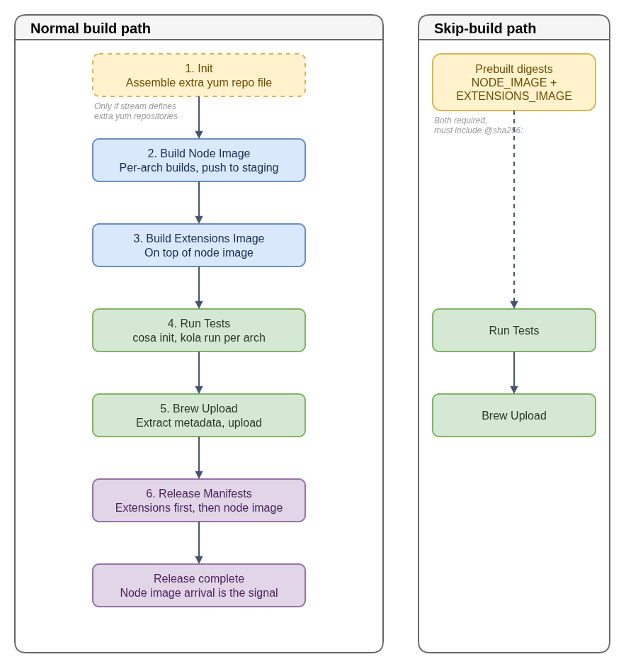

# OpenShift Node-Image Builds

This guide is a starting point for diagnosing the node-image and extensions
image jobs in the public
[`fedora-coreos-pipeline`](https://github.com/coreos/fedora-coreos-pipeline)
repository. The Jenkinsfile on the branch being investigated is authoritative;
job stages and stream configuration can change.

## Build and test flow

The job is parameterized by `RELEASE` (for example `4.22-9.8`: OpenShift
version, then RHEL variant), which selects the stream entry in the pipeline
configuration. On the normal path the stages run in this order:

1. **Init** (only if the stream defines extra yum repositories): assembles the
   repository file used by the image builds.
2. **Build Node Image:** builds the stream's configured source
   (`source_config` URL and ref, normally an `openshift/os` release branch) for
   each configured architecture, pushes the images to a staging repository,
   and creates a multi-arch manifest. If the stream sets `build_args_file`, the
   build gets `--build-arg-file build-args-<RELEASE>.conf`; otherwise it is
   labeled with the stream class (for example `rhel-9`).
3. **Build Extensions Image** (unless the stream disables extensions): builds
   `extensions/Containerfile` (or `extensions/Dockerfile`) on top of the
   just-built node image and pushes it to staging.
4. **Run Tests** (unless the stream disables tests), per architecture in
   parallel:
   - `cosa init` against `openshift/os` on the release branch;
   - `skopeo copy` the staged node image into `openshift-<arch>.ociarchive`;
   - read the image's `org.opencontainers.image.version` label, which is the
     **RHCOS build ID the node image was built on**;
   - `cosa buildfetch --artifact qemu --build <that ID> --url <builds bucket>`
     and `cosa decompress`, to get the matching base disk image;
   - `kola run --oscontainer openshift-<arch>.ociarchive --tag openshift --denylist-stream <RELEASE>`,
     which rebases the base image onto the node image and runs the
     `openshift`-tagged tests (see the [kola guide](../kola/README.md)).
5. **Brew Upload** (unless the stream skips it): extracts build metadata from
   the images and uploads it to Brew.
6. **Release Manifests:** copies the images from staging to the production
   repository tags. The extensions image is copied **first**, because the node
   image appearing is the signal that the release is complete.

The skip-build path (below) runs only Run Tests and Brew Upload on the supplied
images. Not every stream enables every stage.

- [Diagram source](build-node-image-flow.drawio)

When a job fails, start with its first failing stage and retain the source
revision, release, architecture, image digest, and relevant log output. Then
check the matching configuration and image build inputs rather than assuming
that every architecture followed the same path.

## Reusing prebuilt images

The Jenkins job has a skip-build path for digest-pinned images. Supplying either `NODE_IMAGE` or
`EXTENSIONS_IMAGE` requires both values and an `@sha256:` marker. The job uses
the node image repository with the supplied manifest digests, skips its image
build stages, and reuses the configured test and downstream processing steps.

This is not a complete validation of image availability or content. Confirm
the exact checks and stage gates in the target branch before relying on this
mode. The ordinary build path remains separate.

## Where to look

- [`build-node-image.Jenkinsfile`](https://github.com/coreos/fedora-coreos-pipeline/blob/main/jobs/build-node-image.Jenkinsfile) defines the job flow and parameters.
- [`utils.groovy`](https://github.com/coreos/fedora-coreos-pipeline/blob/main/utils.groovy) contains shared build and release helpers.
- [`openshift/os`](https://github.com/openshift/os) contains node-image build inputs; use the branch corresponding to the release.
- [Investigating node-image build failures](build-node-image-troubleshooting.md) gives a short diagnostic checklist.

Registry locations, credentials, release permissions, and upload policy depend
on the deployment environment. Follow the owning project's approved procedure;
this guide intentionally does not document environment-specific access details.
