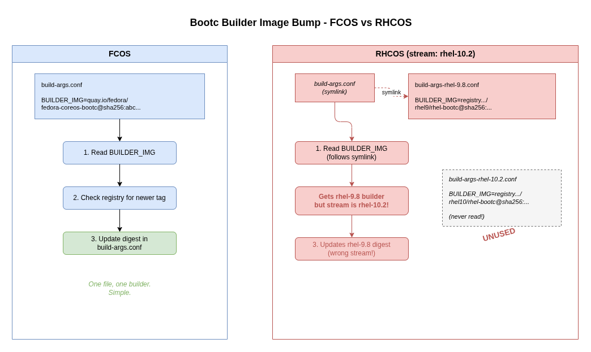
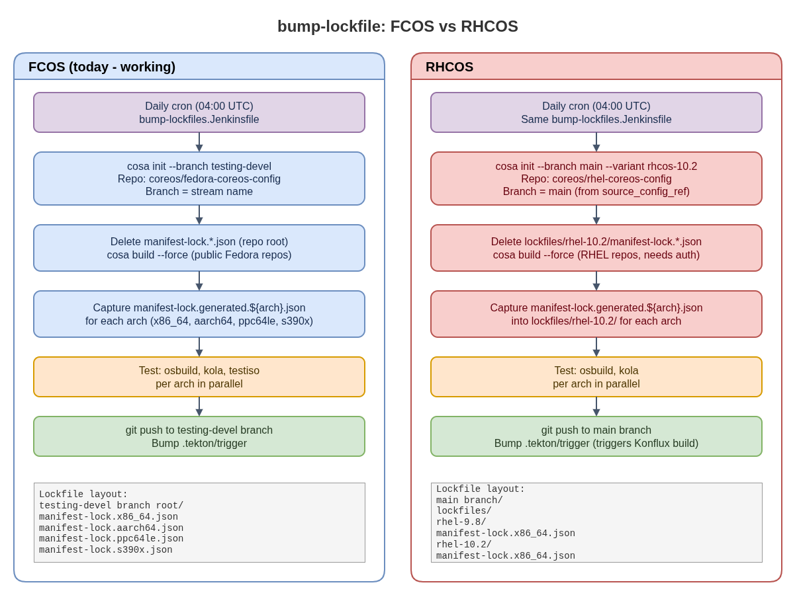

# ELI15: bump-lockfile - Daily RPM Lockfile Regeneration

**Technical reference:** [bump-lockfile.md](bump-lockfile.md)

## What is CoreOS?

CoreOS is an operating system designed to run containers. Instead of installing
packages one by one like a traditional Linux distribution, CoreOS ships as a
complete, pre-built image. There are two variants:

- **FCOS** (Fedora CoreOS) - the community version, built from Fedora packages
- **RHCOS** (Red Hat Enterprise Linux CoreOS) - the enterprise version used
  inside OpenShift, built from RHEL packages

Both are built by the same pipeline (`fedora-coreos-pipeline`) using the same
tool (`cosa` - CoreOS Assembler).

## The problem

CoreOS builds need to be **reproducible** - if you build the same thing twice,
you should get the same result. To achieve this, the build system pins the exact
version of every RPM package in a **lockfile** (a JSON file listing each package
name and its exact version string).

But packages get security patches and bug fixes all the time. So there is a
daily job called **bump-lockfile** that:

1. Throws away the old lockfile
2. Builds the OS from scratch, pulling the latest packages
3. Tests the result
4. Saves the new lockfile back to the config repository

This works for **FCOS**. **RHCOS** has a different repository layout, which
requires the bump-lockfile job to handle both configurations.

## Why is RHCOS different?

Think of FCOS and RHCOS as two restaurants using the same kitchen (the build
pipeline), but with different menus and storage rooms.

### FCOS: one menu per restaurant branch

Each FCOS **stream** (like "stable", "testing", "next") has its own branch in
the config repository. The lockfile sits at the top level of each branch:

```
Branch: testing-devel
  manifest-lock.x86_64.json
  manifest-lock.aarch64.json
```

The bump-lockfile job checks out that branch, regenerates the lockfiles, and
pushes back.

### RHCOS: all menus in one binder

RHCOS has multiple streams too (`rhel-9.8`, `rhel-10.2`, `c9s`, `c10s`), but
they all live on the **same branch** (`main`). Each stream's lockfiles are in
a subdirectory:

```
Branch: main
  lockfiles/
    rhel-9.8/
      manifest-lock.x86_64.json
      manifest-lock.aarch64.json
    rhel-10.2/
      manifest-lock.x86_64.json
      manifest-lock.aarch64.json
```

### Other differences

- **Package sources**: FCOS pulls from public Fedora repositories (anyone can
  download). RHCOS pulls from private RHEL repositories (need a subscription).
- **Build system**: FCOS is moving to Konflux but still uses Jenkins for
  lockfile bumps. RHCOS builds already run in Konflux with Tekton pipelines.

## The bootc builder image bump

Before regenerating lockfiles, the bump-lockfile job also checks if the
**builder image** needs updating. The builder image is the container that `cosa`
runs inside - it contains the OS tools and RPM repositories needed to assemble
CoreOS. Think of it as the oven in the restaurant analogy: you need the right
oven to bake the right menu.

The builder image reference is pinned in a file called `build-args.conf` (a
container image URL with a `@sha256:` digest). The "Bump bootc" stage:

1. Reads the current builder image from `build-args.conf`
2. Checks the registry for a newer version
3. If found, updates the digest in `build-args.conf`

**The RHCOS problem:** In `rhel-coreos-config`, `build-args.conf` is a symlink
to `build-args-rhel-9.8.conf`. Each stream has its own file
(`build-args-rhel-10.2.conf`, `build-args-c9s.conf`, etc.) because each stream
uses a different builder image. If the job runs for `rhel-10.2` but reads the
symlink, it bumps the wrong builder image.



- [Diagram source](bump-lockfile-bootc-bump.drawio)

## How the pipeline handles both layouts

The bump-lockfile job reads each stream's config repo and branch from
`config.yaml` via the `get_source_config_for_stream()` helper in `utils.groovy`.
When the repo's `source_config` sets `lockfiles_subdir: true`, the job uses
`lockfiles/${stream}/` as the path prefix for all lockfile operations.

For FCOS streams, lockfiles stay at the repo root - no prefix needed. For RHCOS
streams, where all streams share a single `main` branch, each stream's lockfiles
live in their own subdirectory.

The builder image bump (bootc stage) is also layout-aware: FCOS streams bump
`build-args.conf` in the pipeline, while RHCOS streams skip this stage because
a separate automation (MintMaker) handles builder image updates.

The downstream tools that consume these lockfiles - `build-rootfs` and
`konflux-rpm-lockfile` - both support the `lockfiles/${stream}/` directory
layout via a `get_lockfile_dir()` function that checks for a stream-specific
subdirectory first, then falls back to the repo root.

## Key terms

- **Lockfile** (`manifest-lock.*.json`): JSON file pinning the exact version of
  every RPM in the OS image
- **Stream**: A release channel (like "stable" or "testing-devel") with its own
  package set and update cadence
- **cosa** (CoreOS Assembler): The container tool that builds CoreOS images
- **Konflux**: Kubernetes-based build platform RHCOS uses for container builds
- **Tekton**: The pipeline engine inside Konflux (like Jenkins but
  Kubernetes-native)
- **Hermetic build**: A build that only uses pre-downloaded packages (from the
  lockfile), not live repos - ensures reproducibility
- **variant**: Configuration flag that tells cosa which flavor of the OS to
  build (e.g. `rhcos-9.8` vs `fedora-coreos`)
- **Builder image** (bootc): The container image that cosa runs inside to
  assemble the OS. Pinned by digest in `build-args.conf`
- **build-args.conf**: File that stores the builder image reference. FCOS has
  one file; RHCOS has per-stream files (`build-args-rhel-10.2.conf`, etc.)



- [Diagram source](bump-lockfile-fcos-vs-rhcos.drawio)
