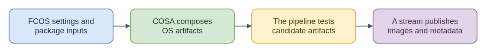

# ELI15: Fedora CoreOS Build and Release Pipeline

`fedora-coreos-pipeline` coordinates the public build and release workflow for Fedora CoreOS. Its stream configuration selects OS configuration and package repositories; CoreOS Assembler composes the OS, then the pipeline builds architecture-specific system and bootable-image artifacts and runs Kola checks. Cloud or upgrade validation can follow, depending on the stream.

Think of this as a production line with different recipes and inspections for different variants. The pipeline gathers the resulting build metadata and its release workflow publishes artifacts to a selected FCOS stream. Exact artifacts and tests can differ by architecture and stream, so one successful path does not establish that every variant was built the same way.

This repository describes the product workflow, not all shared Jenkins infrastructure: `coreos-ci` owns common CI configuration and job infrastructure, while COSA owns the build environment. Recovery of an existing build is also distinct from doing a new build, and neither should be confused with release publication. For CoreOS issue work, pin down the stream, architecture, revision, and failing stage first; that helps separate bad inputs or composition from a test, recovery, or publication problem.

**Technical guide:** [README.md](README.md)

- [Diagram source](eli15-flow.drawio)
