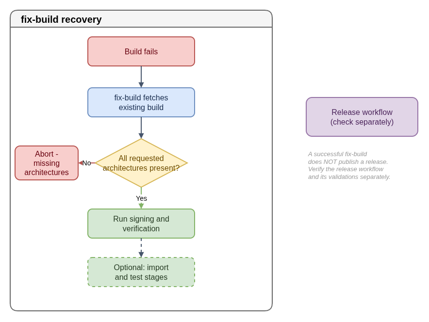

# Recovering an Existing FCOS Build

A recovery job may operate on artifacts that already exist rather than rebuild
the operating system. Before using one, inspect the current job definition and
confirm that its inputs match the failed release and architectures.

In the public `fedora-coreos-pipeline`, `fix-build` fetches an existing build,
checks that the requested architectures are present, and runs the configured
signing or verification path. Optional import and test stages depend on the
release configuration. It is not a replacement for the normal build job.

A successful recovery step does not necessarily publish a release. Check the
separate release workflow and its required validations before considering the
incident resolved. Signing or publication operations can affect release
artifacts; use the project's approved access and recovery procedure.

- [Diagram source](fix-build-recovery.drawio)

References:

- [`fix-build.Jenkinsfile`](https://github.com/coreos/fedora-coreos-pipeline/blob/main/jobs/fix-build.Jenkinsfile)
- [`build.Jenkinsfile`](https://github.com/coreos/fedora-coreos-pipeline/blob/main/jobs/build.Jenkinsfile)
- [FCOS release guidance](https://github.com/coreos/fedora-coreos-streams/blob/main/RELEASE.md)
