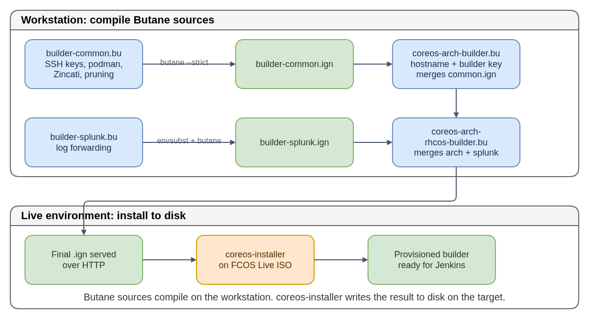

# Multi-Architecture Builder Provisioning

The pipeline builds OS images for multiple CPU architectures (x86_64, aarch64,
ppc64le, s390x). Each non-x86 architecture has a dedicated remote builder -
a physical or virtual machine that Jenkins connects to via SSH using
**podman remote**.

## How builders are configured

Each builder runs Fedora CoreOS (FCOS), configured at install time via
**Ignition**. The Ignition config is assembled from multiple
[Butane](../butane/README.md) files (`.bu`) in `multi-arch-builders/`:

- [Diagram source](multi-arch-builder-chain.drawio)

| File | Purpose |
|---|---|
| `builder-common.bu` | SSH keys, podman socket, Zincati update policy, container pruning |
| `builder-splunk.bu` | Splunk log forwarding (requires `envsubst` before `butane`) |
| `coreos-<arch>-builder.bu` | Architecture-specific hostname and builder SSH key; merges `builder-common.ign` |
| `coreos-<arch>-rhcos-builder.bu` | RHCOS-specific top-level config; merges the arch builder and Splunk configs |

The build chain has a dependency order: `builder-common.bu` and
`builder-splunk.bu` must compile first, because the architecture-specific
files merge their `.ign` outputs using `--files-dir=.`.

## How Jenkins connects

Jenkins stores three credentials per builder as OpenShift Secrets in the
pipeline namespace:

| Secret | Content |
|---|---|
| `coreos-<arch>-builder-host` | OS address of the builder |
| `coreos-<arch>-builder-uid` | Numeric UID of the `builder` user |
| `coreos-<arch>-builder-sshkey` | SSH keypair for the remote podman session |

The build jobs use these to establish a remote podman session on the builder,
then run coreos-assembler commands inside that session.

## Beaker

[Beaker](https://beaker-project.org/) is a hardware lab management system used
for bare-metal builders. It tracks machine inventory (architecture, CPU, memory,
disks), provides BMC (Baseboard Management Controller) access for remote power
control and console, and manages access through group-based policies.

Some builders (e.g. s390x) are registered in Beaker. To provision one, an
operator uses Beaker to access the BMC, mount a FCOS Live ISO via virtual
media, and boot into the live environment where `coreos-installer` writes
the configured image to disk.

## IBM POWER (ppc64le) specifics

The ppc64le builder was previously a bare-metal POWER9 server provisioned
through Beaker using **Petitboot** (the bootloader on IBM POWER hardware,
analogous to GRUB on x86). It is now a VM in an IBM lab where the CoreOS
team has SSH access only - the IBM infrastructure team handles console
access, reboots, and reprovisioning.

Kernel mitigations compatibility has been a recurring concern on POWER -
OS updates that change kargs have caused boot failures on previous
incarnations of this builder.

## Public references

- [Butane specification](https://coreos.github.io/butane/)
- [Ignition specification](https://coreos.github.io/ignition/)
- [Beaker project](https://beaker-project.org/)
- [Petitboot](https://github.com/open-power/petitboot)
- [Fedora CoreOS update strategy (Zincati)](https://docs.fedoraproject.org/en-US/fedora-coreos/auto-updates/)
