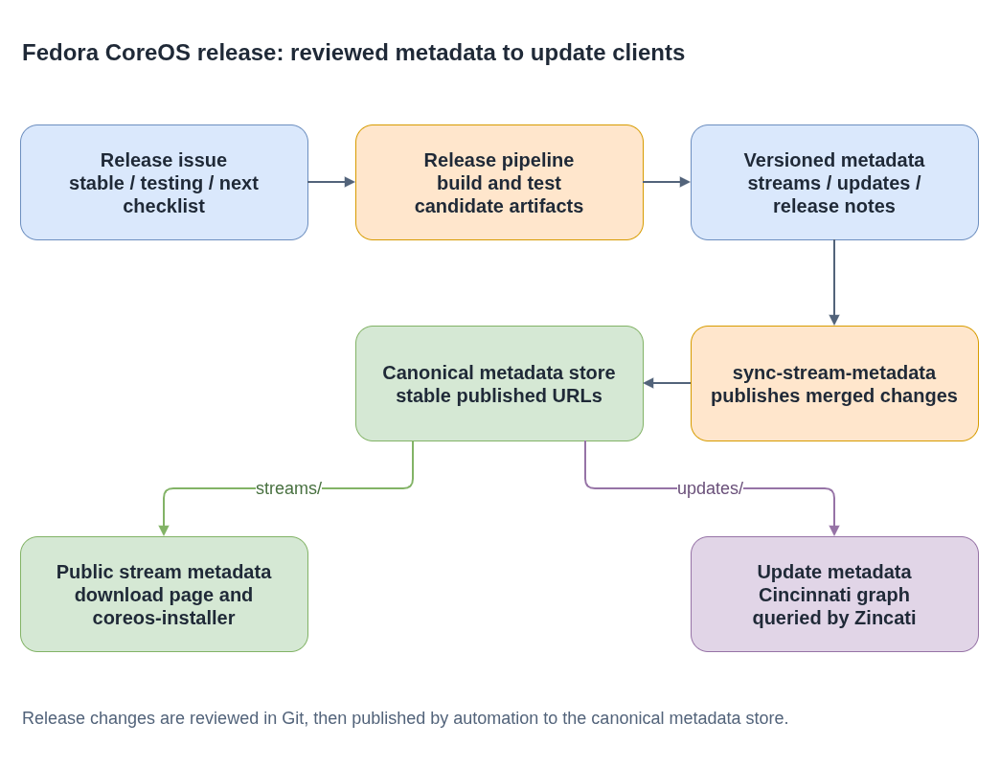

# Fedora CoreOS Streams

**Plain-language companion:** [ELI15](eli15.md)

The [`fedora-coreos-streams`](https://github.com/coreos/fedora-coreos-streams)
repository tracks FCOS release issues and stream, update, and release-note
metadata.

A Fedora CoreOS **release stream** is a moving line of complete OS releases that a machine can follow. It is not one universal image file: a release has artifacts for different CPU architectures, virtualization platforms, bare-metal installation, and clouds. The stream repository describes published releases; it does not itself build the OS or run updates on a user's machine.

## Choosing a release stream

The [FCOS update-stream documentation](https://github.com/coreos/fedora-coreos-docs/blob/main/modules/ROOT/pages/update-streams.adoc) defines three end-user streams:

| Stream | Meaning | Typical reason to follow it |
| --- | --- | --- |
| `stable` | The most conservative, reliable stream. Changes normally reach it after a period in `testing`. | Normal deployments where minimizing exposure to new regressions matters most. |
| `testing` | A preview of content intended for the next `stable` release, updated regularly so users can find problems before wider deployment. | Canary machines and compatibility testing for upcoming stable changes. |
| `next` | A preview of future changes, including new features and rebases onto the next major Fedora version. | Testing a coming platform transition earlier than `testing`. It is not simply another name for Rawhide. |

All three receive automated testing, but they expose users to different stages of change. The documentation encourages putting a portion of a deployment on `testing` and `next` so workload-specific problems can be reported early. A normal FCOS installation follows its selected stream as releases are rolled out; it does not automatically move from `next` to `testing` to `stable`.

**Content generally matures toward `next` -> `testing` -> `stable`; a byte-identical image is not guaranteed to be promoted through every stream.** Streams can share content, diverge during a Fedora rebase, or need release-specific fixes. In the public [stable release checklist](https://github.com/coreos/fedora-coreos-streams/blob/main/.github/ISSUE_TEMPLATE/stable.md), promotion is a reviewed change to the `stable` configuration branch, followed by building and testing stable artifacts. That is not merely relabeling the same downloaded disk image.

Selecting `testing` metadata for a download also does not change an existing machine's stream. Switching an installed FCOS system is a separate rebase operation described in the update-stream documentation. Moving toward older software can introduce data/configuration downgrade problems, and switching streams can skip update barriers; do not treat stream switching as a harmless rename or a guaranteed rollback mechanism.

## Development builds are not equivalent streams

Build tooling also uses the word `stream` for configuration branches and build inputs such as `testing-devel`, `next-devel`, and `rawhide`. These are engineering builds, not interchangeable alternatives to the three end-user update streams. A `*-devel` branch feeds release preparation; Rawhide builds exercise development content rather than providing the same curated release/update contract as `stable`.

For a scoped example, the public [pipeline configuration](https://github.com/coreos/fedora-coreos-pipeline/blob/main/config.yaml) marks `stable`, `testing`, and `next` as `production`, and `testing-devel`, `next-devel`, and `rawhide` as `development`. Older [stream-tooling terminology](https://github.com/coreos/fedora-coreos-tracker/blob/main/stream-tooling.md) also calls uncurated snapshot streams such as Rawhide `mechanical`. Names and implementation categories can evolve. Seeing a successful development build in the build browser is not proof that it is a published end-user release or that Zincati will offer it to an installed system.

## Metadata and consumers

The existing diagram shows metadata publication and its consumers, not a promise that an identical image moves through all streams:



- [Diagram source](./fcos-stream-release-flow.drawio)

- `streams/` contains the public stream metadata consumed by the download page, `coreos-installer`, and other clients. Stream metadata is generated by [`fedora-coreos-stream-generator`](https://github.com/coreos/fedora-coreos-stream-generator).
- `updates/` contains metadata used by Cincinnati to construct the update graph queried by Zincati clients.
- `release-notes/` contains release notes published alongside stream metadata.

The repository is versioned and reviewed in Git. Release automation syncs
merged metadata to the canonical published store; consumers use the published
metadata rather than a contributor's checkout. See the
[stream metadata documentation](https://docs.fedoraproject.org/en-US/fedora-coreos/stream-metadata/)
for the format and compatibility expectations.

### Download catalogue versus upgrade paths

**Stream metadata answers "which installation artifact should I use?"** It maps architectures and platforms to releases, formats, download locations, checksums/signatures, and cloud image identifiers. For example, this read-only query prints the currently advertised stable release and AWS AMI for `x86_64` in `us-west-1`; it neither launches an instance nor updates a machine:

```bash
curl -fsSL https://builds.coreos.fedoraproject.org/streams/stable.json \
  | jq -r '.architectures.x86_64.images.aws.regions["us-west-1"] | .release, .image'
```

The values change as releases are published. Select the architecture, platform, and region that actually match the deployment instead of copying an image ID from an old example. The [documentation source](https://github.com/coreos/fedora-coreos-docs/blob/main/modules/ROOT/pages/stream-metadata.adoc) and [Go data model](https://github.com/coreos/stream-metadata-go/blob/main/stream/stream.go) describe this public download interface.

**The update graph answers "which transitions can this installed machine take?"** Cincinnati combines release information with update/rollout metadata. Its graph nodes identify releases and payloads; directed edges identify valid update transitions. An update barrier requires passing through an intermediate release, while a dead-end release requires manual intervention to leave it. Zincati queries that service for its architecture and selected stream, then uses rpm-ostree to stage an eligible OS update and its configured reboot strategy to finalize it. It is not simply downloading whichever image happens to be listed in `stable.json`.

For comparison, this read-only graph query summarizes the response for the stable `x86_64` stream:

```bash
curl -fsSL -H 'Accept: application/json' \
  'https://updates.coreos.fedoraproject.org/v1/graph?basearch=x86_64&stream=stable' \
  | jq '{releases: (.nodes | length), transitions: (.edges | length)}'
```

This is an illustrative service query, not a replacement for Zincati's node-specific request. The graph can vary with rollout progress and client parameters, and local update/reboot policy matters too. An artifact can be available for new installations before every existing machine is offered an edge to it. See the public [graph protocol](https://coreos.github.io/zincati/development/cincinnati/protocol/), [phased rollout behavior](https://coreos.github.io/zincati/usage/auto-updates/), and [update metadata specification](https://github.com/coreos/fedora-coreos-tracker/blob/main/metadata/updates/specifications.md).

### Not OpenShift release streams

An **OpenShift CI release stream** groups cluster release-payload builds, not FCOS installation images. The OpenShift [release-controller](https://github.com/openshift/release/blob/master/core-services/release-controller/README.md) observes component ImageStreams, assembles release payloads, and runs verification jobs. In an installed OpenShift cluster, the [Cluster Version Operator](https://github.com/openshift/cluster-version-operator/blob/main/README.md) consumes a selected release payload to reconcile cluster operators, using OpenShift update-channel recommendations.

Those streams/channels and FCOS `next`/`testing`/`stable` have different payloads, clients, and release policies. Sharing terminology or Cincinnati-related technology does not make them the same release line. This repository's stream JSON is not an OpenShift release payload, and FCOS/Zincati stream instructions are not instructions for upgrading an OpenShift cluster or its managed CoreOS nodes.

## Release issue workflow

Each release for each stream is generally tracked by a GitHub issue that serves
as the release checklist. The repository's **Create release issues** workflow
creates issues from the `stable`, `testing`, and `next` templates.

- Dry run is enabled by default and previews the issue titles without creating issues. Review the preview before disabling dry run.
- Leave the date blank to use the standard release schedule, or provide an explicit release date.
- The workflow requires the confirmation text `CREATE`, including for a dry run. Existing issues for the same stream and date are skipped.

During a release, build and test the candidate artifacts, update the relevant
metadata and release notes through the repository's reviewed change process,
and verify the automated publication. For the maintained release checklist and
recovery guidance, see [RELEASE.md](https://github.com/coreos/fedora-coreos-streams/blob/main/RELEASE.md).

## Validation

Check changed JSON for valid syntax and the documented format/consumer
expectations, and run the repository's workflow checks before merging. The
public stream-metadata documentation currently notes that there is no JSON
schema for stream metadata; use schemas where they are provided, such as for
update metadata. Treat stream metadata as a stable public interface; update
consumers and documentation deliberately when a format change is required.

## Public references

- [Stream repository and consumer overview](https://github.com/coreos/fedora-coreos-streams)
- [FCOS update streams (documentation source)](https://github.com/coreos/fedora-coreos-docs/blob/main/modules/ROOT/pages/update-streams.adoc)
- [FCOS stream metadata (documentation source)](https://github.com/coreos/fedora-coreos-docs/blob/main/modules/ROOT/pages/stream-metadata.adoc)
- [Metadata types and their different consumers](https://github.com/coreos/fedora-coreos-tracker/blob/main/metadata/README.md)
- [Zincati reboot strategies](https://coreos.github.io/zincati/usage/updates-strategy/)
- [Maintained stable release checklist](https://github.com/coreos/fedora-coreos-streams/blob/main/.github/ISSUE_TEMPLATE/stable.md)

Examples are scoped to FCOS and the specified platform; development build names and release automation can change.
