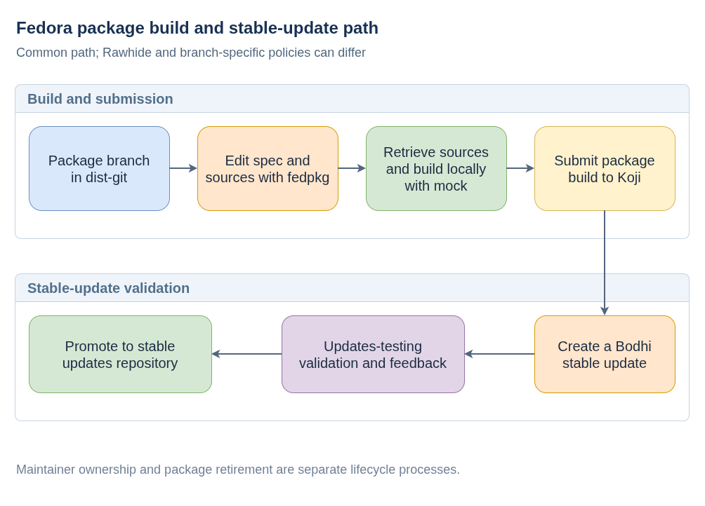

# Fedora Package Maintenance

**Plain-language companion:** [ELI15](eli15.md)

Fedora package sources are maintained in dist-git, built in Koji, and distributed through Fedora repositories. The diagram shows a common stable-update path; Rawhide and branch-specific policies can differ.

## Stable-update flow



- [Diagram source](fedora-package-update-flow.drawio)

A typical maintainer workflow is:

```bash
fedpkg clone rpms/NAME
cd NAME
fedpkg sources
fedpkg mockbuild
fedpkg build
fedpkg update
```

Replace `NAME` with the Fedora package name.

The checkout contains the RPM spec and package-maintained source metadata. `fedpkg sources` retrieves declared source files, and `fedpkg mockbuild` provides a local build check. `fedpkg build` submits a package build to Koji. For a stable update, Bodhi coordinates the update through `updates-testing` and its validation process before promotion to the stable updates repository.

## Package ownership

Orphaned and retired describe package-maintenance lifecycle states; they are not steps in every build or update. Claiming an orphaned package or reintroducing a retired package follows Fedora's current ownership and review policies, which can change over time.

## Field-guide notes

- [Orphaning, retirement, and package restoration](orphan-retire-unorphan.md) (confirm branch-specific current policy)
- [JUnit dependency improvements and migration](python-junit-xml-improvements.md) (historical, superseded proposal)

The JUnit note is historical and superseded for COSA. Check current package
policy and the repository's chosen dependency before reusing an old proposal.

## Public references

- [Fedora package sources](https://src.fedoraproject.org/browse/projects/?namespace=rpms)
- [fedpkg documentation](https://fedpkg.readthedocs.io/en/latest/)
- [Koji build system](https://koji.fedoraproject.org/)
- [Bodhi updates](https://bodhi.fedoraproject.org/)
- [Fedora package-maintainer documentation](https://docs.fedoraproject.org/en-US/package-maintainers/)
- [Fedora packaging guidelines](https://docs.fedoraproject.org/en-US/packaging-guidelines/)
