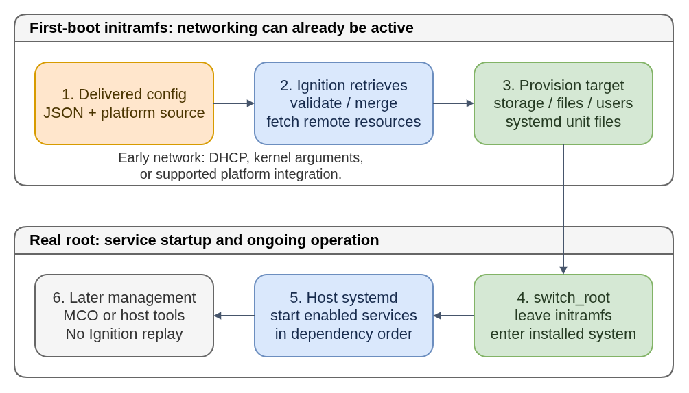

# Ignition: Provisioning Before Normal Boot

Platform support and accepted schemas depend on the target image.

Ignition prepares a machine so its normal operating system can start with the
intended storage and configuration already in place. It runs during first boot
in the **initramfs**, the temporary early-boot environment, before `switch_root`
hands control to the installed system's root filesystem and services.

Its input describes desired state, not a shell-script sequence. Ignition can
partition disks, create filesystems and encrypted volumes, write files, configure
users and SSH public keys, and install or enable systemd units. It is **not an
ongoing configuration manager**, application installer, or OS update controller.

**Plain-language companion:** [ELI15](eli15.md)



- [Diagram source](ignition-first-boot.drawio)

[Editable diagram source](ignition-first-boot.drawio). The PNG also embeds the diagram.

## Component Boundaries

| Neighbor | What is separate from Ignition |
|---|---|
| Butane | Author-side YAML validation and transpilation; this guide delivers its JSON output. |
| Image builders / coreos-installer | Compose or install the OS image and arrange first-boot inputs. Ignition does not install a distribution from packages. |
| Afterburn / early-network integration | Obtain platform metadata or early network inputs where supported; there is no universal "Afterburn runs after Ignition" rule. |
| Host systemd | Start services from provisioned units after normal boot takes over. Ignition does not execute arbitrary user scripts. |
| Machine Config Operator (MCO) / standalone management | Make later supported configuration changes and coordinate OS rollouts. Using Ignition-format data in MCO does not mean rerunning first-boot Ignition. |

Upstream Ignition also documents direct Butane-YAML input and automatic
transpilation. Do not assume every OS image contains that support. The explicit
Butane-to-JSON workflow used here keeps input format and target compatibility clear.

## Logical First-Boot Lifecycle

1. The image's boot integration enables first-boot provisioning and identifies
   the platform. Early networking is brought up when needed for remote resources.
2. Ignition retrieves the platform-provided config, validates its schema, and
   resolves configured replacements or merges, including applicable base config.
3. It prepares the requested storage: partitions, RAID/LUKS devices, filesystems,
   and mounts needed to populate the target system. Existing-storage checks matter.
4. It writes files and directories, configures accounts, and installs systemd
   units/drop-ins and enablement data on the target filesystems.
5. On successful provisioning, boot proceeds through `switch_root`. The host's
   systemd starts normal services using their dependency and enablement rules.
6. Subsequent normal boots use the resulting state without replaying Ignition.
   Post-boot management and OS updates are separate lifecycles.

This is a logical sequence, not an exact systemd-unit ordering for every image.
The target root may be mounted temporarily while being populated; "early boot"
does not mean Ignition completes every action before any filesystem is mounted.
An unmet provisioning requirement can stop boot. Earlier writes are not rolled
back as a transaction, so investigate failed provisioning before trying again.

## How Configuration Arrives

| Platform or workflow | Documented delivery example |
|---|---|
| AWS EC2 | Instance user-data containing the provisioning config, not a cloud-init shell script. |
| QEMU | Firmware configuration key `opt/com.coreos/config` through `fw_cfg`. |
| VMware | `ignition.config.data` and `ignition.config.data.encoding` Guestinfo variables. |
| Bare metal / live installation | Embed the destination config with installer tooling, or use the metal platform's `ignition.config.url` kernel argument. |

Delivery is platform-specific, including encoding and size limits. A live
installer's configuration and the installed machine's destination first-boot
configuration are distinct; supplying one does not automatically supply the other.

**Networking need not wait for Ignition.** Remote config, remote file contents,
or network-bound storage unlocks may require connectivity in the initramfs.
FCOS can obtain it from DHCP, kernel arguments, embedded/copied network keyfiles,
or supported platform integration. Ignition can also write persistent
NetworkManager keyfiles, but those cannot bootstrap access to their own remote
source. Arrange the fetch-time network first when defaults are insufficient.

## Small, Non-Destructive Example

The following readable JSON illustrates the marker file from the
[Butane guide](../butane/README.md). It uses documented Ignition schema `3.5.0`,
not an assertion of the newest schema; check support in the target OS image.
It requests no formatting, user changes, or services. Author real configs with
Butane rather than manually assembling JSON.

```json
{
  "ignition": {"version": "3.5.0"},
  "storage": {
    "files": [{
      "path": "/etc/field-guide.txt",
      "mode": 420,
      "contents": {"source": "data:,Provisioned%20on%20first%20boot.%0A"}
    }]
  }
}
```

`420` is decimal for permission mode `0644`; the data URL contains the text and
a newline. With a compatible validator, `ignition-validate marker.ign` checks
the config without applying it. Provision only a fresh disposable VM for this
exercise, with authorized access arranged separately. Do not invoke the Ignition
provisioner manually on a running workstation or production node.

## Pitfalls And Diagnosis

- A valid schema does not prove the right disk was selected or that remote resources will be reachable at boot. Wipe flags can destroy data; use stable device identities and isolated tests.
- Do not force a rerun as an ordinary update mechanism. Reapplying storage directives or first-boot enablement can have unexpected or destructive effects.
- Replacing user-data after provisioning does not reconfigure an existing node. Use MCO on managed OpenShift nodes, supported host management on standalone systems, or deliberate reprovisioning.
- First-boot-only provisioning does not make a provisioned service first-boot-only. An enabled service can run on every boot unless its unit says otherwise.
- Check file overwrite and filesystem-reuse semantics rather than assuming every existing object is silently replaced.
- Avoid secrets in provisioning data. Metadata access and config retention differ by platform; a data URL or base64 encoding is not encryption.
- Keep runtime-only state out of `/run`, `/tmp`, `/proc`, `/sys`, and `/dev` provisioning writes; use tmpfiles, sysctl, or udev configuration as appropriate.

For failures, inspect the serial console and run
`journalctl --identifier=ignition --all` from an accessible boot environment.
Then distinguish retrieval/network,
schema, storage, and file errors from a later host-service failure. Validator
success alone does not demonstrate a successful boot.

## Related Guides

- [Butane](../butane/README.md): versioned YAML authoring and safe JSON generation.
- [CoreOS ecosystem](../../getting-started/02-coreos-ecosystem.md): boot, writable state, and update boundaries.
- [OpenShift, RHEL, and RHCOS](../../getting-started/03-ocp-rhel-rhcos.md): MCO-managed nodes versus standalone hosts.
- [Custom CoreOS disk images](../custom-coreos-disk-images/README.md): producing boot artifacts is separate from provisioning an instance.

## Primary Sources

- [Ignition getting started](https://coreos.github.io/ignition/getting-started/) and [design rationale](https://coreos.github.io/ignition/rationale/).
- [Ignition schema 3.5.0](https://coreos.github.io/ignition/configuration-v3_5/): provisioning primitives and decimal modes.
- [Supported platforms and config sources](https://coreos.github.io/ignition/supported-platforms/).
- [Operator notes](https://coreos.github.io/ignition/operator-notes/): reuse, merge, path, and secret semantics.
- [FCOS networking, upstream documentation source](https://github.com/coreos/fedora-coreos-docs/blob/main/modules/ROOT/pages/sysconfig-network-configuration.adoc).
- [coreos-installer live ISO commands](https://coreos.github.io/coreos-installer/cmd/iso/): live versus destination configuration.
