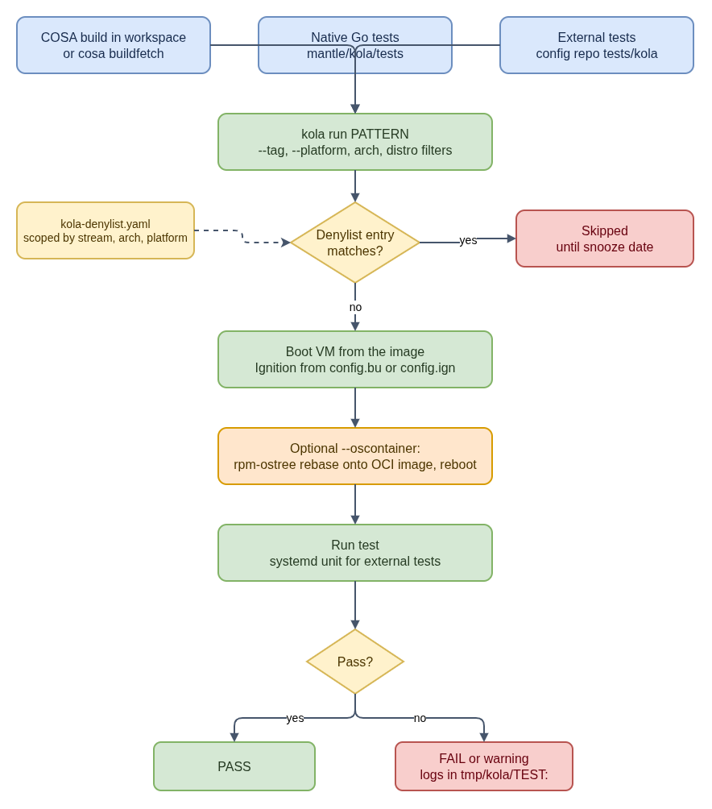

# kola: CoreOS Integration Tests

Flags and metadata keys evolve; `cosa kola run -h` and the upstream docs are
authoritative.

**Plain-language companion:** [ELI15](eli15.md)

kola is the CoreOS integration test framework. It boots real OS images, by
default in QEMU and optionally on cloud platforms, provisions them with
Ignition, and runs tests against the running machines. It lives in the
[`coreos-assembler`](https://github.com/coreos/coreos-assembler) repository
under `mantle/` and ships in the COSA container, so it runs in the same
workspace that built the image.



- [Diagram source](kola-test-flow.drawio)

## Where tests come from

| Source | Location | Name pattern |
|---|---|---|
| Native (Go) tests | `coreos-assembler`: `mantle/kola/tests/` (for example `ignition/`, `ostree/`, `upgrade/`, `iso/`) | `basic`, `fcos.upgrade.basic`, `iso.pxe-online-install.4k.uefi`, ... |
| Config-repo external tests | `tests/kola/` in `fedora-coreos-config` or `rhel-coreos-config`, seen by COSA as `src/config/tests/kola/` | `ext.config.<path>`, for example `ext.config.rpm-ostree.kernel-replace` |
| Package-installed external tests | `/usr/lib/coreos-assembler/tests/kola/` | `ext.<project>.<path>` |
| Extra directories | `kola run -E <dir>` | `ext.<project>.<path>` |

Inside a COSA workspace, kola discovers config-repo and package-installed tests
automatically; `-E` is only for additional directories.

### External tests

An external test is an executable in a directory under `tests/kola/`. kola
uploads it to the machine and runs it as a systemd unit with full privileges.
The test fails if the unit exits non-zero or dies from a signal other than
`SIGTERM`. A directory can also contain:

- `config.bu` or `config.ign`: Butane or Ignition config applied when the machine is provisioned.
- `data/`: dependencies uploaded with the test, available as `$KOLA_EXT_DATA`. In `fedora-coreos-config`, `data/commonlib.sh` holds shared helpers.
- Test metadata, either as `kola.json` or inline in the script header.

If a directory has a single executable named `test.sh`, the test name drops
the script name (`ext.config.<dir>` instead of `ext.config.<dir>.test.sh`).

Inline metadata looks like this:

```bash
#!/bin/bash
## kola:
##   tags: "platform-independent"
##   exclusive: false
##   distros: "fcos rhcos"
##   description: Verify the RPM vendor of every installed package.
```

Common metadata keys:

| Key | Effect |
|---|---|
| `tags` | Labels used for selection (`--tag`) and behavior, see below |
| `platforms`, `architectures`, `distros` | Restrict where the test runs; a `!` prefix excludes |
| `exclusive` | `false` lets a read-only test share a machine with other non-exclusive tests |
| `timeoutMin` | Per-test timeout in minutes |
| `minMemory`, `minDisk`, `additionalDisks`, `additionalNics` | Machine shape the test needs |
| `appendKernelArgs`, `appendFirstbootKernelArgs` | Extra kernel arguments |
| `conflicts` | Tests that must not share a machine with this one |

Tags with built-in meaning include `platform-independent` (run once, on QEMU,
rather than on every platform), `needs-internet`, and `skip-base-checks` (skip
the default console checks for kernel errors and SELinux denials). The full key
list is in the upstream
[external tests documentation](https://coreos.github.io/coreos-assembler/kola/external-tests/).

## Running tests

`cosa kola` wraps `kola` with workspace defaults: platform `qemu`, output in
`tmp/kola`, the `run` subcommand, and the latest build.

```bash
cosa kola run basic                         # one test or glob
cosa kola run 'ext.config.*'                # all config-repo tests
cosa kola run --tag '!reprovision'          # exclude a tag
cosa kola run --parallel 3 'ext.config.*'   # parallel run
cosa kola --upgrades                        # upgrade tests
kola list --json | jq -r '.[] | [.Name,.Description] | @tsv'
```

Useful flags when investigating:

| Flag | Use |
|---|---|
| `--ssh-on-test-failure` | Drop into the machine when a test fails |
| `--rerun` | Re-run failed tests once, to separate flakes from real failures |
| `--multiply N` | Run a test N times to reproduce a race |
| `--denylist-test PATTERN` | Skip extra tests for this run only |
| `--append-butane PATH` | Merge a Butane snippet into every test's config, for example to add debugging units |

ISO and PXE install scenarios are ordinary kola tests named `iso.*` (for example
`cosa kola run iso.iso-offline-install.mpath.bios`) and need the matching live
artifacts to be built first.

### Reading a failure

Each test writes to `tmp/kola/<test-name>/`. Start with the machine's
`console.txt` for boot and kernel problems and `journal.txt` for service
failures, then the test's own output. To reproduce by hand, boot the same build
with `cosa run`, optionally with the test's Ignition config (`cosa run -i <config.ign>`).

## The denylist: skipping known failures

A config repository can ship `kola-denylist.yaml` at its root. COSA reads it
from `src/config/kola-denylist.yaml` and skips matching tests on every run, with
no extra flags.

```yaml
- pattern: ext.config.rpm-ostree.kernel-replace
  tracker: https://github.com/coreos/fedora-coreos-tracker/issues/NNNN
  snooze: 2026-09-30
  warn: true
  streams:
    - rawhide
  arches:
    - ppc64le
  platforms:
    - gcp
```

How kola applies an entry (from `ParseDenyListYaml` in `mantle/kola/harness.go`):

1. **Scope:** `arches`, `platforms`, and `streams` each narrow the entry; an
   omitted list matches everything. The entry is ignored if any listed scope
   does not match the current run.
2. **With `snooze`:** before the date, the test is skipped. After the date the
   test runs again automatically; with `warn: true`, its failures are reported
   as warnings instead of failing the run.
3. **Without `snooze`:** with `warn: true` the test runs and failures only warn;
   otherwise the test is skipped indefinitely.
4. **Special pattern:** `skip-console-warnings` disables the console checks for
   kernel errors rather than skipping a test.

**Stream gotcha:** kola learns the stream from `--denylist-stream`, or else from
the build's `meta.json` (`com.coreos.stream` OCI label). When testing a
user-provided disk image (`--qemu-image`) without `--denylist-stream`, the stream
is unknown and **stream-scoped entries are not applied**, so those tests run.

**Good practice for a new entry:** file or link a public tracker issue, scope
the entry as narrowly as the failure (stream, arch, platform), and prefer a
`snooze` date over an open-ended skip so the test comes back on its own. Config
repositories keep a denylist per branch, so an entry added on a development
branch may also be needed on the branch for the affected production stream.

## Testing an OS container image (`--oscontainer`)

For OS images delivered as containers, such as OpenShift node images, kola can
test the image without building a new disk image:

```bash
cosa buildfetch --url <builds-url> --artifact qemu --build <base-build-id>
cosa decompress --build <base-build-id>
cosa kola run --oscontainer ./node-image.ociarchive --tag openshift \
  --denylist-stream <release>
```

The node-image pipeline passes `--denylist-stream` with its release parameter
(for example `4.22-9.8`), so denylist entries scoped to that release apply to
the node-image run.

`buildfetch` needs `--url` (`s3://`, `https://`, or `file://`) for anything
other than Fedora CoreOS. Without it, it assumes an FCOS build ID, derives the
stream from the ID's third field, and fetches from the public FCOS builds site.

For each machine, kola copies the OCI archive into the VM, runs
`rpm-ostree rebase --experimental` onto it (`ostree-unverified-image:oci-archive:...`),
reboots, and only then runs the tests. A pull spec instead of a local
`.ociarchive` is passed to the rebase directly. The flag's help text describes
it as RHCOS-oriented; see the
[node-image build flow](../fedora-coreos-pipeline/build-node-image.md) for how
the pipeline chooses the base build.

## Where kola runs in CI

- **Pull requests to config and COSA repositories:** CoreOS CI builds the change
  and runs kola ([CoreOS CI](../coreos-ci/README.md)).
- **FCOS pipeline:** kola gates candidate builds on QEMU, with separate jobs for
  cloud platforms and upgrades
  ([fedora-coreos-pipeline](../fedora-coreos-pipeline/README.md)).
- **Node images:** the node-image job tests with `--oscontainer` and the
  `openshift` tag.

Package-level tests that run before an RPM reaches CoreOS use tmt and Testing
Farm instead; see [Testing and gating](../../knowledge/testing-and-gating.md).

## Public references

- [Testing with kola](https://coreos.github.io/coreos-assembler/kola/)
- [Integrating external test suites](https://coreos.github.io/coreos-assembler/kola/external-tests/)
- [Adding kola tests](https://coreos.github.io/coreos-assembler/kola/adding-tests/)
- [kola harness source](https://github.com/coreos/coreos-assembler/tree/main/mantle/kola)
- [`fedora-coreos-config` kola tests](https://github.com/coreos/fedora-coreos-config/tree/testing-devel/tests/kola) and [denylist](https://github.com/coreos/fedora-coreos-config/blob/testing-devel/kola-denylist.yaml)
