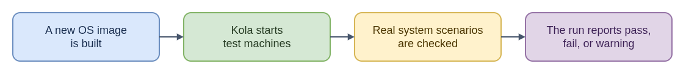

# kola - Plain-Language Explanation

kola is the test driver for CoreOS. After a new OS image is built, kola
starts real virtual machines from it, sets them up the way a user would on
first boot, and checks that things actually work: the machine boots, services
start, disks and networking behave, updates apply.

Think of it as a test track for a newly built car. Unit tests check single
parts on a bench; kola puts the whole car on the road.

Tests come from two places. Some are written in Go inside kola itself. Others
are small scripts that live next to the OS configuration they check, so the
people who change a package or setting can add a test beside the change.

Sometimes a test fails for a reason that is already known and being fixed
elsewhere. Instead of blocking every build, the team adds the test to a
**denylist**: a list of tests to skip, usually only on certain architectures or
release streams, and usually with a **snooze** date. When that date passes, the
test starts running again by itself, so nobody has to remember to turn it back
on.

kola can also take an OS delivered as a container image, such as an OpenShift
node image, switch an existing test machine over to it, and run the tests
there. That tests the new image without building a new disk image.

kola runs on every config and build-tool pull request and on each Fedora
CoreOS build before anything is released.

See the [technical guide](README.md).

- [Diagram source](eli15-flow.drawio)
