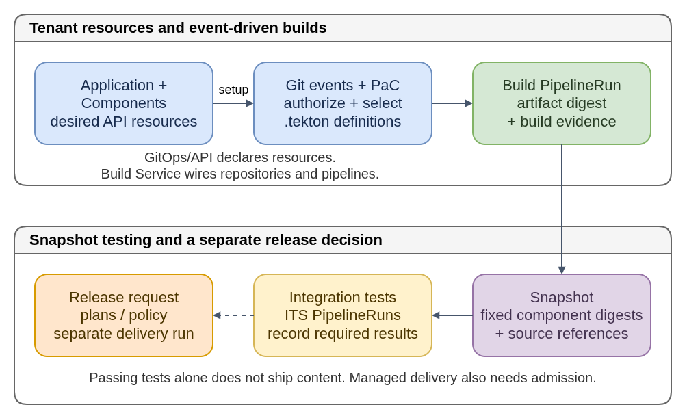

# Konflux: From Source Changes To Released Artifacts

Konflux is a Kubernetes-native platform for building, testing, and releasing
software artifacts with traceable inputs and evidence. A source change can
produce an OCI image, a software bill of materials (SBOM) describing its contents,
and provenance recording how it was built. Tests and release policies decide
what may be delivered.

For CoreOS work, Konflux can orchestrate OS-container or related artifact builds.
It does not replace the tools that compose an OS, define a distribution's release
streams, or update machines already running that OS. A successful build is a
**candidate artifact**, not automatically a published CoreOS release.

**Plain-language companion:** [ELI15](eli15.md)



- [Diagram source](konflux-artifact-lifecycle.drawio)

[Editable diagram source](konflux-artifact-lifecycle.drawio). The PNG also embeds the diagram.

## Resource Model

Konflux and Tekton expose these concepts through Kubernetes custom resources.
Tenant namespaces scope resources and access. A managed release namespace can
separately hold release-team-controlled pipelines, policy, and credentials.
The table describes the public Application-based workflow; installed API groups,
fields, grouping models, and optional controllers can differ.

| Resource | Plain-language meaning |
|---|---|
| Application | A logical group of Components to test/release together, not a running Kubernetes Deployment. |
| Component | A buildable unit with source, build context, and artifact destination; multiple Components can use one source repository. |
| ImageRepository | Where enabled, requests registry repository and access provisioning; it is not the image content itself. |
| Pipeline / Task | Tekton definitions of work; a PipelineRun is one execution, with TaskRuns and Pods beneath it. |
| Snapshot | A fixed set of component artifact digests and source references. Its content list is immutable; test status can change. |
| IntegrationTestScenario (ITS) | Selects an integration-test pipeline to run against a Snapshot, including whether the scenario is required. |
| EnterpriseContractPolicy | Declares artifact/evidence requirements evaluated by Conforma policy checks. |
| ReleasePlan | Relates an Application to a release action, pipeline configuration, and optional automatic-release behavior. |
| ReleasePlanAdmission | For a managed release, the receiving team's authorization and controlled pipeline/policy configuration. |
| Release | An actual request to deliver a particular Snapshot using a particular ReleasePlan; carries progress and outcome. |

A Snapshot is neither a filesystem snapshot nor an alias for "whatever was built
most recently." Its digests identify the exact artifact combination being tested
or released. Check its component list; not every expected build may be present.

## Controllers And Neighboring Tools

| Layer | Owns this responsibility, not the neighboring one |
|---|---|
| GitOps, when configured | Reconcile reviewed resource declarations from Git into the Kubernetes API. A synced tenant config does not mean a source build or release succeeded. |
| Konflux Build Service | Reconcile Components, arrange repository/build integration, and propose pipeline definitions. It is not the Tekton task executor. |
| Pipelines as Code (PaC) | Authorize and match Git events to `.tekton` PipelineRun definitions and submit runs. Event handling is not continuous GitOps reconciliation. |
| Tekton controllers | Execute PipelineRuns through TaskRuns/Pods and report execution status. They do not independently decide product-release eligibility. |
| Konflux Integration Service | Create Snapshots, orchestrate ITS runs, record test outcomes, and request configured automatic releases. |
| Konflux Release Service | Process Release requests and orchestrate separate delivery PipelineRuns under the chosen plan and admission rules. |
| CoreOS Assembler (COSA) / OSBuild / product pipelines | Compose OS artifacts and define product-specific validation/publication. Konflux supplies orchestration, not universal CoreOS release semantics. |

Resource declarations and `.tekton` definitions may live in different repositories.
GitOps configuration changes, source-event build triggers, and controller
reconciliation are related mechanisms, not one interchangeable "Git pipeline."

## Logical Lifecycle

1. Declare the Application/Components and registry access through the supported
   API or GitOps workflow. Build Service can propose `.tekton` definitions for
   review; enabling a Component is separate from completing a build.
2. An authorized pull-request or push event reaches PaC. Repository registration,
   event/branch/path matching, and pipeline provenance determine which run starts.
3. Tekton executes the build PipelineRun. Configured tasks fetch inputs, build
   and push artifacts, run build-time checks, and record digests and evidence.
4. Integration Service reads completed build results and creates a Snapshot with
   the new artifact and other selected component candidates, then starts ITS runs.
5. Integration PipelineRuns test that fixed combination and record outcomes.
   Required scenarios gate automatic Release creation; optional tests are distinct.
6. A manual or configured automatic Release selects the Snapshot and ReleasePlan.
   Release Service orchestrates delivery runs; managed delivery additionally uses
   matching admission and policy. Publication is the configured pipeline's action.

**Candidate promotion is not release promotion.** Push-build candidate references
can advance before integration tests pass. A field such as `lastPromotedImage`
therefore does not prove an artifact was tested successfully or shipped. Inspect
Snapshot test outcomes and the Release/delivery results separately.

Managed releases separate development credentials from receiving-team authority.
Documented tenant-only release pipelines can instead run under the tenant's own
plan and credentials without a managed admission. Neither path is implied by a
green build. Release checks can inspect structured scan/test evidence even when
the build PipelineRun itself succeeded.

## Safe Inspection Example

With existing authorized access, these commands only discover APIs and list runs.
They do not create resources, trigger builds, or initiate releases:

```bash
: "${KONFLUX_CONTEXT:?Set a context you are authorized to inspect}"
: "${TENANT_NAMESPACE:?Set your tenant namespace}"
kubectl --context="$KONFLUX_CONTEXT" api-resources --namespaced=true
kubectl --context="$KONFLUX_CONTEXT" --namespace="$TENANT_NAMESPACE" \
  get pipelineruns.tekton.dev
```

Use API discovery to choose the served resource groups for Snapshots, scenarios,
and Releases instead of copying an assumed Konflux API version. Build, test, and
release runs share the PipelineRun kind; inspect labels, owner references,
results, and status conditions to identify their role and connect the lifecycle.

## Pitfalls

- A GitOps sync, successful build, tested Snapshot, successful Release, published stream, and node rollout are different milestones. None should be inferred solely from another.
- PR artifacts are pre-merge candidates; their trust, retention, and release eligibility can differ from push builds. Review PaC authorization and pipeline-definition provenance.
- Tags can move. Select immutable digests and preserve source/evidence references when comparing tests with released content; rebuilding produces a new candidate.
- Scanners run only if configured, and policy controls acceptable outcomes. A successful task does not necessarily mean it found no vulnerabilities.
- Missing build results, an incomplete Snapshot, or an optional ITS can leave a gap between "green CI" and the intended release checks.
- Keep Secrets out of public Git, generated examples, and logs. Do not bypass GitOps ownership or relax release admission just to get a run started.

After artifact delivery, distribution-specific release tooling still decides
stream publication and consumers' update availability. Zincati, FCOS's update
coordinator, or OpenShift's Machine Config Operator (MCO) manages applicable node
rollouts; Konflux does not become a first-boot or host-update agent.

## Related Guides

- [Tenant configuration](../tenants-config/README.md): public GitOps and dependent-build concepts.
- [CoreOS Assembler](../coreos-assembler/README.md): the actual OS build/test tools.
- [Fedora CoreOS pipeline](../fedora-coreos-pipeline/README.md): product build and stream-publication workflow.
- [OpenShift OS](../openshift-os/README.md): node-image production in the OpenShift ecosystem.
- [CoreOS CI](../coreos-ci/README.md): the distinct Jenkins-based upstream CI infrastructure.

## Primary Sources

This describes public concepts, not a particular cluster deployment.

- [Konflux key concepts](https://konflux-ci.dev/docs/getting-started/) and [Application/Component/Snapshot API](https://konflux-ci.dev/docs/reference/kube-apis/application-api/).
- [Configuration as code](https://konflux-ci.dev/docs/building/configuration-as-code/) and [Build Service implementation](https://github.com/konflux-ci/build-service).
- [PaC concepts and event flow](https://pipelinesascode.com/docs/concepts/).
- [Snapshots](https://konflux-ci.dev/docs/testing/integration/snapshots/) and [Integration Service architecture](https://github.com/konflux-ci/architecture/blob/main/architecture/core/integration-service.md).
- [Release workflow](https://konflux-ci.dev/docs/releasing/) and [tenant-only release pipelines](https://konflux-ci.dev/docs/releasing/tenant-release-pipelines/).
- [Standardized test outputs](https://konflux-ci.dev/docs/testing/integration/standardized-outputs/): execution status versus test evidence.
