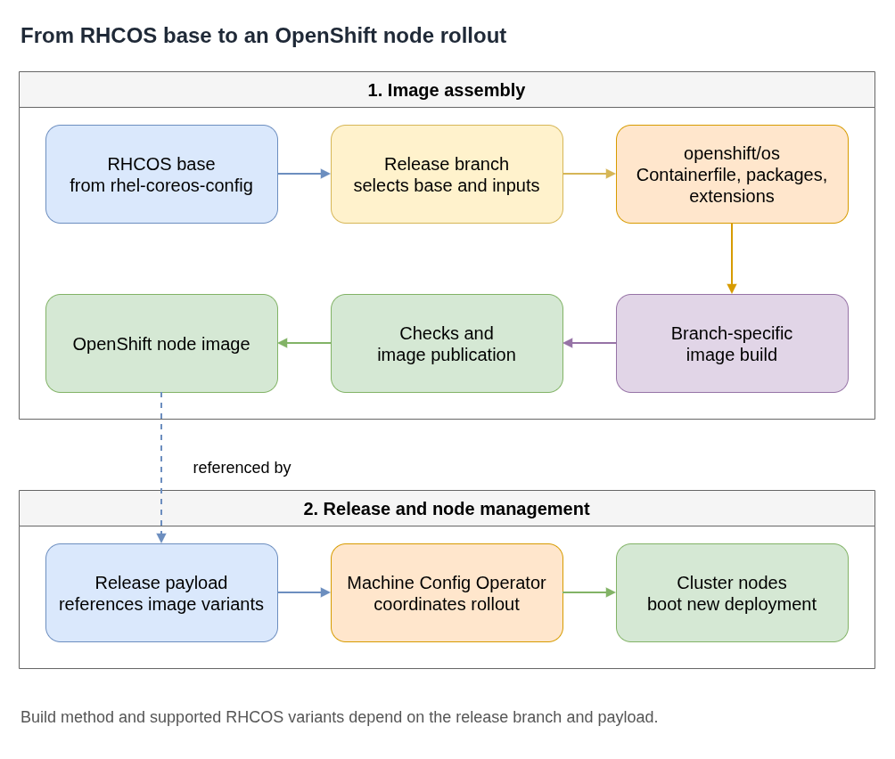

# OpenShift Node Images (`openshift/os`)

Later releases can add or drop node OS variants; check the target release
payload when identifying supported node images.

The `openshift/os` repository assembles OpenShift node operating-system images from a RHEL CoreOS base and OpenShift-specific content. Keep the RHCOS base-image build distinct from the final OpenShift node-image build: the base configuration is maintained in [`rhel-coreos-config`](https://github.com/coreos/rhel-coreos-config), while the `openshift/os` branch adds the node-image content consumed by OpenShift releases.

**Plain-language companion:** [ELI15](eli15.md)



- [Diagram source](openshift-node-image-flow.drawio)

## Build and release flow

1. A release branch selects its RHCOS base and build inputs.
2. The `openshift/os` branch assembles the node image. The build implementation varies by release branch; some branches use COSA-era inputs, while newer branches use a Containerfile-based flow. Check the branch's own documentation rather than assuming one build method for every release.
3. CI builds and tests the image, then makes it available to the OpenShift release process.
4. The release payload records image references for the node OS variants it supports.
5. The Machine Config Operator coordinates node updates from the release payload. This managed rollout is distinct from manually running a host-level update command.

An OpenShift minor release can publish more than one RHCOS variant. For example, the public 4.21 and 4.22 release payloads each list RHEL 9- and RHEL 10-based node OS images. Select an image from the release payload instead of assuming one RHEL base per OCP minor.

```bash
oc adm release info <release-image> --image-for rhel-coreos
```

For a specific variant, use the image component name exposed by that payload (for example, `rhel-coreos-10` where present).

## Public references

- [`openshift/os`](https://github.com/openshift/os)
- [RHCOS base-image configuration](https://github.com/coreos/rhel-coreos-config)
- [OpenShift release CI configuration](https://github.com/openshift/release/tree/master/ci-operator/config/openshift/os)
- [Machine Config Operator OS upgrades](https://github.com/openshift/machine-config-operator/blob/main/docs/OSUpgrades.md)
- [OpenShift 4.21 release payload](https://amd64.ocp.releases.ci.openshift.org/releasestream/4-stable/release/4.21.0)
- [OpenShift 4.22 release payload](https://amd64.ocp.releases.ci.openshift.org/releasestream/4-stable/release/4.22.0)
