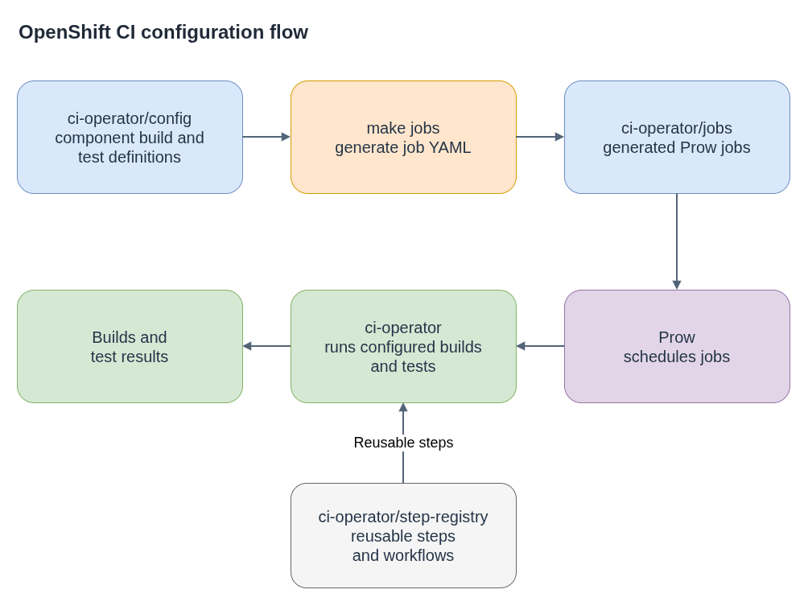

# openshift/release

**Plain-language companion:** [ELI15](eli15.md)

The public [`openshift/release`](https://github.com/openshift/release) repository
contains CI configuration for OpenShift component repositories, including
build and test definitions, generated Prow jobs, and shared CI configuration.

## CI configuration flow

Component CI is usually authored in `ci-operator` configuration and translated
into Prow job definitions. Prow runs the jobs, and `ci-operator` executes the
configured builds and tests.

- [Diagram source](release-ci-flow.drawio)

## Repository map

| Path | Purpose |
|---|---|
| `ci-operator/config/<org>/<repo>/` | Primary component build and test configuration, generally organized by branch and optional variant. |
| `ci-operator/jobs/` | Prow job YAML, usually generated from `ci-operator` configuration. Prefer changing the source configuration. |
| `ci-operator/step-registry/` | Reusable test steps and workflows referenced by component CI. |
| `core-services/`, `cluster/`, `services/` | Broader CI service and cluster configuration; check the current ownership and contribution docs before changing it. |
| `OWNERS` and `OWNERS_ALIASES` | Review and approval ownership for repository areas. |

## Changing component CI

1. Find the config for the target repository and branch. Files commonly follow
   `<org>-<repo>-<branch>.yaml`; multiple configurations for one branch may use
   a `__<VARIANT>` suffix. Branch automation and repository-specific rules can
   affect which file is authoritative.
2. Update the `ci-operator` config for the needed base images, output images,
   tests, or promotion behavior. Reuse a step-registry workflow where it fits.
3. Regenerate Prow jobs with `make jobs`. Use `make update` when other generated
   configuration also needs refreshing, as described by the repository's
   contribution guide.
4. Review generated diffs and run the relevant checks. Avoid hand-editing
   generated job YAML unless the upstream guide documents an exception.
5. Check the applicable `OWNERS` files and review CI presubmits and rehearsals
   for affected jobs.

For a new component, start with `make new-repo` instead of copying a nearby
configuration by hand. Promotion may be described in the component config;
mirroring destinations are managed separately. Update distribution config only
when the image is meant to be published or mirrored.

## References

- [Upstream repository](https://github.com/openshift/release)
- [Contributing CI configuration](https://docs.ci.openshift.org/docs/how-tos/contributing-openshift-release/)
- [`ci-operator` configuration reference](https://steps.ci.openshift.org/ci-operator-reference)
- [Step registry documentation](https://docs.ci.openshift.org/docs/architecture/step-registry/)
