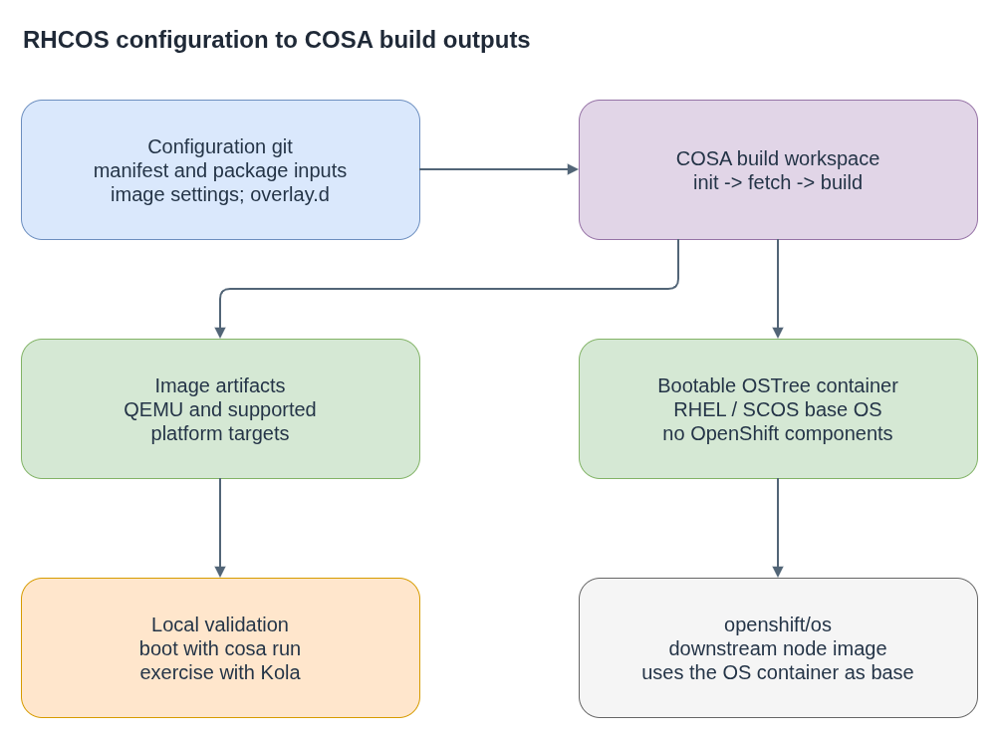

# rhel-coreos-config

The public [`rhel-coreos-config`](https://github.com/coreos/rhel-coreos-config)
repository supplies configuration used by CoreOS Assembler (COSA) to build
RHEL CoreOS (RHCOS) and CentOS Stream CoreOS (SCOS). Its main output is a
bootable OSTree container containing the base OS content, without OpenShift
components. The OpenShift node image is a separate downstream build that uses
that container as its base.

**Plain-language companion:** [ELI15](eli15.md)

## Configuration map

| Path | Purpose |
|---|---|
| `manifest*.yaml`, `common.yaml`, `packages*.yaml` | Shared and variant-specific rpm-ostree treefile inputs, including package selection and configuration. |
| `image*.yaml` | COSA settings for generated image artifacts. |
| `overlay.d/` | Filesystem overlays and scripts, including dracut modules. |
| `tests/`, `kola-denylist.yaml` | Kola test coverage and explicit test exclusions. |

Supported variants and their inputs are branch-dependent. Read the checked-out
manifests and current development notes rather than relying on a fixed version
list.

## COSA build model

COSA runs in a containerized build environment and treats this repository as
its configuration git. Manifests describe the OS content to compose; image
settings and overlays shape the resulting system. `cosa fetch` obtains build
inputs, and `cosa build` assembles the bootable OS container and image
artifacts. A QEMU image can be booted with `cosa run` and tested with
`cosa kola`.



- [Diagram source](rhcos-cosa-flow.drawio)

## Local build outline

Use a dedicated COSA build directory and select a variant supported by the
checked-out branch:

```bash
VARIANT='replace-with-a-variant-supported-by-this-checkout'
cosa init --variant "$VARIANT" https://github.com/coreos/rhel-coreos-config.git
cosa fetch
cosa build
```

This is the public COSA command shape, not a complete RHCOS environment setup.
RHCOS builds also need authorized package-source configuration; its exact setup
depends on the branch and build environment. Keep private repository locations
and credentials out of this guide and out of committed build inputs. Consult
the current [repository development notes](https://github.com/coreos/rhel-coreos-config/tree/main/docs)
for the supported setup.

After a build, use `cosa run` to boot the QEMU image and `cosa kola run` to run
Kola scenarios. Refer to the [COSA working guide](https://coreos.github.io/coreos-assembler/working/)
and the [COSA build guide](https://coreos.github.io/coreos-assembler/building-fcos/)
for command options and output details.

## References

- [RHCOS and SCOS configuration](https://github.com/coreos/rhel-coreos-config)
- [CoreOS Assembler](https://github.com/coreos/coreos-assembler)
- [OpenShift node image build](https://github.com/openshift/os)
