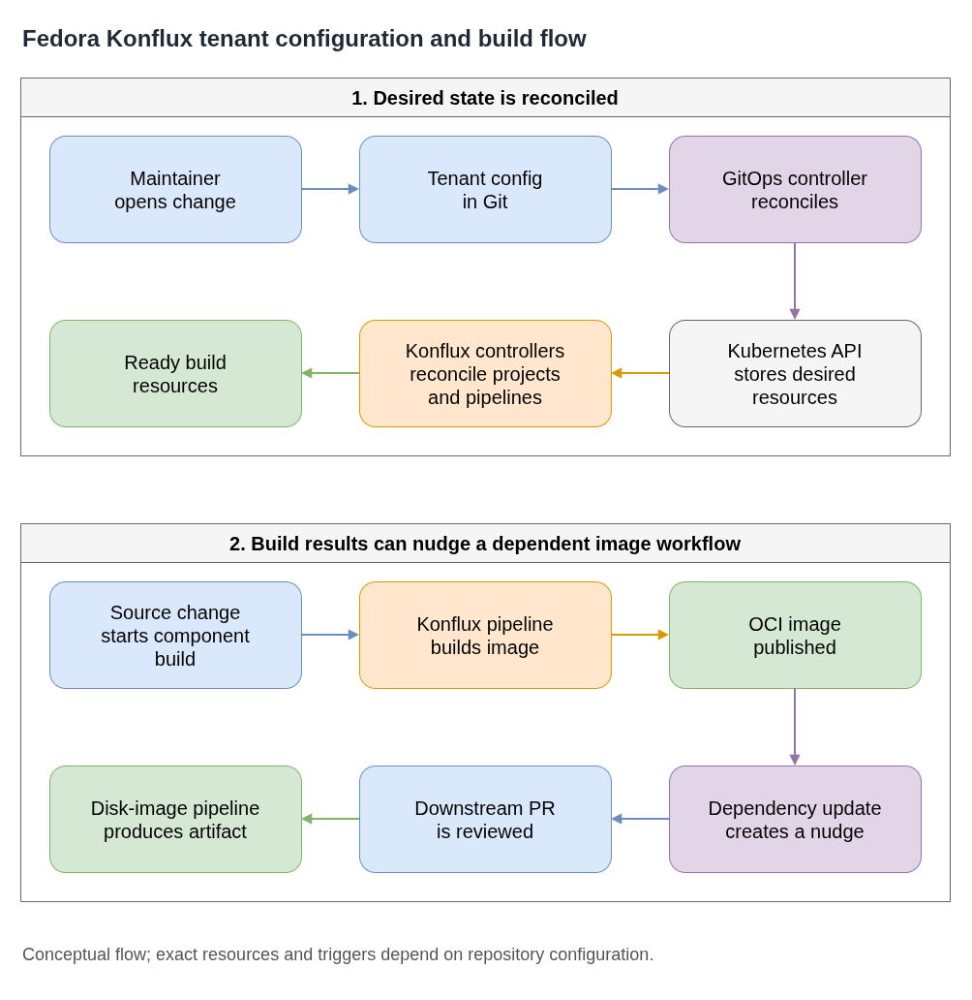

# Fedora Konflux Tenant Configuration

This guide explains the public concepts behind a GitOps-managed Konflux tenant configuration: desired state is stored in Git, controllers reconcile cluster resources, and build results can trigger dependent image workflows. It is a general architecture guide, not a live-cluster runbook.

**Plain-language companion:** [ELI15](eli15.md)

- [Diagram source](fcos-konflux-tenant-flow.drawio)

## Reconciliation flow

1. A maintainer proposes a configuration change in the tenant configuration repository.
2. After review and merge, a GitOps controller reconciles the declared resources with the Kubernetes API.
3. Konflux controllers act on those resources to configure projects, components, and build pipelines.
4. Builds produce OCI images or other declared artifacts.

## Dependent image builds

Some Fedora image workflows use a build result to update or nudge a downstream source repository. A resulting pull request can then start a separate disk-image pipeline. This dependency-update pattern is configuration-specific; it is not a guarantee that every Konflux tenant or component uses the same trigger chain.

For a Fedora CoreOS example, see [Disk-image nudging](fcos-disk-image-nudging.md) for the Component relationship, Renovate settings, and how to check downstream pipeline coverage.

## Public references

- [Fedora Konflux tenant configuration](https://gitlab.com/fedora/infrastructure/konflux/tenants-config)
- [Konflux Project Controller](https://github.com/konflux-ci/project-controller)
- [Konflux Build Service](https://github.com/konflux-ci/build-service)
- [Pipelines as Code](https://pipelinesascode.com/)
