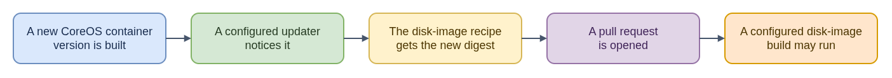

# ELI15: Fedora Konflux Tenant Configuration

[Technical guide: Fedora Konflux tenant configuration](README.md)

This repository is the public configuration source for a Fedora Konflux tenant: the declared setup for a scoped project area in the build platform. Think of it as a reviewed blueprint. Maintainers change it in Git; after review and merge, a GitOps controller reconciles the declared resources into the Kubernetes API. Konflux controllers then use those resources to configure projects, components, and build pipelines. Builds can produce OCI images or other declared artifacts.

The repository describes desired platform setup, not a live-cluster runbook, and a successful reconciliation is not proof that a build passed. Some Fedora image workflows use a build result to nudge a downstream source repository; a resulting pull request can start a separate disk-image pipeline. That chain is specific to configured workflows, not a promise about every tenant or component.

For CoreOS issue work, keep those stages separate: ask whether the tenant resource synced, whether the source build ran, and whether a downstream pull request or image pipeline followed. This prevents treating GitOps success as release success, or assuming a dependency-trigger pattern that the component does not use.

One concrete example is a Fedora CoreOS container build nudging a disk-image project. The [disk-image nudge explanation](fcos-disk-image-nudging.md) shows how a new container version can lead to a digest update pull request and a separate disk-image build.

- [Diagram source](fcos-disk-image-nudging-eli15.drawio)
