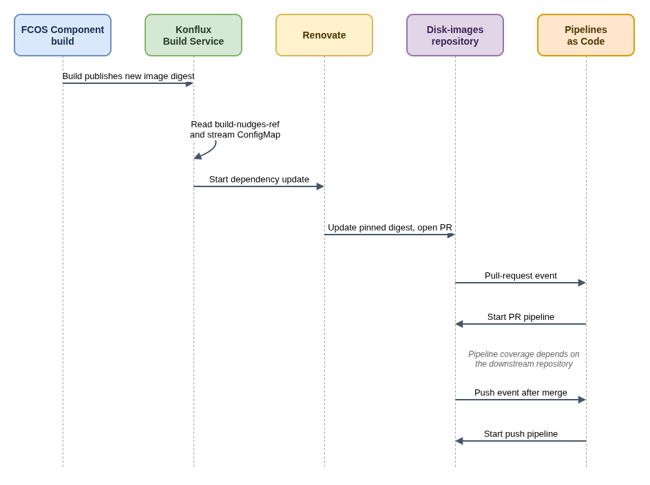

# Fedora CoreOS Disk-Image Nudging

This guide describes a pattern for connecting a Fedora CoreOS container build to a downstream disk-image project. A nudge updates a pinned image digest and opens a pull request; it does not directly start a disk-image build.

## Resources in the tenant configuration

For each stream, the tenant configuration can connect an FCOS Component to a matching disk-images Component and Renovate ConfigMap:

| FCOS Component | Disk-images Component | Renovate ConfigMap |
| --- | --- | --- |
| `fedora-coreos-{stream}` | `disk-images-{stream}` | `{stream}-nudging-renovate-config` |

Each FCOS Component points at the matching disk-images Component in the shared `ProjectDevelopmentStreamTemplate`:

```yaml
spec:
  build-nudges-ref:
    - disk-images-{{.versionName}}
```

The disk-images Components are declared as static Kustomize resources. Each has a fixed `nudge_renovate_config_map` annotation, such as:

```yaml
metadata:
  annotations:
    build.appstudio.openshift.io/nudge_renovate_config_map: rawhide-nudging-renovate-config
```

The ConfigMap holds Renovate options such as automerge behavior and a stream-specific commit-message prefix. The Component also uses `build.appstudio.openshift.io/request: configure-pac-no-mr` to configure Pipelines as Code without asking Konflux to open a pull request with generated pipeline files.

## Why the disk-images resources are static

The Project Controller template supports an allowlist of resource kinds and fields. The source currently supports `Component` resources and the `spec.build-nudges-ref[]` field, but not ConfigMaps or the `nudge_renovate_config_map` annotation. Therefore, the shared template can create the FCOS side of the relationship, while Kustomize declares each disk-images Component and its ConfigMap separately.

This also makes each ConfigMap reference explicit and reviewable. Do not put a ConfigMap into the ProjectDevelopmentStreamTemplate or assume an unlisted annotation will be substituted.

## Plain-language flow



- [Diagram source](fcos-disk-image-nudging.drawio)

1. A successful Fedora CoreOS Component build publishes a new image digest.
2. Konflux Build Service follows the Component's `build-nudges-ref` and selects the named Renovate ConfigMap.
3. Build Service starts the dependency update. Renovate changes the pinned digest in the disk-images source and opens a pull request.
4. The repository pull-request event can start a Pipelines as Code Tekton run. Merging the pull request creates a push event for the push pipeline.

ArgoCD applies the tenant configuration, but the ArgoCD sync itself does not start a disk-image build. The later successful FCOS build triggers the nudge path.

## Pipeline coverage

The downstream repository must define matching pipelines for each stream it supports. Check that it has a pull-request pipeline for the digest update and a push pipeline for the merged change. A tenant dependency reference and Renovate ConfigMap alone do not guarantee that a disk-image build will run.

## References

- [Fedora Konflux tenant configuration](https://gitlab.com/fedora/infrastructure/konflux/tenants-config)
- [Project Controller template resource allowlist](https://github.com/konflux-ci/project-controller/blob/main/internal/template/resources.go)
- [Build Service dependency update controller](https://github.com/konflux-ci/build-service/blob/main/internal/controller/component_dependency_update_controller.go)
- [Build Service Renovate configuration handling](https://github.com/konflux-ci/build-service/blob/main/internal/controller/renovate_util.go)
- [Pipelines as Code](https://pipelinesascode.com/)
- [Tekton documentation](https://tekton.dev/docs/)
