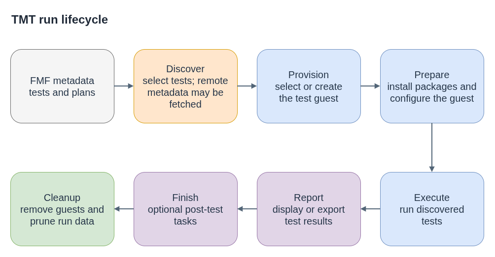

# TMT Testing - Hands-on Guide

**Plain-language companion:** [ELI15](eli15.md)

## What is TMT?

TMT (Test Management Tool) stores test metadata in a repository and runs the
selected tests in a chosen environment. It is used for package tests and other
project test suites; the CI system decides when and how to invoke it.

TMT uses FMF (Flexible Metadata Format) - YAML files with `.fmf` extension.
Think of FMF as the "language" and TMT as the "runner."

Install TMT with the system package when available (`dnf install tmt`) or with
pip (`python3 -m pip install tmt`).

Provisioning plugins are optional. Install only the plugin a plan needs, for
example `dnf install tmt+provision-container` or
`dnf install tmt+provision-virtual`. With pip, use a declared plugin extra such
as `tmt[provision-container]`; upstream does not declare a generic
`tmt[provision]` extra. `dnf install tmt+all` installs all available plugin
packages when that package is available for the distribution.

## The three building blocks

### 1. `.fmf/version` - the FMF root marker

A single file containing just `1`. Place it at the repo root.

```bash
tmt init              # creates .fmf/version automatically
# or manually:
mkdir .fmf
echo 1 > .fmf/version
```

**Why it matters:** TMT scans for this file first. Without it, TMT treats
the directory as having no metadata at all - `tmt tests ls` returns nothing.

Think of it like `.git/` - it marks "this tree is an FMF tree."

You can also scaffold tests and plans with templates:
```bash
tmt test create --template shell /tests/smoke
tmt plan create --template mini /plans/smoke
```

### 2. Test files - what to run

A `.fmf` file with a `test:` key. This is the actual shell script that
gets executed.

```yaml
# tests/tmt/tests/core/core.fmf
summary: check that the package is installed
tag:
  - smoke
test: |
  set -x -e -o pipefail
  rpm -q console-login-helper-messages
```

**Fields:**
- `summary:` - human-readable description (shows up in TMT output)
- `tag:` - list of labels. `smoke` is the convention for gating tests.
  Plans use these tags to filter which tests to run.
- `test:` - the shell script. Runs inside the test environment.
  Exit code 0 = pass, anything else = fail.

**Where to put it:** Convention is `tests/tmt/tests/core/core.fmf` for
the basic smoke test. The path doesn't matter to TMT - it scans the
whole tree under `.fmf/version` - but this structure keeps things
organized and matches ignition/afterburn.

### 3. Plan files - how to find and run tests

Plans describe how to discover tests, provision and prepare an environment,
execute tests, report results, and perform any finishing tasks.

```yaml
# tests/tmt/plans/smoke.fmf
summary: Basic smoke test
tag:
  - smoke
discover:
  how: fmf
  filter: "tag: smoke"
execute:
  how: tmt
```

**Phases explained:**

#### `prepare:` (optional) - set up the environment

Runs before tests. Common uses: install the package, create temp files,
enable systemd units.

```yaml
prepare:
  - name: Install the package
    how: install              # TMT's built-in package installer
    package: my-package       # uses dnf/yum in the test env
  - name: Run a setup script
    how: shell
    script: |
      echo "SOME_VAR=value" > /tmp/config
```

`how: install` - TMT handles the package manager for you.
`how: shell` - run arbitrary shell commands.

#### `discover:` - find the tests

Tells TMT where to look for test `.fmf` files.

```yaml
# Local discovery (scan this repo)
discover:
  how: fmf
  filter: "tag: smoke"
```

```yaml
# Remote discovery (scan a shared test repository)
discover:
  - name: Shared smoke tests
    how: fmf
    url: https://github.com/example-org/shared-tests.git
    filter: 'tag: smoke'
```

`how: fmf` - scan `.fmf` files starting from the FMF root.
`url:` - clone a remote repo and scan there instead of locally.
`filter:` - only pick up tests matching this expression.

#### `execute:` - run the tests

```yaml
execute:
  how: tmt
```

Almost always `how: tmt`. This is TMT's built-in executor - it runs
each discovered test's `test:` script and collects results.

**Plan steps:** A full run has six core plan steps, followed by a separate
cleanup step. CI may select only some steps, so check the command used by the
workflow when diagnosing a run.

| Step | Purpose |
|---|---|
| `discover` | Select tests from local or remote FMF metadata. Remote discovery can fetch repository data. |
| `provision` | Select or create the test guest. |
| `prepare` | Install packages and configure the guest. |
| `execute` | Run discovered tests and collect results. |
| `report` | Display or export results. |
| `finish` | Run optional post-test tasks, such as collecting logs. |
| `cleanup` | Final cleanup step that removes guests and prunes run data, including after an earlier step fails. |

`finish` and `cleanup` are different: `finish` runs plan-defined tasks;
`cleanup` manages TMT guests and run data.



- [Diagram source](tmt-run-lifecycle.drawio)

## Typical plan patterns

### `smoke.fmf` - the discovery plan

Discovers and runs smoke-tagged tests. A CI workflow can select this plan by
its tag.

```yaml
summary: Basic smoke test
tag:
  - smoke
discover:
  how: fmf
  filter: "tag: smoke"
execute:
  how: tmt
```

### `main.fmf` - shared plan metadata

Provides preparation metadata inherited by child plans. In this example it is
not a separate plan; `smoke.fmf` inherits the setup and defines the test steps.

```yaml
prepare:
  - name: Install my-package
    how: install
    package: my-package
```

FMF inheritance follows the metadata tree. A parent `main.fmf` can provide
defaults to child plan files; TMT does not implicitly combine phases from
independent sibling plans.

## Running TMT locally

### Check your structure is valid

```bash
tmt tests ls       # should list your test(s)
tmt plans ls       # should list your plan(s)
tmt lint           # checks for errors
```

### Run tests in a container

```bash
# Run all plans
tmt run --all provision --how container

# Run only smoke plans
tmt run --all plan --filter 'tag: smoke' provision --how container

# Verbose output (helpful for debugging)
tmt run --all -vvv provision --how container
```

`provision --how container` - TMT uses a Podman container as the test guest.
Discovery happens before provisioning; guest preparation and test execution
run in the provisioned environment. The cleanup step normally removes the
guest after the run.

Other provisioning methods:
- `--how local` - run directly on the host and requires an explicit unsafe-behavior opt-in; see the [local provisioning docs](https://tmt.readthedocs.io/en/stable/plugins/provision.html#local)
- `--how virtual` - spin up a VM (needs `tmt+provision-virtual`)
- `--how connect --guest=hostname` - connect to an existing machine via SSH

### TDD cycle for gating tests

1. Add `.fmf/version` + test file only (no plan yet)
   ```bash
   tmt tests ls    # should show the test
   tmt plans ls    # empty - no plans yet
   ```

2. Add the plan files
   ```bash
   tmt plans ls    # should show the plans
   tmt run --all provision --how container   # should fail
   # (package not in the container's repos → rpm -q fails)
   ```

3. Add `prepare: how: install` to `main.fmf`
   ```bash
   tmt run --all provision --how container   # should pass
   # (prepare installs the package → rpm -q succeeds)
   ```

**Note on step 2 failure:** The test can fail if the selected container's
configured package repositories do not provide the target RPM. Use an image
and repository setup appropriate for the package under test. For example:

```bash
tmt run --all provision --how container --image fedora:latest
```

## File tree reference

### Repository with local tests
```
.fmf/version                              # "1"
tests/
  tmt/
    plans/
      smoke.fmf                           # discover + execute
      main.fmf                            # prepare (install pkg)
    tests/
      core/
        core.fmf                          # the actual test script
```

### Repository that discovers tests remotely
```
.fmf/version                              # "1" (separate FMF root)
tests/
  tmt/
    plans/
      smoke.fmf                           # discover shared tests remotely
      main.fmf                            # prepare (install pkg)
```

## Examples to study

See the [upstream TMT examples](https://tmt.readthedocs.io/en/stable/examples.html)
for complete test and plan metadata trees.

## Useful commands

```bash
tmt tests ls                    # list all discovered tests
tmt plans ls                    # list all discovered plans
tmt lint                        # validate structure
tmt run --all -vvv provision --how container   # run everything, verbose
tmt run discover                # run discovery only; this is not a dry run
tmt run --help                  # full help
```

`tmt run discover` can create local run state and fetch remote metadata. It is
not a no-side-effects preview. Use `tmt run --dry` to inspect planned steps;
dry mode can still create or modify the local run workdir. `tmt clean runs`
removes saved run workdirs when their artifacts are no longer needed.

## CI shell hygiene

When a shell-based CI workflow builds optional TMT arguments, use a Bash array
so each option remains a separate argument and no `eval` is needed:

```bash
set -euo pipefail
PLAN_ARGS=()
if [[ -n "${PLAN_FILTER:-}" ]]; then
  PLAN_ARGS=(plan --filter "$PLAN_FILTER")
fi
tmt run --all "${PLAN_ARGS[@]}"
```

With `-u`, use defaults such as `${VAR:-}` when an input may be unset. Use `-x`
when command tracing is useful, but avoid printing secrets in CI logs.

## Links

- TMT docs: https://tmt.readthedocs.io/
- FMF docs: https://fmf.readthedocs.io/
- GitHub Actions docs: https://docs.github.com/en/actions
