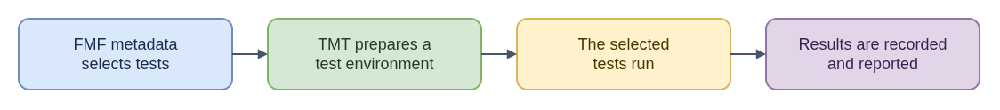

# TMT Testing: ELI15

[Technical README: TMT Testing](README.md)

TMT (Test Management Tool) organizes and runs tests described with FMF metadata. The repository marks the metadata tree with `.fmf/version`; `.fmf` files describe test scripts and plans. A plan determines how tests are discovered, what environment is provisioned or selected, what preparation happens, and which tests execute. The run can also report results, perform plan-defined finish tasks, and clean up guests and saved run data. Finish and cleanup are different stages.

Think of FMF as the menu of available checks and TMT as the coordinator that prepares a workspace, runs selected checks, and records what happened. The inputs are the metadata, test scripts, chosen test environment, and steps that CI asks TMT to run; the output is the result for that run. For CoreOS issue work, this helps distinguish a code regression from a test that was not selected, a setup problem, or an environment mismatch. TMT does not decide when CI invokes it, and CI may select only some plan steps. A passing result therefore describes the selected tests in that environment, not every possible behavior of the system.

- [Diagram source](eli15-flow.drawio)
